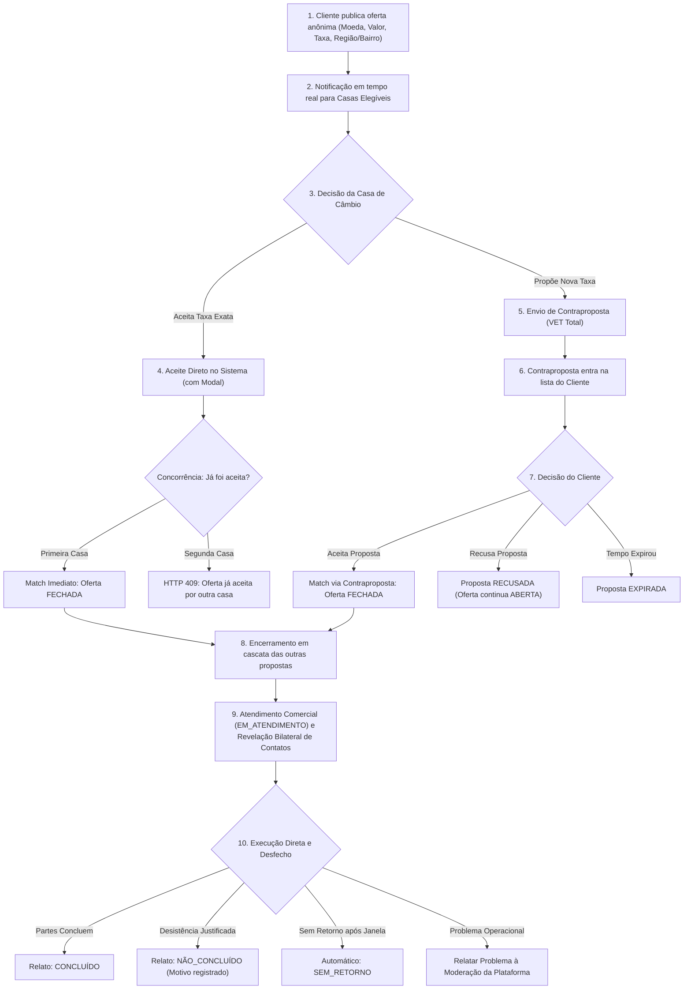

# Plataforma de Comunicação e Aproximação Cambial

> Plataforma de comunicação, mensageria e aproximação tecnológica em tempo real que conecta clientes com intenção de compra ou venda de moeda estrangeira às taxas de casas de câmbio autorizadas pelo Banco Central (evolução conceitual inspirada na mecânica do Melhor Câmbio / Nomad).

---

## 1. Nomes de Trabalho Sugeridos

Para a identidade do produto, são sugeridas três alternativas conceituais:

1. **CâmbioMatch** *(Foco em conexão rápida, dinamismo e liquidez transacional instantânea)*;
2. **MelhorTaxa Câmbio** *(Foco direto na proposta de valor de economia e poder de negociação para o cliente final)*;
3. **CâmbioLivre** *(Foco em transparência, concorrência aberta de mercado e autonomia de precificação)*.

---

## 2. Visão do Produto

O mercado tradicional de câmbio turismo no Brasil é fragmentado, opaco e burocrático. O cliente que precisa de moeda estrangeira para viagens ou compromissos é forçado a cotar manualmente por telefone ou balcão, enquanto as casas de câmbio autorizadas enfrentam alto custo de aquisição de clientes (CAC) e ociosidade em suas mesas de operação.

Inspirado no modelo consolidado e validado pelo **Melhor Câmbio** (`melhorcambio.com`, atualmente sob gestão da Nomad), nossa proposta é oferecer uma versão moderna e superior de **plataforma tecnológica de comunicação e aproximação bilateral** [VALIDAR COM ADVOGADO], iniciando pelas praças estratégicas de São Paulo e Rio de Janeiro:
- O cliente publica sua intenção anônima (moeda, valor, produto, modalidade de entrega, região/bairro e a taxa desejada);
- As casas de câmbio credenciadas e elegíveis competem pelo negócio, podendo aceitar a oferta imediatamente ou enviar contrapropostas competitivas expressas no valor total em reais (VET);
- Ao ocorrer o aceite vinculante (match), o sistema consolida o compromisso comercial, inicia o **Atendimento Comercial** (`EM_ATENDIMENTO`) e revela reciprocamente os canais diretos de contato (telefone e e-mail).

> [!IMPORTANT]
> **Plataforma de Comunicação sem Intermediação Financeira:**
> O produto opera **exclusivamente como canal de mensageria e conexão tecnológica**. A liquidação financeira, a entrega física de papel-moeda, a conferência documental de KYC/Sisbacen e o contrato de câmbio ocorrem **diretamente e exclusivamente entre cliente e casa autorizada**, fora da plataforma. O software não recebe, não custodia, não movimenta e não gerencia pagamentos nem recursos em momento algum [VALIDAR COM ADVOGADO] ([ADR-0010](docs/04-architecture/adr/adr-0010-plataforma-sem-custodia.md)).

---

## 3. Como Funciona o Atendimento Comercial

O mecanismo operacional foi desenhado para assegurar máxima agilidade, transparência e integridade na aproximação entre as partes:



### Regras Centrais do Sistema:
1. **Publicação com Expiração e Dados Territoriais:** O cliente define moeda, operação (compra ou venda), produto (papel-moeda ou cartão pré-pago), modalidade (retirada ou delivery), cidade, região/bairro, taxa pretendida e prazo de validade (conforme a [Tabela de Parâmetros Configuráveis](docs/03-product/prd.md#parâmetros-configuráveis-da-plataforma), gerenciado via BullMQ com validação atômica no PostgreSQL via `clock_timestamp()`). A oferta é anônima (sem dados pessoais nem endereço exato antes do match).
2. **Match Direto Automático:** Se uma casa aceita a taxa da oferta, o match é instantâneo ("first-come, first-served"; o primeiro a comitar vence) sob lock pessimista no banco ([ADR-0006](docs/04-architecture/adr/adr-0006-concorrencia-match.md)).
3. **Contrapropostas Competitivas com VET (Sem Alíquotas Fixas):** As casas formulam contrapropostas para atendimento integral com valor total em reais (VET). A decomposição (câmbio puro, IOF e tarifas) é informada pela casa apenas para transparência: IOF e encargos variam e mudam frequentemente [VALIDAR COM ESPECIALISTA TRIBUTÁRIO]; o sistema não calcula alíquotas. Ordenação:
   - Operação `COMPRA`: ordenação **ascendente** (`ASC`, menor desembolso no topo);
   - Operação `VENDA`: ordenação **descendente** (`DESC`, maior valor recebido no topo).
   A validade da contraproposta é truncada se ultrapassar o término da oferta ([US-025](docs/03-product/user-stories.md#us-025-truncamento-da-validade-da-proposta-pelo-fim-da-oferta)).
4. **Encerramento em Cascata:** Ao consolidar o match ou ocorrer encerramento (`MATCH_OUTRA_CASA`, `OFERTA_EXPIRADA`, `OFERTA_CANCELADA`, `CASA_SUSPENSA`), todas as propostas concorrentes mudam atômica e imediatamente para `ENCERRADA`.
5. **Atendimento Comercial e Revelação Bilateral de Contatos:** O match gera um compromisso comercial de honrar a taxa durante a janela de atendimento acordada (`JANELA_ATENDIMENTO_HORAS`, default: 24h úteis) e revela telefone e e-mail entre as partes para contato direto. A plataforma não participa do pagamento ou entrega.
6. **Qualidade sem Dinheiro (Governança e Moderação):** As partes relatam o desfecho do atendimento de forma independente (`CONCLUÍDO` vs `NÃO_CONCLUÍDO` com motivos padronizados) ([US-019](docs/03-product/user-stories.md#us-019-relato-bilateral-de-desfecho-do-atendimento-comercial)) ou acionam o canal "Relatar Problema" para moderação administrativa ([US-020](docs/03-product/user-stories.md#us-020-relato-de-problema-operacional-para-moderação-da-plataforma)). Casas com queixas reiteradas de "taxa não mantida" sofrem suspensão administrativa; clientes com desistências abusivas sofrem restrição de novas ofertas. Sem resposta após a janela configurada, o atendimento é classificado como `SEM_RETORNO` ([AC-30](docs/03-product/acceptance-criteria.md#ac-30-timeout-de-atendimento-para-sem_retorno)).
7. **Segurança, MFA e Piloto Gratuito:** MFA via TOTP obrigatório para operadores de casas de câmbio ([US-026](docs/03-product/user-stories.md#us-026-autenticação-multifator-mfa-obrigatória-para-casas-de-câmbio)). Todo aceite exige confirmação vinculante em modal ([US-027](docs/03-product/user-stories.md#us-027-confirmação-pré-aceite-com-resumo-financeiro-vinculante)). Teto de valor por oferta no piloto fixado em R$ 50.000,00 ([US-028](docs/03-product/user-stories.md#us-028-controle-de-teto-de-valor-por-oferta-no-piloto)). A Fase 1 é 100% gratuita; cobrança de software (mensalidade SaaS ou taxa por lead aceito) pertence à Fase 2 ([ADR-0012](docs/04-architecture/adr/adr-0012-modelo-cobranca.md)).

---

## 4. Perfis de Usuário (Roles e Permissões)

A plataforma adota Role-Based Access Control (RBAC) com isolamento multi-tenant:

| Perfil | Sub-Roles | Atribuições e Acessos |
|--------|-----------|------------------------|
| **Admin da Plataforma** | Super Admin | Aprovação de cadastros KYB de casas, moderação de relatos de problemas, suspensão preventiva de parceiros infratores, monitoramento de saúde do sistema e acesso a logs de auditoria imutáveis. |
| **Casa de Câmbio** | **Owner** | Gestão institucional, cadastro de pontos de atendimento, configuração de moedas/produtos/cidades e gerenciamento da equipe da casa. Exige **MFA obrigatório** ([US-026](docs/03-product/user-stories.md#us-026-autenticação-multifator-mfa-obrigatória-para-casas-de-câmbio)). |
| | **Operador** | Acesso ao pregão em tempo real via WebSocket, recebimento de ofertas, execução de aceites diretos, envio de contrapropostas, visualização de contatos no painel de atendimento e relato de desfecho. Exige **MFA obrigatório** ([US-026](docs/03-product/user-stories.md#us-026-autenticação-multifator-mfa-obrigatória-para-casas-de-câmbio)). |
| | **Financeiro** | Acesso em modo leitura a relatórios operacionais e volume de atendimentos concluídos (e módulo de faturamento na Fase 2). |
| **Cliente** | Pessoa Física / PJ | Publicação de ofertas anônimas, gestão de propostas recebidas, acompanhamento do painel de atendimento pós-match com contatos da casa, relato de desfecho e acionamento de "Relatar Problema". Confirmação prévia vinculante via modal. |

---

## 5. Stack Tecnológica (Decisões Confirmadas e Propostas)

- **Backend (Decisão Confirmada - Accepted):** [NestJS](docs/04-architecture/adr/adr-0001-backend-nestjs.md) (TypeScript), com arquitetura modular e Clean Architecture.
- **Frontend Web (Decisão Confirmada - Accepted):** React (Vite / Next.js) com Tailwind CSS e shadcn/ui.
- **Banco de Dados Principal (Stack Proposta - Proposed):** [PostgreSQL](docs/04-architecture/adr/adr-0002-postgresql-banco-principal.md) com transações ACID e locking pessimista.
- **Filas e Cache (Stack Proposta - Proposed):** [Redis + BullMQ](docs/04-architecture/adr/adr-0003-redis-bullmq-filas.md) para cancelamento/expiração de prazos e cache de cotações.
- **Comunicação em Tempo Real e Multicanal (Stack Proposta - Proposed):** [WebSocket (Socket.IO)](docs/04-architecture/adr/adr-0004-websocket-socketio.md) complementado por Web Push, e-mail transacional e WhatsApp digest com throttling para operadores offline ([US-024](docs/03-product/user-stories.md#us-024-notificações-multicanal-para-operadores-offline-com-throttling-e-opt-in)).
- **Mobile (Fase Futura):** React Native / Expo com compartilhamento de componentes lógicos.
- **Arquitetura de Código (Stack Proposta - Proposed):** [Monorepo](docs/04-architecture/adr/adr-0007-monorepo-tipos-compartilhados.md) gerenciado via Turborepo e pnpm com pacote `@melhor-cambio/shared` para tipos compartilhados e validação unificada via Zod.

---

## 6. Estrutura do Repositório

```
.
├── apps/                        # Aplicações do Monorepo (Fase de Implementação)
│   ├── api/                     # Backend NestJS (REST + WebSocket)
│   ├── web/                     # Frontend Web React (Cliente, Casa, Admin)
│   ├── mobile/                  # Aplicativo React Native/Expo (Post-MVP)
│   └── landing-pages/           # Next.js Multi-Tenant White-Label (Post-MVP)
├── packages/                    # Pacotes Compartilhados
│   ├── shared/                  # Enums, DTOs, Schemas Zod e Tipos TypeScript
│   ├── config-eslint/           # Padronização de Linting
│   └── config-typescript/       # Configuração base tsconfig
├── docs/                        # DOCUMENTAÇÃO OFICIAL DE PRODUTO E ARQUITETURA
│   ├── 01-discovery/            # Descoberta, Problema, Hipóteses e Contexto Competitivo
│   ├── 02-strategy/             # Priorização de Escopo Multi-Framework
│   ├── 03-product/              # PRD, User Stories e Acceptance Criteria
│   ├── 04-architecture/adr/     # Architecture Decision Records (ADR-0001 a 0012)
│   ├── 05-okrs/                 # OKRs Estratégicos (Trimestres T1 e T2)
│   ├── 06-roadmap/              # Roadmap Evolutivo em Fases e Gantt
│   ├── 07-launch/               # Launch Checklist de Go-Live e Rollback
│   ├── 08-comms/                # Comunicação com Parceiros Comerciais
│   └── 09-review/               # Relatório de Revisão Adversarial PM Critic
└── README.md                    # Visão Geral e Guia de Navegação
```

---

## 7. Índice Completo da Documentação (`/docs`)

Toda a concepção do produto foi elaborada utilizando as skills especializadas de Product Management instaladas no projeto:

### 01. Discovery & Enquadramento
- [`docs/01-discovery/problem-statement.md`](docs/01-discovery/problem-statement.md): Enquadramento do problema para os dois lados do mercado (Cliente e Casa de Câmbio), métricas de sucesso e restrições.
- [`docs/01-discovery/hypotheses.md`](docs/01-discovery/hypotheses.md): Sete hipóteses estruturantes (v1.5.1) cobrindo Desejabilidade (H1), Viabilidade Operacional (H2), Negócio/WTP (H3), Neutralidade e Migração pós-Nomad (H4), Multi-Homing e Liquidez (H5), Aquisição de Demanda / SEO Local (H6) e Automação de Taxas (H7).
- [`docs/01-discovery/competitive-context.md`](docs/01-discovery/competitive-context.md): Análise estrutural do Melhor Câmbio (Nomad), posicionamento como plataforma de comunicação e mensageria, segmento de casas buscando alternativa, proposta de neutralidade (sob validação jurídica), riscos de multi-homing/gargalo de demanda e salvaguardas contratuais/LGPD indispensáveis para o fundador `[VALIDAR COM ADVOGADO]`.
- [`docs/01-discovery/interview-guide-casas.md`](docs/01-discovery/interview-guide-casas.md): *(Novo na v1.5.1)* Roteiro padronizado de entrevista qualitativa com as 8 perguntas estruturais de validação (motivação de alternativa, pricing atual, volume/fechamento, publicação de taxas, exclusividade contratual, threshold de volume, interesse em landing page/modo privado, operação e SLA, e motivos para não migrar) e convite para assinatura de Carta de Intenção (LOI).

### 02. Estratégia & Priorização
- [`docs/02-strategy/prioritization.md`](docs/02-strategy/prioritization.md): Análise comparativa multi-framework (ICE, MoSCoW e Weighted Scoring) para funcionalidades do MVP e post-MVP, complementada na v1.5.1 com reavaliação estratégica de automação de taxas (CSV como Should condicional) e landing pages / Modo Oferta Privada (Fase 2).

### 03. Especificação do Produto
- [`docs/03-product/prd.md`](docs/03-product/prd.md): Documento de Requisitos de Produto completo do MVP (v1.5.1). Posicionado como plataforma de comunicação (sem custódia nem liquidação), Atendimento Comercial (`EM_ATENDIMENTO`), relato bilateral de desfecho (`CONCLUÍDO`, `NÃO_CONCLUÍDO`, `SEM_RETORNO`), moderação administrativa, seção formal de Go-to-Market (SEO local, landing pages e base parceira), meta de 3 a 5 ofertas/casa/semana [HIPÓTESE – A VALIDAR] e exploração do Modo Oferta Privada (Post-MVP).
- [`docs/03-product/user-stories.md`](docs/03-product/user-stories.md): 30 User Stories detalhadas (US-001 a US-030) na v1.5, cobrindo todo o ciclo de vida do leilão e atendimento comercial, MFA (US-026), modal pré-aceite (US-027), teto de valor no piloto (US-028), relato de desfecho (US-019), canal "Relatar Problema" (US-020) e seção formal de itens movidos para Futuro.
- [`docs/03-product/acceptance-criteria.md`](docs/03-product/acceptance-criteria.md): 30 critérios executáveis Given/When/Then na v1.5 (AC-01 a AC-30) com Tabela Unificada de Códigos de Erro e HTTP, testes de concorrência e carga no aceite direto (AC-05), relato bilateral de desfecho (AC-04), timeout de atendimento (AC-30), desistência voluntária (AC-08), suspensão de parceiro (AC-09), e seção formal de critérios movidos para Futuro.

### 04. Arquitetura e Decisões Técnicas (ADRs)
- [`docs/04-architecture/adr/adr-0001-backend-nestjs.md`](docs/04-architecture/adr/adr-0001-backend-nestjs.md): Backend em NestJS (**Accepted** - Decisão confirmada pelo fundador).
- [`docs/04-architecture/adr/adr-0002-postgresql-banco-principal.md`](docs/04-architecture/adr/adr-0002-postgresql-banco-principal.md): PostgreSQL como Banco Principal (**Proposed**).
- [`docs/04-architecture/adr/adr-0003-redis-bullmq-filas.md`](docs/04-architecture/adr/adr-0003-redis-bullmq-filas.md): Redis + BullMQ para Expiração e Filas (**Proposed**).
- [`docs/04-architecture/adr/adr-0004-websocket-socketio.md`](docs/04-architecture/adr/adr-0004-websocket-socketio.md): WebSocket (Socket.IO) para Tempo Real (**Proposed**).
- [`docs/04-architecture/adr/adr-0005-estrategia-cotacao.md`](docs/04-architecture/adr/adr-0005-estrategia-cotacao.md): Estratégia de Cotação de Referência com Cache e Fallback (**Proposed**).
- [`docs/04-architecture/adr/adr-0006-concorrencia-match.md`](docs/04-architecture/adr/adr-0006-concorrencia-match.md): Controle Transacional de Concorrência no Match com READ COMMITTED e FOR UPDATE (**Proposed** - v1.5 refletindo Atendimento Comercial; extensão automática de oferta movida para Future Considerations).
- [`docs/04-architecture/adr/adr-0007-monorepo-tipos-compartilhados.md`](docs/04-architecture/adr/adr-0007-monorepo-tipos-compartilhados.md): Monorepo e Shared Types (**Proposed**; NestJS e React confirmados).
- [`docs/04-architecture/adr/adr-0008-modelo-roles-rbac.md`](docs/04-architecture/adr/adr-0008-modelo-roles-rbac.md): Modelo de Perfis e RBAC Multi-Tenant (**Proposed**).
- [`docs/04-architecture/adr/adr-0009-onboarding-kyb-casas.md`](docs/04-architecture/adr/adr-0009-onboarding-kyb-casas.md): Onboarding e Aprovação KYB das Casas de Câmbio (**Proposed**).
- [`docs/04-architecture/adr/adr-0010-plataforma-sem-custodia.md`](docs/04-architecture/adr/adr-0010-plataforma-sem-custodia.md): Plataforma de Comunicação sem Participação no Pagamento ou Liquidação Financeira (**Proposed** - v1.5 com posicionamento estrito de comunicação e mensageria tecnológica `[VALIDAR COM ADVOGADO]`).
- [`docs/04-architecture/adr/adr-0011-landing-pages-multi-tenant.md`](docs/04-architecture/adr/adr-0011-landing-pages-multi-tenant.md): Landing Pages Multi-Tenant e API Pública (**Proposed** - Post-MVP).
- [`docs/04-architecture/adr/adr-0012-modelo-cobranca.md`](docs/04-architecture/adr/adr-0012-modelo-cobranca.md): Modelo de Cobrança e Monetização (**Proposed** - v1.5 reposicionando monetização para Fase 2 via taxa de software por match ou SaaS sob parecer jurídico; piloto da Fase 1 100% gratuito).

### 05. Metas e Coordenação (OKRs)
- [`docs/05-okrs/okrs.md`](docs/05-okrs/okrs.md): Metas operacionais dos ciclos T1 e T2 (v1.5.1), com foco em KRs de validação de hipóteses (12 LOIs de casas, densidade de 3 a 5 ofertas/casa/semana, tempo de resposta < 15 min) e canais de demanda definidos (SEO local e parcerias).

### 06. Planejamento Evolutivo (Roadmap)
- [`docs/06-roadmap/roadmap.md`](docs/06-roadmap/roadmap.md): Roadmap em 3 fases (v1.5.1) integrando a estratégia de Go-to-Market, meta de densidade de demanda no gate de saída da Fase 1, fast-follow condicional de importação CSV e estudo do Modo Oferta Privada na Fase 2.

### 07. Lançamento e Operações
- [`docs/07-launch/launch-checklist.md`](docs/07-launch/launch-checklist.md): Checklist cross-funcional para o lançamento piloto em RJ e SP (v1.5 com seção Legal & Compliance desmembrada em 6 itens detalhados com donos e prazos, critérios Go/No-Go atualizados e testes de atendimento/desfecho).

### 08. Comunicação com Stakeholders
- [`docs/08-comms/stakeholder-update-001.md`](docs/08-comms/stakeholder-update-001.md): Update assíncrono para parceiro comercial e casas piloto.

### 09. Qualidade e Revisão
- [`docs/09-review/pm-critic-report.md`](docs/09-review/pm-critic-report.md): Relatório de auditoria adversarial mantido intacto.

---

## 8. Decisões em Aberto (Open Decisions)

Conforme a disciplina de gestão de produto, os seguintes tópicos permanecem como **Em Aberto** com as recomendações indicadas, sem serem tratados como decididos:

1. **Forma de expressão do valor da oferta e contraproposta:** [Recomendação: Oferta e contraproposta expressas em valor total final em reais (VET tudo incluso), garantindo comparabilidade perfeita e previsibilidade. O aceite direto e as contrapropostas trazem a decomposição detalhada (câmbio puro, IOF e tarifas) informada pela casa apenas para transparência e compliance, sem alterar o total; o sistema não calcula nem fixa alíquotas de IOF, pois estas variam por operação e produto e mudam com frequência] [VALIDAR COM CASAS E TRIBUTARISTA].
2. **Contato pós-match (revelação bilateral de canais diretos):** Como deve ocorrer o contato após o match? [Recomendação: Revelar mutuamente telefone e e-mail no momento do match — telefone/e-mail do cliente para a casa vencedora e contatos completos da casa para o cliente, replicando o padrão validado pelo Melhor Câmbio e reduzindo a dependência de suporte da plataforma] [VALIDAR COM ADVOGADO/LGPD]. Chat interno permanece como recurso da Fase 2.
3. **Critérios e diretrizes de governança de PLD para plataforma de software:** Qual a postura institucional formal e monitoramento recomendados para a plataforma, considerando que a responsabilidade primária de PLD/Sisbacen é das casas autorizadas? [Recomendação: Manter teto de R$ 50.000,00 por oferta no piloto e submeter ao jurídico regulatório a necessidade ou não de alerta preventivo de fracionamento para o suporte] [VALIDAR COM JURÍDICO].
4. **Identidade da casa de câmbio antes do match:** O cliente deve visualizar o nome fantasia da casa nas contrapropostas ou as propostas devem ser 100% anônimas até o match? [Recomendação: exibir nome fantasia da casa para conferir credibilidade e permitir escolha consciente, mantendo canais de contato direto como telefone e endereço exato estritamente protegidos pré-match, a confirmar com o fundador].
5. **Suspensão preventiva de casa e atendimentos em andamento:** Caso uma casa seja suspensa pelo Admin, deve haver discricionariedade administrativa para permitir que atendimentos em andamento com contatos já repassados sejam concluídos pelas partes, ou todos devem ser sinalizados compulsoriamente? [VALIDAR COM JURÍDICO].
6. **Janela de atendimento informada pós-match:** Qual o prazo padrão de validade do compromisso comercial para realização do contato e atendimento direto? [Recomendação: 24 horas úteis como parâmetro padrão do piloto (`JANELA_ATENDIMENTO_HORAS`), ajustável nas configurações da plataforma] [HIPÓTESE – A VALIDAR com as casas].
7. **Calibragem dos Parâmetros Operacionais (Tabela Centralizada):** Prazos padrão de expiração de oferta (15 a 30 min), validade da contraproposta (`prazo_validade_minutos`: 10 min), teto de revisões (3x), cooldown (30s) e limites de reputação/desistência parametrizados e pendentes de validação de campo.
8. **Visibilidade entre casas (Propostas Cegas vs. Leilão Aberto):** No MVP adotou-se o modelo cego (cada casa só vê sua própria proposta, o cliente vê todas), pendente de teste sobre impacto na agressividade dos preços.
9. **Modo Oferta Privada (Post-MVP / Fase 2):** Modalidade onde o cliente que acessa a landing page ou widget de uma casa específica envia a oferta diretamente para a mesa dela (sem leilão concorrencial aberto). Registrado como ideia para validação com as casas ([Questão 7](docs/01-discovery/interview-guide-casas.md)), estritamente fora do MVP.
10. **Automação de Taxas via Planilha CSV (Fast-Follow da Fase 1):** Dependendo do resultado das entrevistas com as casas piloto ([Questão 4](docs/01-discovery/interview-guide-casas.md)), avaliar inclusão de upload em lote de CSV padronizado logo após a estabilização do core do leilão (Should condicional).
11. **Contraproposta reversa do cliente:** Fora do escopo do MVP; será avaliado na Fase 2 se clientes devem poder renegociar contrapropostas.
12. **Modelo definitivo de monetização na Fase 2 (ADR-0012):** Taxa de software por lead/match aceito, mensalidade fixa SaaS ou modelo híbrido, bloqueado até a conclusão do parecer jurídico regulatório [A VALIDAR COM ADVOGADO]. O piloto da Fase 1 é 100% gratuito.

---

## 9. Riscos Principais

| Risco | Classificação | Impacto | Estratégia de Mitigação |
|-------|---------------|---------|--------------------------|
| **1. Enquadramento Regulatório (BACEN)** | **Crítico** | Paralisação da operação se o software for enquadrado como instituição financeira ou intermediador cambial não autorizado. | Posicionamento estrito como plataforma de comunicação e mensageria tecnológica ([ADR-0010](docs/04-architecture/adr/adr-0010-plataforma-sem-custodia.md)); condicionamento do go-live aos 6 pareceres jurídicos formais ([Launch Checklist](docs/07-launch/launch-checklist.md)) `[VALIDAR COM ADVOGADO]`. |
| **2. Vazamento e Descumprimento de Taxa** | **Alto** | Casas não honram a taxa no contato direto ou clientes desistem reiteradamente sem justificativa. | Módulo de relato bilateral de desfecho ([US-019](docs/03-product/user-stories.md#us-019-relato-bilateral-de-desfecho-do-atendimento-comercial)), canal "Relatar Problema" para moderação ([US-020](docs/03-product/user-stories.md#us-020-relato-de-problema-operacional-para-moderação-da-plataforma)), e suspensão administrativa de casas reincidentes. |
| **3. Liquidez Insuficiente e Multi-Homing** | **Alto** | Casas operam em paralelo no concorrente e deixam a aba de lado se houver poucas ofertas. | Estratégia de GTM baseada em SEO local por praça, landing pages de casas e meta operacional de 3 a 5 ofertas/casa/semana ([H5](docs/01-discovery/hypotheses.md#h5--hipótese-de-multi-homing-e-priorização-por-densidade-de-ofertas)). |
| **4. Concorrência e Double-Matching** | **Médio** | Duas casas aceitam a mesma oferta no mesmo milissegundo, gerando litígio e frustração. | Controle transacional estrito no PostgreSQL com lock pessimista serializado, validação via `clock_timestamp()`, prova de teste de carga e constraint de unicidade ([ADR-0006](docs/04-architecture/adr/adr-0006-concorrencia-match.md)). |
| **5. Instabilidade de Cotações Externas** | **Médio** | Falha da AwesomeAPI trava a tela de emissão ou avaliação de ofertas. | Cache centralizado em Redis com TTL de 300s, entrega de dados com flag `is_stale: true` e fallback configurado ([ADR-0005](docs/04-architecture/adr/adr-0005-estrategia-cotacao.md)). |

---

## 10. Como Usar as PM Skills Neste Projeto

Este repositório está integrado ao ecossistema de habilidades padronizadas de gestão de produto. Utilize os comandos abaixo conforme o ciclo de vida evolutivo da plataforma:

| Skill | Quando Utilizar | Artefatos Gerados / Impactados |
|-------|-----------------|--------------------------------|
| `define-problem-statement` | Ao iniciar uma nova iniciativa ou pivotar a proposta de valor para novos segmentos. | `docs/01-discovery/problem-statement.md` |
| `define-hypothesis` | Ao formular novas premissas de produto antes de investir esforço de engenharia. | `docs/01-discovery/hypotheses.md` |
| `define-prioritization-framework` | Durante o planejamento de novos trimestres para balancear itens do backlog (ICE, MoSCoW, Weighted Scoring). | `docs/02-strategy/prioritization.md` |
| `deliver-prd` | Ao especificar o escopo e regras funcionais de novos épicos ou grandes versões de release. | `docs/03-product/prd.md` |
| `deliver-user-stories` | No refinamento técnico pré-sprint para quebrar épicos em histórias estimáveis (INVEST). | `docs/03-product/user-stories.md` |
| `deliver-acceptance-criteria` | Na definição de critérios Given/When/Then executáveis para handoff de desenvolvimento e QA. | `docs/03-product/acceptance-criteria.md` |
| `develop-adr` | Sempre que uma decisão técnica ou arquitetural estruturante for proposta ou alterada. | `docs/04-architecture/adr/` |
| `foundation-okr-writer` | No planejamento trimestral de OKRs do time de produto e negócios. | `docs/05-okrs/okrs.md` |
| `deliver-launch-checklist` | Entre 1 e 2 semanas antes de qualquer go-live importante para coordenação cross-funcional. | `docs/07-launch/launch-checklist.md` |
| `foundation-stakeholder-update` | Para comunicação assíncrona periódica de decisões e avanços com parceiros e liderança. | `docs/08-comms/` |
| `utility-mermaid-diagrams` | Ao criar ou validar fluxos, diagramas de estado, sequências ou cronogramas Gantt em Markdown. | Diagramas Mermaid em qualquer doc |
| `utility-pm-critic` | Para rodar auditoria adversarial contra qualquer artefato antes de apresentá-lo a stakeholders. | `docs/09-review/pm-critic-report.md` |
| **`measure-okr-grader`** | **NÃO UTILIZAR NO INÍCIO.** Esta skill destina-se exclusivamente ao **fim do ciclo trimestral (fechamento do T1)** para pontuar os KRs concluídos com base em evidências reais coletadas. | Relatórios de fechamento de ciclo de OKRs |

---

## 11. Status do Projeto

- **Fase Atual:** **Fase 0 — Concepção, Especificação e Arquitetura Concluída (v1.5.1)**.
- **Próximo Passo:** Condução das entrevistas estruturadas com as 10-15 casas piloto com base no [Roteiro de Entrevistas](docs/01-discovery/interview-guide-casas.md), obtenção das primeiras Cartas de Intenção (LOIs) e contratação dos 6 pareceres jurídicos do [Launch Checklist](docs/07-launch/launch-checklist.md).

---

## 12. Como Rodar a Aplicação

> [!NOTE]
> **Placeholder:** O repositório encontra-se atualmente na fase de documentação e arquitetura (somente documentos). Nenhuma base de código de aplicação foi gerada ainda. As instruções de inicialização de ambiente (Docker Compose, migrações de banco de dados e comandos `pnpm dev`) serão adicionadas assim que a Fase 1 de engenharia for iniciada.

---

## 13. Histórico de Versões da Documentação

| Versão | Data | Responsável | Escopo das Modificações |
|--------|------|-------------|-------------------------|
| 1.0 | 2026-11-02 | Agente de Produto e Arquitetura | Geração inicial completa dos 13 artefatos documentais de produto, estratégia e arquitetura. |
| 1.1 | 2026-11-03 | Agente de Produto e Arquitetura | Incorporação dos apontamentos e recomendações do relatório adversarial PM-Critic. |
| 1.2 | 2026-11-03 | Agente de Produto e Arquitetura | Aplicação das correções de alinhamento: recusa voltando para aberta, encerramento de propostas em cascata para expiração/cancelamento com auditoria, cobrança no match, notificações multicanal offline (US-024, AC-15), regras estritas de concorrência com lock_timeout e NOW() (ADR-0006), anonimização e entrega protegida, verificação de identidade/telefone, governança de disputas, linguagem jurídica neutra e distinção formal de stack confirmada (NestJS e React) vs. stack proposta. |
| 1.3 | 2026-11-03 | Agente de Produto e Arquitetura | Revisão integral v1.3: substituição de NOW() por clock_timestamp() e requisições rejeitadas sem mutação de estado (ADR-0006); remoção de detalhes SQL e implementação de Tabela Unificada de Erros nos ACs; reescrita do AC-05 como teste de carga (N paralelas, 1 sucesso, N-1 conflitos, idempotência e estouro de lock_timeout); inclusão de 8 novos ACs (AC-17 a AC-24); calibração de AC-07 e AC-08; isolamento de suspensão de casa com motivo SUSPENSAO_PARCEIRO e mensagem neutra ao cliente [VALIDAR COM JURÍDICO] em AC-09; ordenação condicional de contrapropostas (compra ASC, venda DESC); inclusão de Região/Bairro na oferta anônima pré-match e proteção bidirecional (FR-46); atendimento integral obrigatório no MVP (parcial movido para Future Considerations); política de estorno em aberto mantida no ADR-0012; throttling de WhatsApp e opt-in obrigatório; teto de 3 revisões com cooldown de 30s e reenvio após recusa; padronização de prazo_validade_minutos; VET discriminado sem alíquotas fixas; regra única de conclusão bilateral e janela de execução; sincronização rigorosa das 27 User Stories no PRD; e registro explícito das decisões em aberto com recomendações. |
| 1.4 | 2026-11-03 | Agente de Produto e Arquitetura | Revisão integral v1.4: correção e unificação de códigos de erro e HTTP (US-008 AC-2 para 422 OFFER_ALREADY_CLOSED); remoção completa de alíquotas fixas de IOF (1,1%, 3,5%) e exemplos numéricos embutidos, definindo IOF e encargos como informados pela casa sem cálculo pelo sistema; registro da Decisão em Aberto nº 1 (VET total final recomendado vs. taxa pura + encargos); regra estrita de extensão única da oferta (+5 min, máx. 1 extensão) com lock pessimista e desacoplamento de reagendamento no BullMQ; substituição do checkpoint fixo por checkpoint ao fim da janela acordada com gestão de no-show, prazo de 24h úteis de contestação pelo cliente, strikes e trilha imutável de auditoria contra abuso; clarificação de escopo de cobrança (MVP 100% gratuito, cobrança e estorno na Fase 2 / ADR-0012); confirmação dos 4 gatilhos de encerramento em cascata no diagrama e textos; requisitos de segurança e PLD (MFA obrigatório para casas US-028, modal de confirmação pré-aceite US-029, teto de valor de R$ 50k e alertas de fracionamento US-030); criação da seção centralizada de Parâmetros Configuráveis no PRD (21 parâmetros); inclusão de 7 novos critérios de aceitação (AC-25 a AC-31); e sincronização de 30 User Stories entre PRD, US, ACs, Roadmap, OKRs e Launch Checklist. |
| 1.5 | 2026-11-03 | Agente de Produto e Arquitetura | Reposicionamento estratégico v1.5 para plataforma de comunicação e aproximação tecnológica (estilo Melhor Câmbio / Nomad). Criação de `docs/01-discovery/competitive-context.md`; substituição do termo Negociação por Atendimento Comercial (`EM_ATENDIMENTO`), relato bilateral de desfecho (`CONCLUÍDO`, `NÃO_CONCLUÍDO`, `SEM_RETORNO`), desistência voluntária com motivo e canal "Relatar Problema" para moderação sem custódia; remoção e movimentação para "Future Considerations" de: extensão automática da oferta, no-show/strikes, disputa mediada pelo admin com SLAs e alertas automatizados de fracionamento PLD; desmembramento de Legal & Compliance em 6 frentes com donos e prazos no Launch Checklist; retitulação do ADR-0010 e reposicionamento do ADR-0012 para Fase 2 com taxa de software por lead/SaaS; sincronização rigorosa de 30 User Stories e 30 Acceptance Criteria ativos no MVP. |
| 1.5.1 | 2026-11-03 | Agente de Produto e Arquitetura | Complemento estratégico v1.5.1: formulação de quatro novas hipóteses estruturantes (H4 Neutralidade/Migração, H5 Multi-Homing/Liquidez, H6 Canais GTM/SEO Local, H7 Automação de Taxas); criação do Roteiro de Entrevistas com Casas (`docs/01-discovery/interview-guide-casas.md`); aprofundamento do Contexto Competitivo com proposta de neutralidade e análise de riscos de multi-homing, demanda, exclusividade contratual e LGPD; reavaliação de priorização (importação CSV como Should condicional e landing pages/Modo Oferta Privada na Fase 2); incorporação de seção formal de GTM no PRD e Roadmap com meta de 3 a 5 ofertas/casa/semana [HIPÓTESE – A VALIDAR]; e alinhamento dos OKRs de T1 ancorados em canais definidos e Cartas de Intenção (LOIs). |

