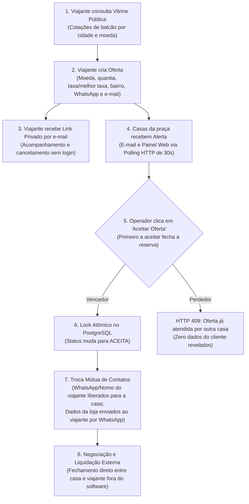

# Plataforma Neutra de Aproximação Cambial (Clone do Melhor Câmbio)

> Plataforma tecnológica de aproximação e mensageria entre viajantes (pessoa física) e casas de câmbio físicas autorizadas pelo Banco Central em São Paulo e no Rio de Janeiro. Inspirada na mecânica clássica e comprovada do **Melhor Câmbio** (`melhorcambio.com`), atuando como alternativa 100% neutra após a aquisição do portal pela fintech Nomad.

---

## 1. Contexto e Tese Estratégica

Em junho de 2024, a fintech de conta internacional Nomad adquiriu o portal Melhor Câmbio por cerca de R$ 3 milhões. Essa aquisição criou um **conflito de interesse estrutural** para as casas de câmbio físicas independentes: o dono do maior canal de captação de clientes passou a competir diretamente com elas, promovendo sua própria conta digital global e spread promocional.

Nossa proposta é ocupar a lacuna de **canal neutro**:
* **Não competimos com as casas de câmbio:** Não oferecemos conta internacional, cartão digital proprietário nem produtos financeiros concorrentes.
* **Foco em Câmbio Turismo (Papel-Moeda & Cartão Pré-Pago):** Atendemos o viajante pessoa física que precisa de dinheiro em espécie ou cartão pré-pago internacional (USD, EUR, GBP), direcionando 100% da demanda para a sua loja.
* **Piloto Gratuito:** O piloto inicial em SP e RJ é 100% gratuito para viajantes e casas de câmbio.

---

## 2. Princípio Inviolável: Zero Custódia e Zero Intermediação Financeira

A plataforma opera estritamente como **software de comunicação e aproximação tecnológica** ([ADR-001](docs/04-architecture/adr/ADR-001-comunicacao-sem-custodia.md)):

* **NÃO recebemos, NÃO intermediamos e NÃO custodiamos valores (sem Pix, TED ou dinheiro).**
* **NÃO calculamos nem recolhemos IOF ou tarifas** (a casa de câmbio informa o valor final ao cliente no contato direto).
* **NÃO formalizamos o contrato cambial nem gerencia logística de entrega.**
* Toda a liquidação financeira, identificação documental cambial (KYC Bacen) e entrega física do numerário ocorrem **diretamente entre o cliente e a instituição autorizada**, fora da plataforma.

---

## 3. O Fluxo Operacional Enxuto (MVP)

A arquitetura descarta pregões complexos em tempo real ou WebSockets, adotando a mecânica assíncrona clássica:

---

## 4. Estado Atual e Portão de Código (Gate Pré-Implementação)

> [!IMPORTANT]
> **Status da Especificação: `spec-locked`**
> A documentação técnica está travada e aprovada, mas a **implementação do código (NestJS) está bloqueada** até a validação das hipóteses no mundo real através de um **MVP Concierge Manual** ([Hipóteses](docs/01-discovery/hypotheses.md)).

### O Portão de Validação:
1. **H1 (Compromisso das Casas):** Abordagem a 40 casas de câmbio (20 em SP e 20 no RJ) com a tese de neutralidade. Meta: $\ge$ 10 cartas/compromissos de recebimento de ofertas gratuitas.
2. **H2 (Oferta do Viajante):** Coleta manual de 15 ofertas qualificadas de viajantes reais em 21 dias.
3. **H3 (Primeiro Aceite Manual):** Encaminhamento manual das ofertas às casas comprometidas, validando a janela de 4 horas úteis e taxa de fechamento $\ge$ 50%.
4. **H4 (Liquidação Externa):** Confirmação de que as partes fecharam a operação diretamente sem exigir intermediação de pagamento da plataforma.

---

## 5. Índice da Documentação Oficial

Todos os requisitos e decisões do projeto estão estruturados em 9 documentos canônicos:

### 01. Discovery & Validação
* [`docs/01-discovery/problem-statement.md`](docs/01-discovery/problem-statement.md): Framing formal do problema, impacto do conflito com a Nomad e critérios de sucesso do piloto de 90 dias.
* [`docs/01-discovery/hypotheses.md`](docs/01-discovery/hypotheses.md): As 4 hipóteses críticas (H1 a H4) que formam a porteira obrigatória antes do desenvolvimento.

### 03. Especificação do Produto
* [`docs/03-product/prd.md`](docs/03-product/prd.md): Product Requirements Document (v1.2 `spec-locked`) com 31 requisitos funcionais testáveis e escopo negativo blindado.
* [`docs/03-product/user-stories.md`](docs/03-product/user-stories.md): 13 histórias de usuário detalhadas divididas entre Viajante, Operador da Casa e Operação Interna.
* [`docs/03-product/acceptance-criteria.md`](docs/03-product/acceptance-criteria.md): Critérios de aceite rigorosos em formato Given/When/Then, cobrindo testes de concorrência massiva e relógio de expiração de 4h úteis.

### 04. Arquitetura e Decisões Técnicas (ADRs)
* [`ADR-001`](docs/04-architecture/adr/ADR-001-comunicacao-sem-custodia.md): Plataforma de comunicação estrita, sem custódia nem intermediação financeira.
* [`ADR-002`](docs/04-architecture/adr/ADR-002-monolito-modular-aceite-atomico.md): Backend NestJS em monólito modular, com PostgreSQL e aceite atômico (`UPDATE ... WHERE status = 'ABERTA'`).
* [`ADR-003`](docs/04-architecture/adr/ADR-003-polling-notificacoes-link-privado.md): Polling HTTP simples a cada 30 segundos no painel web, notificações assíncronas (e-mail/WhatsApp) e link privado de acompanhamento.
* [`ADR-004`](docs/04-architecture/adr/ADR-004-autenticacao-operador-sessao.md): Autenticação simplificada do operador com sessão de 10 horas comerciais e credenciamento manual no Bacen.

---

## 6. Stack Tecnológica Planejada

* **Backend:** Node.js / [NestJS](https://nestjs.com/) (TypeScript)
* **Banco de Dados:** [PostgreSQL](https://www.postgresql.org/) (com transações e locks atômicos)
* **Filas e Cache:** [Redis](https://redis.io/) / [BullMQ](https://bullmq.io/) (para disparos assíncronos)
* **Frontend:** [Next.js](https://nextjs.org/) / React (Tailwind CSS)
* **Notificações:** E-mail transacional (Resend/SendGrid) e WhatsApp API (Z-API / Evolution API)
