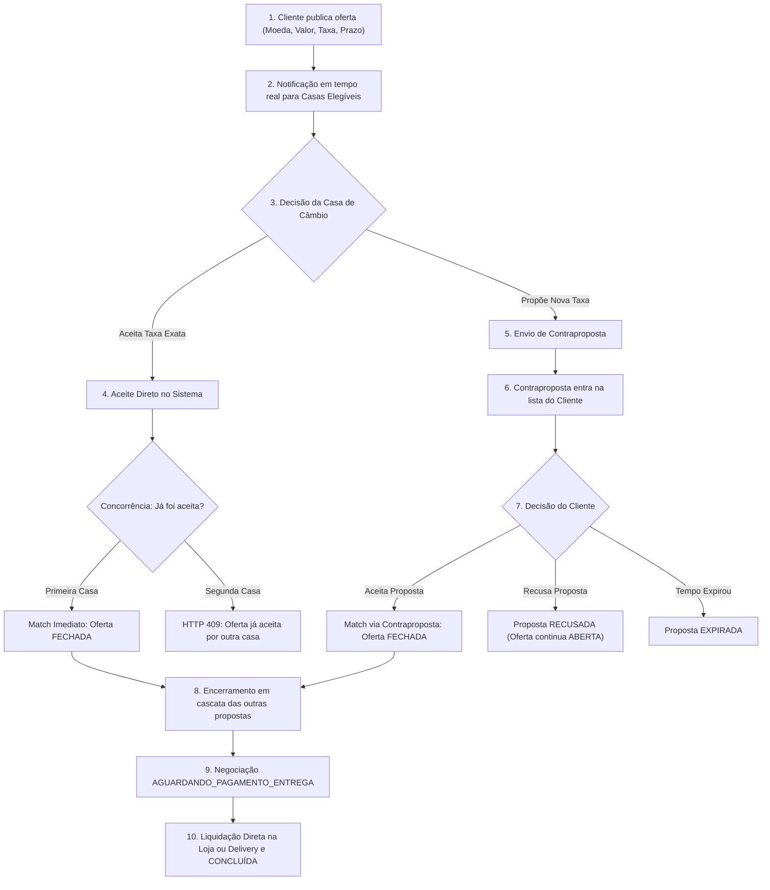

# Marketplace de Câmbio por Melhor Oferta

> Plataforma transacional em tempo real que conecta clientes com intenção de compra ou venda de moeda estrangeira às melhores taxas de casas de câmbio autorizadas pelo Banco Central.

---

## 1. Nomes de Trabalho Sugeridos

Para a identidade do produto, são sugeridas três alternativas conceituais:

1. **CâmbioMatch** *(Foco em conexão rápida, dinamismo e liquidez transacional instantânea)*;
2. **MelhorTaxa Câmbio** *(Foco direto na proposta de valor de economia e poder de negociação para o cliente final)*;
3. **CâmbioLivre** *(Foco em transparência, concorrência aberta de mercado e autonomia de precificação)*.

---

## 2. Visão do Produto

O mercado tradicional de câmbio turismo no Brasil é historicamente fragmentado, opaco e ineficiente. O cliente que precisa de moeda estrangeira para viagens ou compromissos comerciais é forçado a pesquisar individualmente por telefone ou balcão, sofrendo com spreads elevados e assimetria de informação. Por outro lado, as casas de câmbio autorizadas enfrentam alto custo de aquisição de clientes (CAC), dependem do fluxo físico de transeuntes e sofrem com a ociosidade operacional das suas mesas de operação em períodos de baixa demanda.

Nossa visão é estabelecer o **primeiro marketplace dinâmico de câmbio turismo operando pelo modelo de "melhor oferta" (leilão competitivo em tempo real)** no Brasil, iniciando pelas praças estratégicas do Rio de Janeiro e de São Paulo. O cliente publica sua demanda detalhada (moeda, valor, tipo de produto, modalidade de entrega e a taxa desejada) e as casas de câmbio elegíveis competem ativamente pelo negócio, podendo aceitar a oferta imediatamente ou formular contrapropostas mais vantajosas.

A plataforma atua estritamente como **camada tecnológica e ambiente seguro de intermediação de informações**, sem jamais custodiar dinheiro ou assumir a liquidação financeira das operações. Toda a transação cambial, a formalização regulatória e o contrato de câmbio permanecem sob a responsabilidade jurídica e operacional das instituições devidamente autorizadas pelo Banco Central do Brasil.

---

## 3. Como Funciona a Negociação

O mecanismo operacional foi desenhado para assegurar máxima agilidade, transparência e integridade transacional:



### Regras Centrais da Negociação:
1. **Publicação com Expiração e Dados Territoriais:** O cliente define moeda, operação (sempre sob a perspectiva do cliente: compra ou venda), produto (papel-moeda ou cartão pré-pago), modalidade (retirada ou delivery), cidade, região/bairro, taxa pretendida e prazo de validade (conforme a [Tabela de Parâmetros Configuráveis](docs/03-product/prd.md#parâmetros-configuráveis-da-plataforma), gerenciado via BullMQ com validação em banco via `clock_timestamp()`). A oferta distribuída pré-match é anônima (sem dados pessoais nem logradouro/CEP).
2. **Match Direto Automático:** Se uma casa aceita integralmente a taxa original, o match é instantâneo ("first-come, first-served"; no aceite direto o cliente não escolhe a casa) e a primeira transação a comitar vence, serializada no backend com validação atômica contra `clock_timestamp()` ([ADR-0006](docs/04-architecture/adr/adr-0006-concorrencia-match.md)).
3. **Contrapropostas Competitivas com VET (Sem Alíquotas Fixas):** As casas submetem contrapropostas com valor idêntico ao da oferta (atendimento integral no MVP), expressas em valor total final em reais (VET). A decomposição (taxa de câmbio, IOF e tarifas) é informada pela casa apenas para transparência: IOF e encargos variam por operação e produto e mudam com frequência [VALIDAR COM ESPECIALISTA TRIBUTÁRIO]; o sistema não calcula nem fixa alíquotas. As propostas entram em lista ordenada condicionalmente pelo valor total:
   - Operação `COMPRA`: ordenação **ascendente** (`ASC`, menor desembolso no topo);
   - Operação `VENDA`: ordenação **descendente** (`DESC`, maior valor recebido no topo).
   Se uma contraproposta chegar nos minutos finais da oferta, ocorre no máximo 1 extensão automática de 5 minutos sob lock pessimista [HIPÓTESE – A VALIDAR]. Limites de revisões (máx. 3), cooldown (30s) e validade são geridos via [Parâmetros Configuráveis](docs/03-product/prd.md#parâmetros-configuráveis-da-plataforma).
4. **Encerramento em Cascata e Proteção Bidirecional:** No momento em que qualquer match se consolida ou gatilho de auditoria ocorre (`MATCH_OUTRA_CASA`, `OFERTA_EXPIRADA`, `OFERTA_CANCELADA`, `CASA_SUSPENSA`), todas as outras propostas ativas daquela oferta mudam imediatamente para `ENCERRADA` e as demais casas são notificadas. Nenhuma das partes tem acesso a dados de contato ou endereço exato antes do match (FR-46); a liberação é estritamente pós-match.
5. **Gestão de No-Show, Checkpoint Bilateral e Strikes:** Ao fim da janela de execução acordada, o sistema dispara notificação bilateral (concluída / não compareceu / remarcar). Caso a casa declare "não compareceu", o cliente tem 24h úteis para contestar; sem resposta, a negociação transiciona para `CANCELADA` por ausência e registra strike no histórico do cliente [HIPÓTESE – A VALIDAR]; se contestar, transiciona para `DISPUTA`. Declarações de ausência exigem trilha imutável de auditoria para mitigar riscos de abuso por parte das casas em decorrência de oscilação desfavorável do spot cambial.
6. **Segurança, PLD e Escopo Gratuito no Piloto:** Autenticação em dois fatores (MFA via TOTP) é obrigatória para usuários de casas de câmbio (Owner e Operador) [HIPÓTESE – A VALIDAR]. Todo aceite vinculante exige confirmação em modal com resumo financeiro completo e aviso de modelo sem custódia. O piloto conta com teto de valor por oferta e alertas para padrões de ofertas fracionadas (PLD) [A VALIDAR COM JURÍDICO/PLD]. O MVP da Fase 1 é 100% gratuito (cobrança e estorno pertencem à Fase 2 / [ADR-0012](docs/04-architecture/adr/adr-0012-modelo-cobranca.md)).

---

## 4. Perfis de Usuário (Roles e Permissões)

A plataforma adota Role-Based Access Control (RBAC) com isolamento multi-tenant:

| Perfil | Sub-Roles | Atribuições e Acessos |
|--------|-----------|------------------------|
| **Admin da Plataforma** | Super Admin | Aprovação de cadastros KYB de casas, moderação, suspensão preventiva, monitoramento de saúde do sistema e acesso a logs de auditoria imutáveis. |
| **Casa de Câmbio** | **Owner** | Gestão institucional, cadastro de pontos de atendimento, configuração de moedas/produtos/cidades e gerenciamento da equipe da casa. Exige **MFA obrigatório** [HIPÓTESE – A VALIDAR]. |
| | **Operador** | Acesso ao pregão em tempo real via WebSocket, recebimento de ofertas, execução de aceites diretos, envio de contrapropostas e atualização de taxas de balcão. Exige **MFA obrigatório** [HIPÓTESE – A VALIDAR]. |
| | **Financeiro** | Acesso em modo leitura a relatórios de conciliação, volume de negócios concluídos e dados de faturamento. |
| **Cliente** | Pessoa Física / PJ | Publicação de ofertas, gestão de propostas recebidas, acompanhamento do status de negociação e avaliação do serviço. Confirmação prévia vinculante via modal. |

---

## 5. Stack Tecnológica (Decisões Confirmadas e Propostas)

- **Backend (Decisão Confirmada - Accepted):** [NestJS](docs/04-architecture/adr/adr-0001-backend-nestjs.md) (TypeScript), com arquitetura modular e Clean Architecture.
- **Frontend Web (Decisão Confirmada - Accepted):** React (Vite / Next.js) com Tailwind CSS e shadcn/ui.
- **Banco de Dados Principal (Stack Proposta - Proposed):** [PostgreSQL](docs/04-architecture/adr/adr-0002-postgresql-banco-principal.md) com transações ACID e locking pessimista.
- **Filas e Cache (Stack Proposta - Proposed):** [Redis + BullMQ](docs/04-architecture/adr/adr-0003-redis-bullmq-filas.md) para cancelamento/expiração de prazos e cache de cotações.
- **Comunicação em Tempo Real e Multicanal (Stack Proposta - Proposed):** [WebSocket (Socket.IO)](docs/04-architecture/adr/adr-0004-websocket-socketio.md) complementado por Web Push, e-mail transacional e WhatsApp para operadores offline.
- **Mobile (Fase Futura):** React Native / Expo com compartilhamento de componentes lógicos.
- **Arquitetura de Código (Stack Proposta - Proposed):** [Monorepo](docs/04-architecture/adr/adr-0007-monorepo-tipos-compartilhados.md) gerenciado via Turborepo e pnpm com pacote `@melhor-cambio/shared` para tipos compartilhados e validação unificada via Zod.

---

## 6. Estrutura do Repositório

```
.
├── apps/                        # Aplicações do Monorepo (Fase de Implementação)
│   ├── api/                     # Backend NestJS (REST + WebSocket)
│   ├── web/                     # Frontend Web React (Cliente, Casa, Admin)
│   ├── mobile/                  # Aplicativo React Native/Expo (Post-MVP)
│   └── landing-pages/           # Next.js Multi-Tenant White-Label (Post-MVP)
├── packages/                    # Pacotes Compartilhados
│   ├── shared/                  # Enums, DTOs, Schemas Zod e Tipos TypeScript
│   ├── config-eslint/           # Padronização de Linting
│   └── config-typescript/       # Configuração base tsconfig
├── docs/                        # DOCUMENTAÇÃO OFICIAL DE PRODUTO E ARQUITETURA
│   ├── 01-discovery/            # Descoberta, Problema e Hipóteses
│   ├── 02-strategy/             # Priorização de Escopo Multi-Framework
│   ├── 03-product/              # PRD, User Stories e Acceptance Criteria
│   ├── 04-architecture/adr/     # Architecture Decision Records (ADR-0001 a 0012)
│   ├── 05-okrs/                 # OKRs Estratégicos (Trimestres T1 e T2)
│   ├── 06-roadmap/              # Roadmap Evolutivo em Fases e Gantt
│   ├── 07-launch/               # Launch Checklist de Go-Live e Rollback
│   ├── 08-comms/                # Comunicação com Parceiros Comerciais
│   └── 09-review/               # Relatório de Revisão Adversarial PM Critic
└── README.md                    # Visão Geral e Guia de Navegação
```

---

## 7. Índice Completo da Documentação (`/docs`)

Toda a concepção do produto foi elaborada utilizando as skills especializadas de Product Management instaladas no projeto:

### 01. Discovery & Enquadramento
- [`docs/01-discovery/problem-statement.md`](docs/01-discovery/problem-statement.md): Enquadramento do problema para os dois lados do mercado (Cliente e Casa de Câmbio), métricas de sucesso e restrições.
- [`docs/01-discovery/hypotheses.md`](docs/01-discovery/hypotheses.md): Hipóteses testáveis de Desejabilidade (H1), Viabilidade Operacional (H2) e Negócio/WTP (H3).

### 02. Estratégia & Priorização
- [`docs/02-strategy/prioritization.md`](docs/02-strategy/prioritization.md): Análise comparativa multi-framework (ICE, MoSCoW e Weighted Scoring) para 16 funcionalidades candidatas do MVP e post-MVP.

### 03. Especificação do Produto
- [`docs/03-product/prd.md`](docs/03-product/prd.md): Documento de Requisitos de Produto (PRD) completo do MVP (v1.4), sincronizado com 30 User Stories, tabela centralizada de parâmetros configuráveis, regras de concorrência com clock_timestamp(), atendimento integral no MVP, ordenação condicional VET (compra ASC, venda DESC), extensão única de oferta, checkpoint bilateral de no-show e anonimização com Região/Bairro.
- [`docs/03-product/user-stories.md`](docs/03-product/user-stories.md): 30 User Stories detalhadas organizadas por perfil e pelos 8 épicos do sistema (v1.4), incluindo MFA obrigatório (US-028), confirmação vinculante em modal (US-029) e governança PLD com teto de valor e alerta de fracionamento (US-030).
- [`docs/03-product/acceptance-criteria.md`](docs/03-product/acceptance-criteria.md): 31 critérios executáveis Given/When/Then (v1.4) com Tabela Unificada de Códigos de Erro e HTTP, testes de concorrência no aceite direto e extensão (AC-05, AC-25 a AC-27), gestão de no-show/strikes (AC-28), MFA mandatório (AC-29), modal pré-aceite (AC-30) e PLD (AC-31).

### 04. Arquitetura e Decisões Técnicas (ADRs)
- [`docs/04-architecture/adr/adr-0001-backend-nestjs.md`](docs/04-architecture/adr/adr-0001-backend-nestjs.md): Backend em NestJS (**Accepted** - Decisão confirmada pelo fundador).
- [`docs/04-architecture/adr/adr-0002-postgresql-banco-principal.md`](docs/04-architecture/adr/adr-0002-postgresql-banco-principal.md): PostgreSQL como Banco Principal (**Proposed**).
- [`docs/04-architecture/adr/adr-0003-redis-bullmq-filas.md`](docs/04-architecture/adr/adr-0003-redis-bullmq-filas.md): Redis + BullMQ para Expiração e Filas (**Proposed**).
- [`docs/04-architecture/adr/adr-0004-websocket-socketio.md`](docs/04-architecture/adr/adr-0004-websocket-socketio.md): WebSocket (Socket.IO) para Tempo Real (**Proposed**).
- [`docs/04-architecture/adr/adr-0005-estrategia-cotacao.md`](docs/04-architecture/adr/adr-0005-estrategia-cotacao.md): Estratégia de Cotação de Referência com Cache e Fallback (**Proposed**).
- [`docs/04-architecture/adr/adr-0006-concorrencia-match.md`](docs/04-architecture/adr/adr-0006-concorrencia-match.md): Controle Transacional de Concorrência no Match com READ COMMITTED e FOR UPDATE (**Proposed** - v1.4 com extensão atômica sob lock pessimista e desacoplamento do worker BullMQ via clock_timestamp()).
- [`docs/04-architecture/adr/adr-0007-monorepo-tipos-compartilhados.md`](docs/04-architecture/adr/adr-0007-monorepo-tipos-compartilhados.md): Monorepo e Shared Types (**Proposed**; NestJS e React confirmados).
- [`docs/04-architecture/adr/adr-0008-modelo-roles-rbac.md`](docs/04-architecture/adr/adr-0008-modelo-roles-rbac.md): Modelo de Perfis e RBAC Multi-Tenant (**Proposed**).
- [`docs/04-architecture/adr/adr-0009-onboarding-kyb-casas.md`](docs/04-architecture/adr/adr-0009-onboarding-kyb-casas.md): Onboarding e Aprovação KYB das Casas de Câmbio (**Proposed**).
- [`docs/04-architecture/adr/adr-0010-plataforma-sem-custodia.md`](docs/04-architecture/adr/adr-0010-plataforma-sem-custodia.md): Plataforma sem Custódia de Fundos (**Proposed** - Depende de Parecer Jurídico).
- [`docs/04-architecture/adr/adr-0011-landing-pages-multi-tenant.md`](docs/04-architecture/adr/adr-0011-landing-pages-multi-tenant.md): Landing Pages Multi-Tenant e API Pública (**Proposed** - Post-MVP).
- [`docs/04-architecture/adr/adr-0012-modelo-cobranca.md`](docs/04-architecture/adr/adr-0012-modelo-cobranca.md): Modelo de Cobrança e Monetização (**Proposed** - v1.4 reiterando Fase 1 100% gratuita; cobrança e estorno pertencem à Fase 2).

### 05. Metas e Coordenação (OKRs)
- [`docs/05-okrs/okrs.md`](docs/05-okrs/okrs.md): Metas de liquidez para o T1 (casas ativas, tempo mediano de resposta e taxa de match) e validação de receita para o T2 (v1.4 alinhado com tabela de parâmetros configuráveis e piloto gratuito).

### 06. Planejamento Evolutivo (Roadmap)
- [`docs/06-roadmap/roadmap.md`](docs/06-roadmap/roadmap.md): Roadmap em 3 fases (MVP → Monetização e Confiança → Expansão Regional) com cronograma Gantt em semanas relativas e marcos de validação com os parceiros (v1.4 com escopo completo de segurança, no-show e PLD).

### 07. Lançamento e Operações
- [`docs/07-launch/launch-checklist.md`](docs/07-launch/launch-checklist.md): Checklist cross-funcional para o lançamento piloto em RJ e SP, critérios Go/No-Go com checagem de MFA, modal mandatório, testes de no-show/strikes e plano de rollback (v1.4).

### 08. Comunicação com Stakeholders
- [`docs/08-comms/stakeholder-update-001.md`](docs/08-comms/stakeholder-update-001.md): Primeiro update assíncrono para o parceiro comercial e casas piloto, com linguagem de negócios e CTA de alinhamento.

### 09. Qualidade e Revisão
- [`docs/09-review/pm-critic-report.md`](docs/09-review/pm-critic-report.md): Relatório de auditoria adversarial com apontamentos P0/P1/P2 resolvidos.

---

## 8. Decisões em Aberto (Open Decisions)

Conforme a disciplina de gestão de produto, os seguintes tópicos permanecem como **Em Aberto** com as recomendações indicadas, sem serem tratados como decididos:

1. **Forma de expressão do valor da oferta e contraproposta:** A oferta do cliente e as contrapropostas devem ser expressas em valor total final tudo incluso (VET) ou em taxa de câmbio pura com acréscimo posterior de encargos? [Recomendação: Oferta e contraproposta expressas em valor total final em reais (VET tudo incluso), garantindo comparabilidade perfeita e previsibilidade. O aceite direto e as contrapropostas trazem a decomposição detalhada (câmbio puro, IOF e tarifas) informada pela casa apenas para transparência e compliance, sem alterar o total; o sistema não calcula nem fixa alíquotas de IOF, pois estas variam por operação e produto e mudam com frequência] [VALIDAR COM CASAS E TRIBUTARISTA]. Alternativa registrada: taxa pura + encargos (menos comparável e sujeita a surpresas no fechamento).
2. **Identidade da casa de câmbio antes do match:** O cliente deve visualizar o nome fantasia da casa nas contrapropostas ou as propostas devem ser 100% anônimas até o match? [Recomendação: exibir nome fantasia da casa para conferir credibilidade e permitir escolha consciente, mantendo canais de contato direto como telefone e endereço exato estritamente protegidos pré-match, a confirmar com o fundador].
3. **Política de estorno da taxa no match (Fase 2 / ADR-0012):** Em caso de cancelamento por inatividade ou ausência comprovada, como tratar a cobrança? [Opção 1: estorno unicamente via disputa formal comprovando cliente ausente vs. Opção 2: estorno automático em cancelamento por inatividade], mantido em aberto no [ADR-0012](docs/04-architecture/adr/adr-0012-modelo-cobranca.md) sob parecer jurídico. *Nota: o piloto da Fase 1 é 100% gratuito.*
4. **Suspensão preventiva de casa e negociações em andamento:** Caso uma casa seja suspensa pelo Admin, deve haver discricionariedade administrativa para permitir que negociações em andamento seguro sejam concluídas normalmente, ou todas devem ser suspensas compulsoriamente? [VALIDAR COM JURÍDICO].
5. **Janela de execução física pós-match e vinculação da taxa:** Qual o prazo máximo de cumprimento da operação cambial pelas partes após o match? [Recomendação: mesmo dia útil até o fechamento bancário para papel-moeda; prazo para cartão a definir] [HIPÓTESE – A VALIDAR com as casas].
6. **Critérios de contestação de No-Show e definição de ausência:** Quais evidências (ex.: registro de geolocalização, mensagem no WhatsApp, comprovante de tentativa de contato) o cliente ou a casa devem apresentar para justificar a contestação de ausência dentro do prazo de 24h úteis? [VALIDAR COM OPERAÇÕES E JURÍDICO].
7. **Critérios e limites de alerta para fracionamento de ofertas (PLD):** Qual o volume consolidado acumulado por CPF/CNPJ em janela móvel de 24h a 7 dias que deve disparar o alerta de suspeita de fracionamento para a equipe de compliance? [VALIDAR COM JURÍDICO/PLD].
8. **Janela de decisão do cliente no término da oferta:** Extensão automática de 5 minutos garantida caso uma contraproposta chegue nos minutos finais da oferta? [Recomendação: sim, exatamente 1 extensão de 5 min] [HIPÓTESE – A VALIDAR].
9. **Calibragem dos Parâmetros Operacionais (Tabela Centralizada):** Prazos padrão de expiração de oferta (15 a 30 min), validade da contraproposta (`prazo_validade_minutos`: 10 min), teto de revisões (3x), cooldown (30s) e limite de strikes de cliente (3 strikes) parametrizados e pendentes de validação de campo.
10. **Visibilidade entre casas (Propostas Cegas vs. Leilão Aberto):** No MVP adotou-se o modelo cego (cada casa só vê sua própria proposta, o cliente vê todas), pendente de teste sobre impacto na agressividade dos preços.
11. **Contraproposta reversa do cliente:** Fora do escopo do MVP; será avaliado na Fase 2 se clientes devem poder renegociar contrapropostas.
12. **Modelo definitivo de monetização:** Cobrança no match (para mitigar o desincentivo de confirmação na conclusão), mensalidade fixa SaaS ou modelo híbrido, bloqueado até a conclusão do parecer jurídico regulatório [A VALIDAR COM ADVOGADO].

---

## 9. Riscos Principais

| Risco | Classificação | Impacto | Estratégia de Mitigação |
|-------|---------------|---------|--------------------------|
| **1. Enquadramento Regulatório (BACEN)** | **Crítico** | Paralisação da operação se a plataforma for interpretada como intermediadora financeira. | Desenho sem custódia ([ADR-0010](docs/04-architecture/adr/adr-0010-plataforma-sem-custodia.md)); condicionamento do go-live à entrega de parecer formal assinado por escritório especializado em direito bancário e cambial. |
| **2. Vazamento (Desintermediação)** | **Alto** | Clientes e casas combinam por fora da plataforma após o match, sonegando receita futura. | Ocultação rigorosa de nomes, telefones e endereços antes do match; cobrança no momento do aceite; criação de ferramentas de conveniência e reputação na plataforma. |
| **3. Liquidez Insuficiente no Cold-Start** | **Alto** | Clientes publicam ofertas mas não recebem propostas em tempo hábil, abandonando o sistema. | Estratégia de GTM baseada no parceiro comercial com acesso prévio; exigência de 5 a 10 casas comprometidas em RJ e SP antes da divulgação a clientes. |
| **4. Concorrência e Double-Matching** | **Médio** | Duas casas aceitam a mesma oferta no mesmo milissegundo, gerando litígio e frustração. | Controle transacional estrito no PostgreSQL com lock pessimista serializado, validação via `clock_timestamp()`, prova de teste de carga e constraint de unicidade ([ADR-0006](docs/04-architecture/adr/adr-0006-concorrencia-match.md)). |
| **5. Instabilidade de Cotações Externas** | **Médio** | Falha da AwesomeAPI trava a tela de emissão ou avaliação de ofertas. | Cache centralizado em Redis com TTL de 300s, entrega de dados com flag `is_stale: true` e fallback configurado ([ADR-0005](docs/04-architecture/adr/adr-0005-estrategia-cotacao.md)). |

---

## 10. Como Usar as PM Skills Neste Projeto

Este repositório está integrado ao ecossistema de habilidades padronizadas de gestão de produto. Utilize os comandos abaixo conforme o ciclo de vida evolutivo da plataforma:

| Skill | Quando Utilizar | Artefatos Gerados / Impactados |
|-------|-----------------|--------------------------------|
| `define-problem-statement` | Ao iniciar uma nova iniciativa ou pivotar a proposta de valor para novos segmentos. | `docs/01-discovery/problem-statement.md` |
| `define-hypothesis` | Ao formular novas premissas de produto antes de investir esforço de engenharia. | `docs/01-discovery/hypotheses.md` |
| `define-prioritization-framework` | Durante o planejamento de novos trimestres para balancear itens do backlog (ICE, MoSCoW, Weighted Scoring). | `docs/02-strategy/prioritization.md` |
| `deliver-prd` | Ao especificar o escopo e regras funcionais de novos épicos ou grandes versões de release. | `docs/03-product/prd.md` |
| `deliver-user-stories` | No refinamento técnico pré-sprint para quebrar épicos em histórias estimáveis (INVEST). | `docs/03-product/user-stories.md` |
| `deliver-acceptance-criteria` | Na definição de critérios Given/When/Then executáveis para handoff de desenvolvimento e QA. | `docs/03-product/acceptance-criteria.md` |
| `develop-adr` | Sempre que uma decisão técnica ou arquitetural estruturante for proposta ou alterada. | `docs/04-architecture/adr/` |
| `foundation-okr-writer` | No planejamento trimestral de OKRs do time de produto e negócios. | `docs/05-okrs/okrs.md` |
| `deliver-launch-checklist` | Entre 1 e 2 semanas antes de qualquer go-live importante para coordenação cross-funcional. | `docs/07-launch/launch-checklist.md` |
| `foundation-stakeholder-update` | Para comunicação assíncrona periódica de decisões e avanços com parceiros e liderança. | `docs/08-comms/` |
| `utility-mermaid-diagrams` | Ao criar ou validar fluxos, diagramas de estado, sequências ou cronogramas Gantt em Markdown. | Diagramas Mermaid em qualquer doc |
| `utility-pm-critic` | Para rodar auditoria adversarial contra qualquer artefato antes de apresentá-lo a stakeholders. | `docs/09-review/pm-critic-report.md` |
| **`measure-okr-grader`** | **NÃO UTILIZAR NO INÍCIO.** Esta skill destina-se exclusivamente ao **fim do ciclo trimestral (fechamento do T1)** para pontuar os KRs concluídos com base em evidências reais coletadas. | Relatórios de fechamento de ciclo de OKRs |

---

## 11. Status do Projeto

- **Fase Atual:** **Fase 0 — Concepção, Especificação e Arquitetura Concluída**.
- **Próximo Passo:** Contratação do parecer jurídico especializado e início da implementação da Fase 1 (Setup do monorepo e fundações de software).

---

## 12. Como Rodar a Aplicação

> [!NOTE]
> **Placeholder:** O repositório encontra-se atualmente na fase de documentação e arquitetura (somente documentos). Nenhuma base de código de aplicação foi gerada ainda. As instruções de inicialização de ambiente (Docker Compose, migrações de banco de dados e comandos `pnpm dev`) serão adicionadas assim que a Fase 1 de engenharia for iniciada.

---

## 13. Histórico de Versões da Documentação

| Versão | Data | Responsável | Escopo das Modificações |
|--------|------|-------------|-------------------------|
| 1.0 | 2026-11-02 | Agente de Produto e Arquitetura | Geração inicial completa dos 13 artefatos documentais de produto, estratégia e arquitetura. |
| 1.1 | 2026-11-03 | Agente de Produto e Arquitetura | Incorporação dos apontamentos e recomendações do relatório adversarial PM-Critic. |
| 1.2 | 2026-11-03 | Agente de Produto e Arquitetura | Aplicação das correções de alinhamento: recusa voltando para aberta, encerramento de propostas em cascata para expiração/cancelamento com auditoria, cobrança no match, notificações multicanal offline (US-024, AC-15), regras estritas de concorrência com lock_timeout e NOW() (ADR-0006), anonimização e entrega protegida, verificação de identidade/telefone, governança de disputas, linguagem jurídica neutra e distinção formal de stack confirmada (NestJS e React) vs. stack proposta. |
| 1.3 | 2026-11-03 | Agente de Produto e Arquitetura | Revisão integral v1.3: substituição de NOW() por clock_timestamp() e requisições rejeitadas sem mutação de estado (ADR-0006); remoção de detalhes SQL e implementação de Tabela Unificada de Erros nos ACs; reescrita do AC-05 como teste de carga (N paralelas, 1 sucesso, N-1 conflitos, idempotência e estouro de lock_timeout); inclusão de 8 novos ACs (AC-17 a AC-24); calibração de AC-07 e AC-08; isolamento de suspensão de casa com motivo SUSPENSAO_PARCEIRO e mensagem neutra ao cliente [VALIDAR COM JURÍDICO] em AC-09; ordenação condicional de contrapropostas (compra ASC, venda DESC); inclusão de Região/Bairro na oferta anônima pré-match e proteção bidirecional (FR-46); atendimento integral obrigatório no MVP (parcial movido para Future Considerations); política de estorno em aberto mantida no ADR-0012; throttling de WhatsApp e opt-in obrigatório; teto de 3 revisões com cooldown de 30s e reenvio após recusa; padronização de prazo_validade_minutos; VET discriminado sem alíquotas fixas; regra única de conclusão bilateral e janela de execução; sincronização rigorosa das 27 User Stories no PRD; e registro explícito das decisões em aberto com recomendações. |
| 1.4 | 2026-11-03 | Agente de Produto e Arquitetura | Revisão integral v1.4: correção e unificação de códigos de erro e HTTP (US-008 AC-2 para 422 OFFER_ALREADY_CLOSED); remoção completa de alíquotas fixas de IOF (1,1%, 3,5%) e exemplos numéricos embutidos, definindo IOF e encargos como informados pela casa sem cálculo pelo sistema; registro da Decisão em Aberto nº 1 (VET total final recomendado vs. taxa pura + encargos); regra estrita de extensão única da oferta (+5 min, máx. 1 extensão) com lock pessimista e desacoplamento de reagendamento no BullMQ; substituição do checkpoint fixo por checkpoint ao fim da janela acordada com gestão de no-show, prazo de 24h úteis de contestação pelo cliente, strikes e trilha imutável de auditoria contra abuso; clarificação de escopo de cobrança (MVP 100% gratuito, cobrança e estorno na Fase 2 / ADR-0012); confirmação dos 4 gatilhos de encerramento em cascata no diagrama e textos; requisitos de segurança e PLD (MFA obrigatório para casas US-028, modal de confirmação pré-aceite US-029, teto de valor de R$ 50k e alertas de fracionamento US-030); criação da seção centralizada de Parâmetros Configuráveis no PRD (21 parâmetros); inclusão de 7 novos critérios de aceitação (AC-25 a AC-31); e sincronização de 30 User Stories entre PRD, US, ACs, Roadmap, OKRs e Launch Checklist. |

