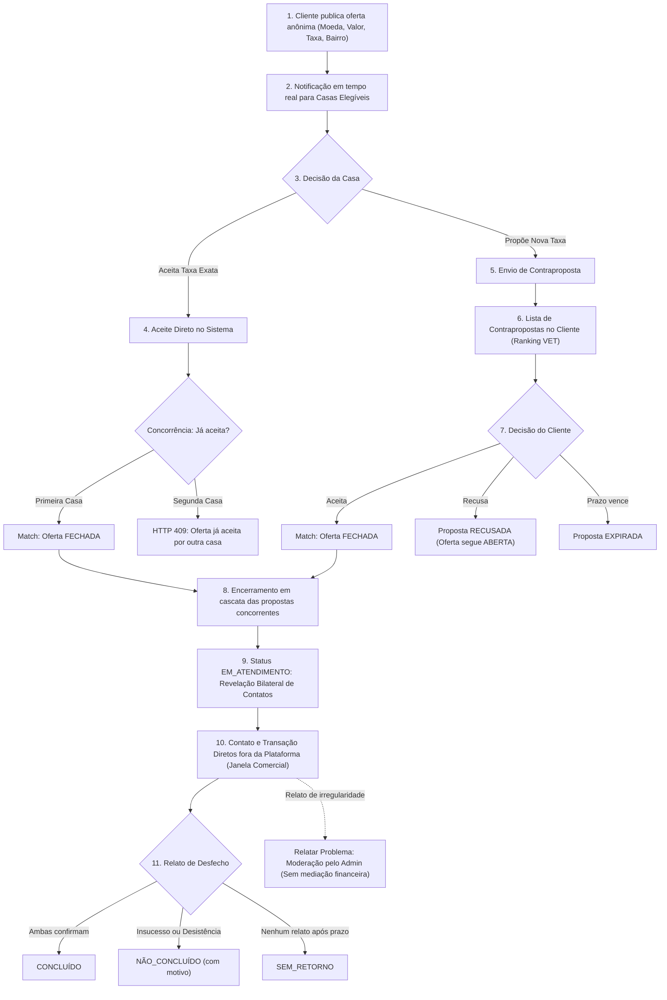
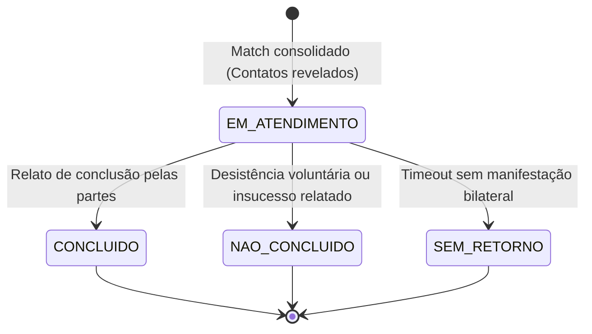

# PRD: Marketplace de Câmbio — MVP (Versão 1.5.1)

## Overview

### Problem Statement

Pessoas físicas e jurídicas que precisam comprar ou vender moeda estrangeira enfrentam um mercado fragmentado, opaco e com taxas de balcão discrepantes. Os canais tradicionais de cotação (ligações telefônicas, visitas presenciais ou consulta a sites estáticos individuais) demandam alto esforço do cliente e oferecem pouca transparência sobre taxas efetivas com todos os encargos inclusos. Por outro lado, para as casas de câmbio autorizadas pelo Banco Central, a atração de clientes depende fortemente de localização física e marketing local, resultando em mesas operacionais subutilizadas em horários de menor movimento.

O resultado é um mercado com alta assimetria de informação: clientes pagam spreads elevados e casas de câmbio perdem oportunidades de negócio qualificadas.

### Solution Summary

A plataforma é posicionada formalmente na versão 1.5 como uma **PLATAFORMA TECNOLÓGICA DE COMUNICAÇÃO, MENSAGERIA E APROXIMAÇÃO** entre clientes e casas de câmbio autorizadas pelo Banco Central, inspirada na mecânica de mercado do portal **Melhor Câmbio** (`melhorcambio.com`), porém modernizada com pregão em tempo real e contrapropostas simultâneas.

O cliente publica sua demanda anônima especificando: moeda, operação (compra ou venda sob sua ótica), valor pretendido, taxa desejada, modalidade (papel-moeda ou cartão pré-pago), preferência de atendimento (retirada ou delivery) e recorte territorial macro (cidade e região/bairro). As casas de câmbio elegíveis conectadas ao pregão em tempo real via WebSocket podem **aceitar diretamente** a oferta original (match instantâneo por *first-come, first-served*) ou submeter **contrapropostas estruturadas** com valor total em reais (VET).

> [!IMPORTANT]
> **Premissa Inviolável de Não-Intermediação Financeira [VALIDAR COM ADVOGADO]:**
> A plataforma atua estritamente como canal de comunicação e aproximação tecnológica.
> - **A plataforma NÃO recebe, NÃO custodia, NÃO transaciona, NÃO processa e NÃO intermedia valores financeiros.**
> - **A plataforma NÃO gerencia formas de pagamento (Pix, TED, dinheiro em espécie) nem etapas logísticas de entrega ou retirada de valores.**
> - O pagamento, a entrega do numerário, a conferência documental regulatória (KYC cambial) e a celebração formal do contrato de câmbio ocorrem **DIRETAMENTE ENTRE A CASA DE CÂMBIO AUTORIZADA E O CLIENTE**, fora do ambiente do software.
> - O aceite na plataforma constitui um **compromisso comercial de atendimento direto** por uma janela temporal informada (conforme parâmetro configurável) e **NÃO é executado nem garantido financeiramente pela plataforma**.

---

### Contexto Competitivo: O Modelo Melhor Câmbio e Diferenciais em Hipótese

Conforme detalhado no documento de discovery [Contexto Competitivo](../01-discovery/competitive-context.md), o produto posiciona-se no mesmo segmento desbravado pelo **Melhor Câmbio** (`melhorcambio.com`, adquirido pela fintech Nomad):

1. **O Modelo Incumbente:** O Melhor Câmbio opera como um comparador de taxas por cidade combinado a um sistema assíncrono de ofertas: o cliente informa o montante e seus contatos; a plataforma anuncia a oferta às casas parceiras; se uma casa aceita, o cliente é avisado por e-mail e tem até 2 horas para finalizar; a casa contata o cliente diretamente para concluir o câmbio. *(Os números do site de 1.600+ parceiros e 1M+ usuários únicos/mês são dados auto-declarados, pendentes de verificação).*
2. **Hipóteses de Diferenciação da Nova Plataforma:**
   - **Contrapropostas simultâneas estruturadas:** Múltiplas casas concorrem ativamente pela mesma oferta com taxas alternativas, comparadas em ranking transparente pelo valor total em reais (VET) [HIPÓTESE – A VALIDAR];
   - **Anonimato pré-match:** O cliente expõe apenas região/bairro, mantendo nome e telefone 100% protegidos até a consolidação do match para evitar assédio comercial [HIPÓTESE – A VALIDAR];
   - **Comunicação instantânea em tempo real:** Pregão via WebSocket com alertas sonoros e visuais, substituindo a latência do e-mail [HIPÓTESE – A VALIDAR];
   - **Ferramentas B2B para Casas:** Vitrine Informativa de taxas de balcão, auditoria e futura integração via APIs e landing pages [HIPÓTESE – A VALIDAR];
   - **Mobile-First:** Aplicação web responsiva moderna evoluindo para app móvel dedicado na Fase 2 [HIPÓTESE – A VALIDAR].
3. **Riscos Competitivos:** Reconhecimento de marca e escala massiva do incumbente, prática de *multi-homing* pelas casas parceiras e risco de desintermediação/vazamento comercial após a revelação dos contatos.
4. **Salvaguardas Contratuais do Fundador [VALIDAR COM ADVOGADO]:**
   - A assessoria jurídica deve avaliar eventuais obrigações contratuais do fundador decorrentes de vínculos prévios com concorrentes (cláusulas de confidencialidade, não-concorrência e não-aliciamento).
   - É expressamente vedada a reutilização de marcas, trade dress, código-fonte, bases de dados ou contatos de terceiros.

---

### Glossário e Convenções Operacionais

- **Operação de Compra e Venda:** A definição de compra/venda é **sempre sob a perspectiva do CLIENTE**:
  - **COMPRA:** O cliente adquire moeda estrangeira (paga reais - BRL, recebe moeda estrangeira). A casa de câmbio é vendedora.
  - **VENDA:** O cliente converte moeda estrangeira em reais (entrega moeda estrangeira, recebe BRL). A casa de câmbio é compradora.
- **Valor Efetivo Total (VET):** Valor final total em Reais da transação, composto pela taxa de câmbio pura somada ao IOF e eventuais tarifas informadas pela casa de câmbio. IOF e demais encargos: valor informado pela casa; alíquotas variam por operação e produto e mudam com frequência [VALIDAR COM ESPECIALISTA TRIBUTÁRIO]. O sistema não calcula nem fixa alíquotas.
- **Oferta Anônima:** Divulgação pré-match aos operadores contendo apenas parâmetros essenciais da demanda (moeda, operação, valor, taxa, produto, cidade, região/bairro e modalidade), sem dados de contato direto (telefone, e-mail) nem logradouro/CEP.
- **Atendimento Comercial (Substitui "Negociação"):** O ciclo pós-match onde a plataforma disponibiliza os contatos mútuos para que casa e cliente realizem a transação diretamente fora do sistema. Estados: `EM_ATENDIMENTO` → `CONCLUÍDO` | `NÃO_CONCLUÍDO` | `SEM_RETORNO`.
- **Janela de Atendimento:** Prazo comercial acordado e parametrizado para que as partes estabeleçam contato direto e concluam o atendimento (padrão: 24 horas úteis [HIPÓTESE – A VALIDAR]). A plataforma **não executa** a operação.

### Target Users

- **Cliente (Pessoa Física / Jurídica):** Deseja comprar ou vender moeda estrangeira com agilidade, privacidade e melhor taxa total em reais.
- **Casa de Câmbio (Owner, Operador, Financeiro):** Deseja captar clientes com intenção firme de câmbio, acessar pregão em tempo real e gerenciar atendimentos.
- **Admin da Plataforma:** Aprova o cadastro KYB de casas, monitora a qualidade da rede, atende a relatos de problemas e audita o sistema.

## Goals & Success Metrics

### Goals

1. Estabelecer o primeiro canal digital de mensageria em tempo real com leilão por melhor oferta entre clientes e casas de câmbio autorizadas em RJ e SP.
2. Permitir que o cliente obtenha taxas competitivas por meio de contrapropostas dinâmicas comparadas pelo valor final total (VET).
3. Validar a liquidez operacional do modelo de aproximação sem participação financeira no piloto em São Paulo e Rio de Janeiro.
4. Construir uma rede qualificada de casas parceiras comprometidas com agilidade e integridade no atendimento ao cliente.

### Success Metrics

| Métrica | Baseline Atual | Meta | Prazo |
|---------|---------------|------|-------|
| Casas de câmbio cadastradas e aprovadas (RJ + SP) | 0 | 10 a 20 casas [HIPÓTESE – A VALIDAR] | 90 dias pós-lançamento |
| Densidade semanal de demanda (ofertas por casa ativa) | 0 | 3 a 5 ofertas/casa/semana [HIPÓTESE – A VALIDAR] | 90 dias pós-lançamento |
| Taxa de match (ofertas que geram atendimento comercial) | 0% | > 35% [HIPÓTESE – A VALIDAR] | 90 dias pós-lançamento |
| Taxa de conversão por desfecho declarado (`CONCLUÍDO` / atendimentos) | 0% | > 60% [HIPÓTESE – A VALIDAR] | 90 dias pós-lançamento |
| Tempo mediano de primeira resposta das casas | N/A | < 15 minutos [HIPÓTESE – A VALIDAR] | 90 dias pós-lançamento |
| Índice de relatos de "taxa não mantida" | N/A | < 3% dos atendimentos [HIPÓTESE – A VALIDAR] | 90 dias pós-lançamento |
| Retenção mensal de casas ativas | 0% | > 70% no Mês 3 [HIPÓTESE – A VALIDAR] | 90 dias pós-lançamento |

### Non-Goals

- **Intermediação ou Custódia Financeira:** A plataforma NÃO processa pagamentos, não recebe Pix, não emite boletos, não retém dinheiro em conta escrow e não liquida contratos cambiais.
- **Logística e Entrega:** A plataforma NÃO gerencia logística física de entregadores, motoboys ou horários de agendamento de balcão.
- **Mediação Financeira de Disputas:** A plataforma NÃO atua como juízo arbitral de valores, não devolve recursos e não impõe retenções pecuniárias. O suporte atua exclusivamente na moderação de cadastro e qualidade da rede.
- **Monetização no MVP:** O piloto da Fase 1 é 100% gratuito. A cobrança (por lead/atendimento ou SaaS) ocorrerá exclusivamente na Fase 2 ([ADR-0012](../04-architecture/adr/adr-0012-modelo-cobranca.md)).
- **Cobertura Nacional Imediata:** O piloto é restrito às praças estratégicas do Rio de Janeiro e de São Paulo.

---

## Go-to-Market (GTM) e Aquisição de Demanda

A retenção sustentável das casas de câmbio no regime de *multi-homing* com o incumbente depende de superar o gargalo de liquidez de demanda. Para o piloto em São Paulo e Rio de Janeiro, o plano de Go-to-Market apoia-se em três pilares de tração orgânica e co-distribuída:

### 1. Pilares de Aquisição de Demanda

1. **SEO Local de Cotação por Cidade e Região:**
   - Construção de páginas altamente performáticas e otimizadas para busca orgânica com intenção local imediata (ex.: *"onde comprar dólar em são paulo"*, *"cotação euro turismo rj"*, *"melhor câmbio barra da tijuca"*).
   - O tráfego de busca local captura clientes no exato momento da decisão de viagem ou compra de papel-moeda, sem depender de investimento maciço em mídia de performance no piloto.
2. **Landing Pages e Presença Digital das Casas:**
   - Disponibilização de links parametrizados e páginas públicas de perfil para que as casas participantes possam divulgar aos seus clientes em canais próprios (site institucional, redes sociais, assinatura de e-mail e QR Code no balcão).
3. **Base de Clientes das Próprias Casas Parceiras:**
   - Incentivo para que as casas parceiras utilizem a plataforma para organizar pedidos de sua carteira recorrente de clientes que pedem cotações por telefone ou WhatsApp, digitalizando o fluxo de atendimento da mesa.

### 2. Metas de Ofertas por Casa por Semana [HIPÓTESE – A VALIDAR]
- Conforme a hipótese estruturante [H5](../01-discovery/hypotheses.md#h5--hipótese-de-multi-homing-e-priorização-por-densidade-de-ofertas), a mesa de câmbio só manterá a aba da plataforma aberta e com operadores engajados se receber um fluxo mínimo perceptível de negócios.
- **Meta Operacional do Piloto:** Atingir entre **3 a 5 ofertas qualificadas por casa ativa por semana** [HIPÓTESE – A VALIDAR] nas praças de SP e RJ durante o ciclo T1. Volumes inferiores a 2 ofertas/semana aumentam o risco de abandono silencioso da mesa.

### 3. Exploração Conceitual: "Modo Oferta Privada" (Post-MVP / Fora do Escopo do MVP)
- **Conceito:** Modalidade em que um cliente que acessa a plataforma por meio da landing page ou link exclusivo de uma casa de câmbio específica pode optar por criar uma **"Oferta Privada"**. Nesse modo, a oferta é despachada **exclusivamente para a mesa daquela casa parceira**, sem entrar no pregão concorrencial aberto com as demais instituições da cidade. Se a casa aceitar, o match é direto; caso a casa recuse ou o prazo expire, o cliente pode optar por abrir a oferta para o mercado geral.
- **Status do Recurso:** Registrado formalmente como uma **ideia para validação de produto com as casas parceiras** ([Questão 7 do Roteiro de Entrevistas](../01-discovery/interview-guide-casas.md)), posicionada **ESTRITAMENTE FORA DO ESCOPO DO MVP** (planejada para estudo e prototipação na Fase 2).

---

## User Stories

A suíte completa de 30 User Stories do MVP está documentada detalhadamente em [User Stories](user-stories.md), estruturada por persona e épicos:

| ID | User Story | Persona | Prioridade | Épico |
|----|------------|---------|------------|-------|
| US-001 | Autocadastro de Cliente com Validação Mínima | Cliente | P0 | Épico 1: Onboarding e Autenticação |
| US-002 | Autocadastro de Casa de Câmbio (KYB) | Casa (Owner) | P0 | Épico 1: Onboarding e Autenticação |
| US-003 | Aprovação/Reprovação de Casa pelo Admin | Admin | P0 | Épico 1: Onboarding e Autenticação |
| US-004 | Consulta de Cotação de Referência | Cliente / Casa | P0 | Épico 2: Cotações de Referência |
| US-005 | Fallback e Cache de Cotação no Backend | Sistema | P0 | Épico 2: Cotações de Referência |
| US-006 | Publicação de Oferta de Câmbio Anônima | Cliente | P0 | Épico 3: Ofertas |
| US-007 | Configuração de Prazo de Expiração da Oferta | Cliente | P0 | Épico 3: Ofertas |
| US-008 | Cancelamento de Oferta sem Match | Cliente | P0 | Épico 3: Ofertas |
| US-009 | Visualização e Histórico de Ofertas | Cliente | P0 | Épico 3: Ofertas |
| US-010 | Recebimento de Ofertas Elegíveis em Tempo Real | Casa (Operador) | P0 | Épico 4: Aceite e Contrapropostas |
| US-011 | Aceite Direto de Oferta (Match Automático) | Casa (Operador) | P0 | Épico 4: Aceite e Contrapropostas |
| US-012 | Envio de Contraproposta Estruturada por Casa | Casa (Operador) | P0 | Épico 4: Aceite e Contrapropostas |
| US-013 | Visualização e Comparação de Contrapropostas por Valor Total | Cliente | P0 | Épico 4: Aceite e Contrapropostas |
| US-014 | Aceite de Contraproposta pelo Cliente | Cliente | P0 | Épico 4: Aceite e Contrapropostas |
| US-015 | Recusa de Contraproposta pelo Cliente | Cliente | P1 | Épico 4: Aceite e Contrapropostas |
| US-016 | Resolução Transacional de Concorrência de Aceite | Sistema | P0 | Épico 5: Match e Atendimento Comercial |
| US-017 | Encerramento em Cascata de Propostas Concorrentes | Sistema | P0 | Épico 5: Match e Atendimento Comercial |
| US-018 | Acompanhamento do Atendimento Comercial e Revelação Segura de Contatos | Cliente / Casa | P0 | Épico 5: Match e Atendimento Comercial |
| US-019 | Relato de Desfecho do Atendimento Comercial e Conclusão / Sem Retorno | Casa / Cliente | P0 | Épico 5: Match e Atendimento Comercial |
| US-020 | Relato de Problema à Moderação da Plataforma (Qualidade sem Mediação Financeira) | Cliente / Casa | P1 | Épico 5: Match e Atendimento Comercial |
| US-021 | Cadastro de Taxas de Balcão na Vitrine | Casa (Owner/Operador) | P1 | Épico 6: Vitrine Informativa |
| US-022 | Consulta da Vitrine de Taxas pelo Cliente | Cliente | P1 | Épico 6: Vitrine Informativa |
| US-023 | Notificações em Tempo Real via WebSocket | Cliente / Casa | P0 | Épico 7: Notificações |
| US-024 | Notificações Multicanal para Operadores Offline | Casa / Cliente | P1 | Épico 7: Notificações |
| US-025 | Gestão de Operadores e Membros da Casa | Casa (Owner) | P1 | Épico 8: Gestão e Governança |
| US-026 | Suspensão Preventiva de Casa pelo Admin | Admin | P0 | Épico 8: Gestão e Governança |
| US-027 | Log de Auditoria de Ações Transacionais | Admin / Sistema | P0 | Épico 8: Gestão e Governança |
| US-028 | Autenticação Multifator (MFA) Obrigatória para Casas de Câmbio | Casa (Owner/Operador) | P0 | Épico 1: Onboarding e Autenticação |
| US-029 | Confirmação Pré-Aceite com Resumo Financeiro Vinculante | Cliente / Casa (Operador) | P0 | Épico 4: Aceite e Contrapropostas |
| US-030 | Controle de Teto de Valor por Oferta no Piloto | Sistema / Admin | P0 | Épico 3: Ofertas |

---

## Scope

### In Scope (MVP)

- Cadastro e autenticação de clientes (PF e PJ) com validação de telefone via OTP.
- Cadastro institucional de casas de câmbio (KYB) com aprovação pelo Admin.
- Cotação de referência em tempo real (AwesomeAPI com cache Redis e fallback).
- Publicação de oferta anônima pelo cliente (moeda, operação, valor, taxa desejada, produto, retirada/delivery, região/bairro e prazo de expiração).
- Aceite direto por casa elegível com match instantâneo ("first-come, first-served").
- Submissão de contrapropostas com valor total VET decomposto informado pela casa (sem alíquotas fixas), ordenadas por valor total (compra ASC, venda DESC).
- Ciclo de Atendimento Comercial pós-match (`EM_ATENDIMENTO` → `CONCLUÍDO` / `NÃO_CONCLUÍDO` / `SEM_RETORNO`) com revelação de contatos diretos.
- Relato qualitativo de desfecho pelas partes e funcionalidade "Relatar Problema" à moderação (sem mediação de valores).
- Desistência voluntária de atendimento informando motivo.
- Notificações em tempo real via WebSocket (Socket.IO) e canais complementares offline (WhatsApp com throttling, push e e-mail).
- Vitrine Informativa de taxas de balcão das casas parceiras.
- Painel Administrativo de governança e suspensão de casas.
- Auditoria imutável (append-only) de todas as transições e ações no leilão.
- MFA obrigatório para usuários de casas (Owner e Operador).
- Modal mandatório de confirmação vinculante antes de qualquer aceite.
- Teto de valor por oferta no piloto configurável no backend.

### Out of Scope

- Pagamentos integrados (Pix automático, TED, gateway bancário ou custódia escrow).
- Logística de entrega ou rastreamento de motoboys.
- Chat interno em tempo real dentro da plataforma.
- Mediação financeira formal de disputas com julgamento de valores.
- Sistema de cobrança e faturamento (MVP é 100% gratuito; monetização na Fase 2).
- Aplicativo mobile nativo (mantido foco em Web responsivo/PWA no MVP).
- API pública de integração para terceiros.
- Landing pages personalizadas para casas de câmbio.
- Geolocalização exata por GPS / mapas no leilão.
- Contraproposta reversa do cliente.

---

### Future Considerations / Removido do MVP na v1.5

Os itens abaixo foram formalmente removidos do escopo do MVP na versão 1.5 e arquivados para consideração futura:

1. **Disputa Mediada pelo Admin com SLAs Financeiros:**
   - *Texto original:* Previa abertura de litígio com prazos de 24h a 5 dias úteis e mediação pelo suporte para decidir estornos ou transferências financeiras.
   - *Razão da remoção:* A plataforma não é intermediadora financeira nem custodia valores. Disputas entre as partes sobre entrega ou pagamento bancário devem ser resolvidas diretamente entre cliente e casa autorizada ou via órgãos de proteção ao consumidor (Procon/BACEN). Na plataforma, foi substituída por "Relatar Problema" voltado estritamente à moderação de cadastro.
2. **Sistema de Strikes, Checkpoint de No-Show e Contestação de 24h:**
   - *Texto original:* Previa checkpoint às 18h / fim da janela com contadores de ausências (strikes) e suspensão compulsória de clientes.
   - *Razão da remoção:* Complexidade operacional desnecessária para o piloto sem fluxo financeiro. O MVP adota o relato voluntário de desfecho (`CONCLUÍDO` ou `NÃO_CONCLUÍDO` com motivo) e moderação qualitativa pelo Admin.
3. **Extensão Automática da Oferta nos Minutos Finais ("Janela de Decisão"):**
   - *Texto original:* Previa prorrogação automática de 5 minutos da oferta caso uma contraproposta chegasse no final, com controle concorrencial via `extensions_count === 0`.
   - *Razão da remoção:* Simplificação do motor do pregão e eliminação de prorrogações artificiais de leilão. A validade da oferta passa a ser rígida conforme definida pelo cliente, e as contrapropostas limitam-se ao tempo remanescente da oferta principal.
4. **Bloqueio Rígido de Cancelamento Pós-Match (HTTP 422 `OFFER_ALREADY_CLOSED`):**
   - *Texto original:* Proibia unilateralmente o cancelamento de ofertas após o match para forçar o cumprimento.
   - *Razão da remoção:* Incompatível com o modelo de comunicação onde as partes podem desistir comercialmente antes da formalização bancária. Substituído por "Desistir do Atendimento" com motivo informado e notificação bilateral imediata.
5. **Alerta Automatizado de Fracionamento PLD:**
   - *Texto original:* Algoritmo de agregação de ofertas em janela de 24h para disparar alertas automáticos de estruturação financeira.
   - *Razão da remoção:* Risco de falsos positivos em plataforma sem transação financeira. O teto de valor por oferta (R$ 50k) foi mantido no piloto, e os critérios de monitoramento de fracionamento foram movidos para pergunta em aberto sob parecer jurídico de compliance.
6. **Atendimento Parcial do Valor (v2):** Permitir contrapropostas de montante fracionado (deferido; atendimento integral obrigatório no MVP).
7. **Sistema de Monetização e Cobrança por Lead / SaaS (v2):** Implementação de faturamento no T2 ([ADR-0012](../04-architecture/adr/adr-0012-modelo-cobranca.md)).
8. **Chat Interno Pós-Match (v2):** Canal de mensageria proprietário entre cliente e casa.
9. **App Mobile Nativo (v2):** Aplicativo React Native / Expo.
10. **Landing Pages White-Label e API Pública (v3):** Serviços B2B para expansão.

---

## Solution Design

### Parâmetros Configuráveis da Plataforma

> [!NOTE]
> Os parâmetros operacionais abaixo controlam limites temporais, de concorrência, frequência e governança. Todos são gerenciados via configuração centralizada no backend (variáveis de ambiente e tabela `platform_configs`), podendo ser ajustados sem necessidade de alteração de código ou novos deploys. Os valores padrão representam hipóteses de calibração operacional para o piloto [HIPÓTESE – A VALIDAR].

| Parâmetro | Chave de Configuração | Valor Padrão | Unidade | Owner | Status |
|-----------|------------------------|--------------|---------|-------|--------|
| Expiração Padrão da Oferta | `OFFER_EXPIRATION_DEFAULT_MINUTES` | 30 | minutos | Produto | [HIPÓTESE – A VALIDAR] |
| Expiração Mínima da Oferta | `OFFER_EXPIRATION_MIN_MINUTES` | 15 | minutos | Produto | [HIPÓTESE – A VALIDAR] |
| Expiração Máxima da Oferta | `OFFER_EXPIRATION_MAX_MINUTES` | 60 | minutos | Produto | [HIPÓTESE – A VALIDAR] |
| Validade da Contraproposta | `PROPOSAL_VALIDITY_DEFAULT_MINUTES` | 10 | minutos | Produto | [HIPÓTESE – A VALIDAR] |
| Teto de Revisões de Proposta | `PROPOSAL_MAX_REVISIONS_PER_EXCHANGE` | 3 | revisões | Produto | [HIPÓTESE – A VALIDAR] |
| Cooldown entre Propostas | `PROPOSAL_COOLDOWN_SECONDS` | 30 | segundos | Produto | [HIPÓTESE – A VALIDAR] |
| Limite de Ofertas Abertas Simultâneas | `CUSTOMER_MAX_OPEN_OFFERS` | 3 | ofertas | Produto | [HIPÓTESE – A VALIDAR] |
| Desvio Máximo de Alerta da Cotação | `QUOTE_ALERT_DEVIATION_PERCENT` | 15 | % | Produto | [HIPÓTESE – A VALIDAR] |
| Janela Comercial de Atendimento Informada | `JANELA_ATENDIMENTO_HORAS` | 24 | horas úteis | Operações | [HIPÓTESE – A VALIDAR] |
| Timeout para Relato de Desfecho | `TIMEOUT_RELATO_DESFECHO_DIAS` | 5 | dias úteis | Produto | [HIPÓTESE – A VALIDAR] |
| Aviso Prévio no Timeout de Desfecho | `ATENDIMENTO_TIMEOUT_WARNING_HOURS` | 48 | horas | Produto | [HIPÓTESE – A VALIDAR] |
| Throttling de Alertas via WhatsApp | `WHATSAPP_ALERT_THROTTLING_MINUTES` | 30 | minutos | Engenharia | [HIPÓTESE – A VALIDAR] |
| Inatividade Offline para Alerta Multicanal | `OPERATOR_OFFLINE_THRESHOLD_MINUTES` | 5 | minutos | Engenharia | [HIPÓTESE – A VALIDAR] |
| Limite de Desistências para Alerta de Cliente | `LIMITE_DESISTENCIAS_CLIENTE` | 3 | desistências | Operações | [HIPÓTESE – A VALIDAR] |
| Threshold de Relatos de Taxa Não Mantida | `THRESHOLD_REPUTACAO_TAXA_NAO_MANTIDA` | 3 | relatos em 30d | Operações | [HIPÓTESE – A VALIDAR] |
| Teto de Valor por Oferta no Piloto | `OFFER_MAX_VALUE_BRL` | 50.000,00 | BRL | Jurídico / PLD | [A VALIDAR COM JURÍDICO/PLD] |

---

### Functional Requirements

#### Cadastro e Autenticação
- **FR-01:** O sistema deve permitir cadastro de clientes (pessoa física e jurídica) com e-mail, senha e dados básicos.
- **FR-02:** O sistema deve autenticar usuários via JWT com access tokens de curta duração e refresh tokens em cookies seguros.
- **FR-03:** O sistema deve implementar RBAC com os perfis: Admin, Casa de Câmbio (Owner, Operador, Financeiro) e Cliente.
- **FR-04:** Cada perfil deve ter permissões granulares definidas (ex.: Operador pode aceitar ofertas e emitir propostas; Financeiro apenas visualiza relatórios).

#### Cadastro de Casas de Câmbio (KYB)
- **FR-05:** A casa de câmbio deve poder se autocadastrar informando: CNPJ, razão social, nome fantasia, responsável legal, documentos societários, autorização formal do Banco Central e pontos de atendimento.
- **FR-06:** O cadastro da casa segue o ciclo: `PENDENTE` → `EM_ANÁLISE` → `APROVADA` → `SUSPENSA`.
- **FR-07:** O admin deve poder aprovar, reprovar, suspender e reativar casas de câmbio no painel de governança.
- **FR-08:** Somente casas com status `APROVADA` podem receber ofertas e operar no pregão.
- **FR-09:** A casa deve cadastrar moedas, produtos (papel-moeda, cartão pré-pago) e cidades em que atua (RJ e/ou SP), determinando sua elegibilidade.

#### Vitrine Informativa
- **FR-10:** Cada casa pode cadastrar e atualizar taxas padrão de balcão (por moeda, compra/venda, papel-moeda/cartão).
- **FR-11:** As taxas da vitrine são exibidas como informativo público para comparação de mercado.

#### Cotação de Referência
- **FR-12:** O backend consulta cotações de referência (comercial, turismo, PTAX) via AwesomeAPI como provedor primário, com fallback secundário configurável.
- **FR-13:** As cotações devem ser cacheadas em Redis com TTL configurável.
- **FR-14:** O backend distribui cotações atualizadas ao frontend via WebSocket. O frontend nunca chama provedores externos diretamente.

#### Criação de Ofertas
- **FR-16:** O cliente pode criar uma oferta informando: moeda, operação (compra/venda sob a perspectiva do cliente), valor, taxa desejada, produto (papel-moeda/cartão), modalidade (retirada/delivery), região/bairro e prazo de expiração.
- **FR-16A:** Oferta e contrapropostas são expressas em **valor total final em reais (VET)**, tudo incluso (Decisão nº 1). IOF e tarifas são informados pela casa apenas para transparência; o sistema não calcula nem fixa alíquotas [VALIDAR COM ESPECIALISTA TRIBUTÁRIO]. Ordenação condicional: COMPRA = ascendente (`ASC`); VENDA = descendente (`DESC`).
- **FR-16B:** O cliente deve ter telefone verificado via OTP e CPF/CNPJ validado antes de publicar ofertas, respeitando o limite de ofertas ativas simultâneas da tabela de parâmetros.
- **FR-16C:** Alerta visual de desvio excessivo da cotação (> 15%). Em caso de provedores fora do ar, o sistema exibe banner informativo e permite a criação livre da oferta sem bloqueio.
- **FR-17:** A oferta é criada como `ABERTA` e distribuída como oferta anônima em tempo real às casas elegíveis (apenas moeda, operação, valor, taxa, produto, cidade, região/bairro e modalidade). Dados de contato direto e endereço exato são estritamente ocultados pré-match.
- **FR-18:** O cliente pode cancelar uma oferta `ABERTA` a qualquer momento pré-match, transitando para `CANCELADA`. As propostas vinculadas transitam para `ENCERRADA` (`OFERTA_CANCELADA`).
- **FR-19:** Ofertas cujo prazo vence sem match transitam para `EXPIRADA`. As propostas vinculadas transitam para `ENCERRADA` (`OFERTA_EXPIRADA`).

#### Aceite Direto
- **FR-20:** Uma casa elegível pode aceitar uma oferta `ABERTA` exatamente como publicada, informando a decomposição transparente do valor acordado.
- **FR-21:** O aceite direto gera match automático imediato ("first-come, first-served"). No aceite direto, o cliente não escolhe a casa.
- **FR-22:** Quando o match ocorre, a oferta transita para `FECHADA` e todas as propostas ativas concorrentes transitam para `ENCERRADA` (`MATCH_OUTRA_CASA`).
- **FR-23:** Controle transacional determinístico com lock pessimista (`SELECT FOR UPDATE`) e `clock_timestamp()` no PostgreSQL ([ADR-0006](../04-architecture/adr/adr-0006-concorrencia-match.md)), garantindo exatamente 1 vencedor e $N-1$ conflitos tratados (HTTP 409 `OFFER_ALREADY_ACCEPTED`).

#### Contrapropostas
- **FR-24:** Uma casa elegível pode submeter contraproposta estruturada com valor idêntico ao da oferta (atendimento integral no MVP), taxa em reais, `prazo_validade_minutos`, ponto/local de atendimento e decomposição transparente de IOF/tarifas informadas pela casa, totalizando o VET final em reais.
  - Teto de revisões (máx. 3) e cooldown de 30s respeitados conforme tabela de parâmetros.
  - Casa com proposta recusada pelo cliente pode submeter nova contraproposta enquanto a oferta principal estiver aberta.
  - Validade efetiva da contraproposta é limitada ao tempo remanescente da oferta ($\min(\text{validade\_proposta}, \text{tempo restante da oferta})$).
- **FR-25:** A contraproposta é criada como `PENDENTE` e não gera match automático.
- **FR-26:** O cliente visualiza as contrapropostas em lista ordenada pelo total em reais (VET) e pode aceitar ou recusar individualmente.
- **FR-27:** Quando o cliente aceita uma contraproposta, ela transita para `ACEITA`, a oferta transita para `FECHADA` e as demais propostas transitam para `ENCERRADA` (`MATCH_OUTRA_CASA`).
- **FR-28:** Quando o cliente recusa uma contraproposta, ela transita para `RECUSADA`. A oferta segue `ABERTA`.
- **FR-29:** Propostas cujo prazo vence transitam para `EXPIRADA`.

#### Atendimento Comercial (Ciclo Pós-Match e Qualidade sem Dinheiro)
- **FR-30:** Quando o match ocorre (aceite direto ou aceite de contraproposta), cria-se um registro de Atendimento Comercial com status `EM_ATENDIMENTO`. A plataforma revela bilateralmente os canais de contato direto: telefone e e-mail do cliente para a casa vencedora; telefone, WhatsApp, e-mail e endereço da loja da casa para o cliente.
- **FR-31 (Relato de Desfecho e Janela Comercial):**
  - As partes dispõem da Janela Comercial de Atendimento (`JANELA_ATENDIMENTO_HORAS`, padrão: 24h úteis) para entrar em contato diretamente e realizar a operação cambial fora da plataforma.
  - Ambas as partes possuem acesso aos botões de **Relato de Desfecho**:
    - **`Concluído`:** Se ambas as partes confirmam (ou uma confirma e a outra não se manifesta até o timeout), o atendimento transiciona para `CONCLUÍDO`.
    - **`Não Concluído`:** Qualquer parte pode relatar insucesso informando obrigatoriamente um motivo padronizado: `CLIENTE_DESISTIU`, `CASA_NAO_ATENDEU`, `TAXA_NAO_MANTIDA` ou `OUTRO`, transicionando o atendimento para `NÃO_CONCLUÍDO`.
    - **`SEM_RETORNO`:** Caso nenhuma das partes informe o desfecho dentro do prazo limite (`TIMEOUT_RELATO_DESFECHO_DIAS`, padrão: 5 dias úteis com aviso prévio de 48h), o atendimento transiciona automaticamente para `SEM_RETORNO`.
- **FR-32 ("Relatar Problema" à Moderação):** A qualquer momento durante o atendimento, qualquer das partes pode acionar o recurso "Relatar Problema" para notificar a equipe de suporte e moderação da plataforma sobre comportamentos irregulares (ex.: recusa da casa em manter a taxa acordada, contato falso ou fraude). O suporte analisa o caso estritamente para fins de governança de rede e reputação, **sem mediação financeira ou execução cambial**.
- **FR-33 (Governança e Moderação da Plataforma):**
  - Casas de câmbio que acumularem relatos recorrentes de `TAXA_NAO_MANTIDA` (atingindo o limiar parametrizado) sofrem investigação administrativa e podem ser suspensas (`SUSPENSA`) pelo Admin [HIPÓTESE – A VALIDAR].
  - Clientes que acumularem desistências não justificadas frequentes podem ter o limite de novas ofertas simultâneas temporariamente restrito pelo sistema [HIPÓTESE – A VALIDAR].
- **FR-34 (Desistência Voluntária do Atendimento):** Qualquer das partes pode registrar desistência voluntária do atendimento a qualquer momento pós-match, selecionando o motivo correspondente. A contraparte é notificada imediatamente via push/e-mail e o atendimento é encerrado como `NÃO_CONCLUÍDO`, liberando as partes sem bloqueios rígidos no software.

#### Notificações em Tempo Real e Multicanal
- **FR-35:** O sistema notifica casas elegíveis via WebSocket em tempo real sobre novas ofertas compatíveis.
- **FR-36:** O sistema notifica o cliente em tempo real sobre aceites diretos e novas contrapropostas.
- **FR-37:** O sistema notifica casas concorrentes sobre o encerramento em cascata de suas propostas.
- **FR-38:** Suporte a canais complementares para operadores offline (push notifications, e-mail transacional e WhatsApp). O WhatsApp opera com throttling de no máximo 1 alerta consolidado a cada 30 minutos por operador offline, sob opt-in prévio e templates homologados pela Meta.

#### Painel Administrativo e Governança
- **FR-39:** O Admin dispõe de painel com visão consolidada de: casas cadastradas, atendimentos em curso, taxa de conversão declarada e fila de relatos de problemas.
- **FR-40:** O Admin gerencia o ciclo de vida das casas (aprovar, suspender, reativar).
- **FR-41:** O Admin consulta a trilha imutável de auditoria de todas as ações e transições da plataforma.

#### Auditoria
- **FR-42:** Registro append-only em `audit_logs` de todas as ações em ofertas (criação, cancelamento, expiração, fechamento).
- **FR-43:** Registro append-only de todas as ações em propostas (criação, aceite, recusa, expiração, substituição, encerramento com gatilho).
- **FR-44:** Registro append-only de todas as transições de Atendimentos (`EM_ATENDIMENTO`, desfechos, relatos de problemas e desistências).

#### Segurança e Conformidade
- **FR-45:** Gestão de consentimento e conformidade estrita com LGPD.
- **FR-46:** Proteção de dados bidirecional: nenhum dado de contato direto é exposto antes do match consolidado.
- **FR-47:** Autenticação multifator (MFA via TOTP) obrigatória para usuários de casas de câmbio (Owner e Operador) [HIPÓTESE – A VALIDAR].
- **FR-48:** Modal mandatório de confirmação vinculante antes de qualquer aceite, com resumo transparente de moeda, valor, total em reais VET e aviso explícito de que a operação cambial será realizada diretamente com a contraparte.
- **FR-49:** Aplicação do teto máximo de valor por oferta no piloto (`OFFER_MAX_VALUE_BRL`, padrão: R$ 50.000,00 [A VALIDAR COM JURÍDICO/PLD]).

---

### Edge Cases e Cenários de Borda

A tabela abaixo sintetiza o tratamento dos cenários de concorrência e borda formalizados nos critérios de aceitação executáveis ([Acceptance Criteria](acceptance-criteria.md)):

| Cenário | Comportamento Esperado | Critério de Aceitação |
|---------|----------------------|-----------------------|
| Concorrência de aceites simultâneos ($N$ casas) | Lock pessimista atômico serializa: exatamente 1 vencedor (HTTP 200/201) e $N-1$ conflitos (HTTP 409 `OFFER_ALREADY_ACCEPTED`), gerando 1 atendimento único | [AC-05](acceptance-criteria.md#ac-05-teste-de-carga-e-concorrência-de-aceite-direto-n-requisições-paralelas) |
| Oferta expira em concorrência com tentativa de aceite | Validação atômica contra `clock_timestamp()`; se expirada, rejeita com HTTP 410 Gone (`OFFER_EXPIRED`) sem alterar estado no banco | [AC-06](acceptance-criteria.md#ac-06-tentativa-de-aceite-em-oferta-expirada-race-condition-com-worker-assíncrono) |
| Cliente aceita contraproposta que já expirou | Rejeição imediata com HTTP 400 Bad Request (`PROPOSAL_EXPIRED`) sem alterar estado da proposta | [AC-07](acceptance-criteria.md#ac-07-tentativa-de-aceite-de-contraproposta-expirada-pelo-cliente) |
| Desistência do atendimento pós-match pelo cliente ou casa | Em vez de bloqueio rígido, qualquer parte registra desistência com motivo, notificando a contraparte e mudando para `NÃO_CONCLUÍDO` | [AC-08](acceptance-criteria.md#ac-08-desistência-voluntária-do-atendimento-comercial-pós-match) |
| Casa com status `SUSPENSA` durante atendimento | Propostas pendentes invalidadas (`CASA_SUSPENSA`) e atendimento em curso notificado com aviso institucional neutro `SUSPENSAO_PARCEIRO` [VALIDAR COM JURÍDICO] | [AC-09](acceptance-criteria.md#ac-09-casa-de-câmbio-suspensa-pelo-admin-com-atendimento-em-curso) |
| Provedor de cotação fora do ar | Fallback configurado ou entrega do cache Redis com flag `is_stale: true`, sem bloquear criação de oferta | [AC-10](acceptance-criteria.md#ac-10-indisponibilidade-total-das-apis-de-cotação-de-referência-awesomeapi--fallback) |
| Queda e reconexão WebSocket | Reconexão automática Socket.IO e ressincronização via REST | [AC-11](acceptance-criteria.md#ac-11-queda-e-reconexão-de-conexão-websocket-durante-o-leilão) |
| Contraproposta com atendimento parcial | Rejeição por schema (`PARTIAL_VALUE_NOT_SUPPORTED` / 422); atendimento integral obrigatório no MVP | [AC-12](acceptance-criteria.md#ac-12-tentativa-de-envio-de-contraproposta-com-atendimento-parcial-do-valor) |
| Contraproposta com variação abusiva | Alerta visual de confirmação na interface para evitar erros de digitação de taxas | [AC-13](acceptance-criteria.md#ac-13-contraproposta-com-variação-expressiva-em-relação-à-taxa-desejada-ou-de-mercado) |
| Obtenção de dados pessoais pré-match | Bloqueio estrutural de campos de contato na API pública de ofertas anônimas | [AC-14](acceptance-criteria.md#ac-14-tentativa-de-obtenção-de-dados-pessoais-do-cliente-antes-do-match) |
| Throttling de mensagens no WhatsApp | Máximo de 1 alerta digest a cada 30 minutos para mesas offline | [AC-15](acceptance-criteria.md#ac-15-throttling-e-limitação-de-frequência-de-alertas-no-whatsapp) |
| Teto de revisões e cooldown | Bloqueio de 4ª revisão (422 `PROPOSAL_REVISION_LIMIT_REACHED`) e envio antes de 30s (429 `PROPOSAL_COOLDOWN_ACTIVE`) | [AC-16](acceptance-criteria.md#ac-16-limite-de-revisões-de-contraproposta-e-cooldown-entre-envios) |
| Cancelamento de oferta vs. aceite direto simultâneos | Serialização no banco: ou oferta cancela (409 `OFFER_CANCELED` na casa) ou oferta fecha (422 `OFFER_ALREADY_CLOSED` no cancelamento) | [AC-17](acceptance-criteria.md#ac-17-cancelamento-de-oferta-pelo-cliente-vs-aceite-direto-simultâneos) |
| Aceite de proposta vs. aceite direto por outra casa | Serialização atômica garante exatamente 1 atendimento com a casa pioneira e 409 na concorrente | [AC-18](acceptance-criteria.md#ac-18-aceite-de-contraproposta-pelo-cliente-vs-aceite-direto-por-outra-casa-simultâneos) |
| Duplo aceite simultâneo de propostas pelo cliente | Segunda requisição encontra oferta já `FECHADA` e é rejeitada com HTTP 422 `OFFER_ALREADY_CLOSED` | [AC-19](acceptance-criteria.md#ac-19-duplo-aceite-simultâneo-de-contrapropostas-pelo-cliente) |
| Aceite de proposta com versão desatualizada | Rejeição atômica com HTTP 409 `PROPOSAL_SUPERSEDED` e retorno da versão mais recente | [AC-20](acceptance-criteria.md#ac-20-tentativa-de-aceite-de-proposta-com-versão-desatualizada-substituída) |
| Operador com perfil Financeiro tentando operar leilão | Interceptação em RBAC com HTTP 403 Forbidden (`INSUFFICIENT_PERMISSIONS`) | [AC-21](acceptance-criteria.md#ac-21-tentativa-de-operação-por-usuário-com-perfil-financeiro) |
| Casa não elegível ou suspensa tentando operar | Validação de matriz: rejeição com HTTP 403 (`EXCHANGE_NOT_ELIGIBLE`, `EXCHANGE_SUSPENDED`) | [AC-22](acceptance-criteria.md#ac-22-tentativa-de-aceite-ou-contraproposta-por-casa-não-elegível-ou-suspensa) |
| Concorrência na criação de ofertas no teto simultâneo | Serialização atômica impede que o cliente ultrapasse o teto de 3 ofertas (HTTP 422 `OFFER_LIMIT_REACHED`) | [AC-23](acceptance-criteria.md#ac-23-concorrência-na-criação-de-ofertas-no-limite-simultâneo-por-cliente) |
| Countdown com relógio local descalibrado | Delta calculado via `server_timestamp` oficial do servidor retornado no payload | [AC-24](acceptance-criteria.md#ac-24-sincronização-do-countdown-de-expiração-baseado-no-horário-do-servidor) |
| Validade efetiva de proposta com tempo curto | Proposta tem validade truncada ao tempo remanescente da oferta ($\min(\text{proposta}, \text{oferta})$) | [AC-25](acceptance-criteria.md#ac-25-validade-efetiva-da-contraproposta-limitada-ao-término-da-oferta) |
| Usuário de casa tentando operar sem MFA | Bloqueio de acesso operacional com HTTP 403 Forbidden (`MFA_REQUIRED`) | [AC-26](acceptance-criteria.md#ac-26-autenticação-multifator-mfa-obrigatória-para-operadores-de-casas-de-câmbio) |
| Aceite direto ou de proposta sem confirmação explícita | Exibição obrigatória de modal com resumo decomposto antes do dispatch transacional | [AC-27](acceptance-criteria.md#ac-27-modal-de-confirmação-mandatório-antes-de-aceite-vinculante) |
| Oferta acima do teto de valor no piloto | Rejeição com HTTP 422 `OFFER_VALUE_LIMIT_EXCEEDED` para valores acima de R$ 50.000 | [AC-28](acceptance-criteria.md#ac-28-validação-de-teto-de-valor-por-oferta-no-piloto) |
| Relato de problema pelo cliente ou casa | Notificação à moderação administrativa sem mediação financeira de valores | [AC-29](acceptance-criteria.md#ac-29-relato-de-problema-à-moderação-da-plataforma-sem-mediação-financeira) |
| Atendimento sem manifestação após timeout | Transição automática para `SEM_RETORNO` após 5 dias úteis | [AC-30](acceptance-criteria.md#ac-30-transição-automática-de-atendimento-para-sem_retorno-após-timeout) |

---

### Diagramas de Fluxo e Estados

#### Fluxo Completo de Atendimento

#### Estados do Atendimento Comercial

---

## Technical Considerations

- **Stack Confirmada vs. Proposta:** Backend em **NestJS** (TypeScript) e Frontend Web em **React** confirmados pelo fundador. PostgreSQL (banco relacional), Redis + BullMQ (cache e filas assíncronas), Socket.IO (WebSocket em tempo real) e Monorepo com `@melhor-cambio/shared` compõem a stack proposta.
- **Isolamento de Pagamentos e Custódia:** O sistema não possui conexões com arranjos de pagamento ou gateways bancários. Nenhum dado financeiro sensível (cartão, conta bancária ou chaves Pix) transita na API.
- **Relógio de Banco Atômico:** Validação de expiração utiliza estritamente `clock_timestamp()` no PostgreSQL ([ADR-0006](../04-architecture/adr/adr-0006-concorrencia-match.md)).
- **Auditoria Append-Only:** Toda ação transacional e relato de desfecho grava registro imutável em `audit_logs` na mesma transação.

---

## Dependencies & Risks

### Dependencies

| Dependência | Responsável | Status | Impacto se Atrasada |
|-------------|-------------|--------|---------------------|
| AwesomeAPI (cotações) | Terceiro (externo) | Disponível | Sem cotação de referência; tela exibe cotações em fallback sem bloquear criação |
| Parecer jurídico regulatório (Comunicação vs. Câmbio) | Jurídico | Não iniciado | Bloqueador absoluto do Go-Live [A VALIDAR COM ADVOGADO] |
| Parecer tributário sobre VET e ausência de fixação de IOF | Jurídico / Tributário | Não iniciado | Risco de questionamento sobre responsabilidade tributária [VALIDAR COM ADVOGADO] |
| Revisão jurídica dos Termos de Uso (isenção de responsabilidade) | Jurídico | Não iniciado | Bloqueador de lançamento [VALIDAR COM ADVOGADO] |
| Parecer sobre obrigações contratuais do fundador | Jurídico | Não iniciado | Bloqueador ético/legal de governança [VALIDAR COM ADVOGADO] |

### Risks

| Risco | Classificação | Impacto | Estratégia de Mitigação |
|-------|---------------|---------|--------------------------|
| **1. Enquadramento Regulatório (BACEN)** | **Crítico** | Risco de equiparação a instituição financeira não autorizada. | Posicionamento estrito como plataforma de comunicação e mensageria sem custódia ([ADR-0010](../04-architecture/adr/adr-0010-plataforma-sem-custodia.md)); condicionamento do lançamento à entrega de parecer formal assinado por escritório regulatório especializado [VALIDAR COM ADVOGADO]. |
| **2. Vazamento Comercial (Desintermediação)** | **Alto** | Clientes e casas fecham operações futuras diretamente sem retornar à plataforma. | Anonimato rígido pré-match; revelação dos contatos somente pós-match; comodidade de leilão em tempo real; monetização da Fase 2 focada em lead qualificado ou assinatura SaaS. |
| **3. Liquidez Insuficiente no Cold-Start** | **Alto** | Ofertas sem respostas em tempo hábil frustram clientes. | Piloto restrito a RJ e SP com 10 a 20 casas comprometidas comercialmente antes da abertura ao público; alertas sonoros no painel dos operadores. |
| **4. Concorrência e Double-Matching** | **Médio** | Duas casas aceitam a mesma oferta no mesmo milissegundo. | Serialização determinística no PostgreSQL com lock pessimista (`SELECT FOR UPDATE`), validação atômica via `clock_timestamp()` e constraint `UNIQUE (offer_id)` ([ADR-0006](../04-architecture/adr/adr-0006-concorrencia-match.md)). |
| **5. Taxa Não Mantida pela Casa** | **Médio** | Casa parceira tenta cobrar spread adicional no balcão físico. | Funcionalidade "Relatar Problema" e relato de desfecho `TAXA_NAO_MANTIDA`; moderação ativa pelo Admin com faculdade de suspensão preventiva da casa da rede. |

---

## Open Questions

> [!IMPORTANT]
> Os itens abaixo estão **Em aberto** com as respectivas recomendações indicadas, sem serem tratados como decididos:

1. **Forma de expressão do valor da oferta e contraproposta (Decisão em Aberto nº 1):**
   - *Em Aberto:* Definir se a oferta e as contrapropostas são expressas em valor total final tudo incluso (VET) ou em taxa pura com acréscimo posterior de encargos.
   - *Recomendação:* **Oferta e contraproposta expressas em valor total final em reais (VET tudo incluso)**, garantindo comparabilidade perfeita. No aceite direto e nas contrapropostas, a casa informa a decomposição (câmbio puro, IOF e tarifas) apenas para transparência e formalização regulatória, sem alterar o total acordado. O sistema não calcula nem fixa alíquotas [VALIDAR COM ESPECIALISTA TRIBUTÁRIO].
2. **Contato Pós-Match (Decisão em Aberto nº 2):**
   - *Em Aberto:* Quais dados exatos de contato devem ser disponibilizados às partes após a consolidação do match?
   - *Recomendação:* **Revelar ao match o telefone/WhatsApp e e-mail do cliente para a casa vencedora, e os dados de contato institucional (telefone, WhatsApp, e-mail e endereço da loja física) da casa para o cliente**, reproduzindo o padrão estabelecido no mercado pelo Melhor Câmbio. Chat proprietário interno permanece fora do MVP.
3. **Critérios de Monitoramento Preventivo de PLD/FT:**
   - *Em Aberto:* Sendo a plataforma um canal de comunicação sem custódia de fundos, quais regras de agregação ou monitoramento de ofertas devem gerar alertas preventivos ao Admin para resguardar a integridade da rede?
   - *Recomendação:* Manter o teto parametrizado de R$ 50.000 por oferta no piloto e submeter à consultoria jurídica regulatória a definição de eventuais regras de agregação por CPF/CNPJ [VALIDAR COM JURÍDICO/PLD].
4. **Suspensão preventiva de casa e atendimentos em andamento:**
   - *Em Aberto:* Caso uma casa seja suspensa pelo Admin por denúncia de má conduta, como tratar atendimentos que já receberam match?
   - *Recomendação:* Invalidação imediata de propostas ativas; nos atendimentos em andamento, emissão de notificação institucional neutra ao cliente informando sobre o encerramento da parceria e orientando cautela [VALIDAR COM JURÍDICO].
5. **Visibilidade entre casas concorrentes (Cego vs. Aberto):**
   - *Em Aberto:* Propostas cegas no MVP (cada casa vê apenas sua proposta) vs. leilão com book semi-aberto para incentivar agressividade de spreads.
   - *Recomendação:* Manter propostas cegas no MVP para simplificar o pregão e avaliar leilão dinâmico na Fase 2.
6. **Modelo Definitivo de Monetização da Fase 2 ([ADR-0012](../04-architecture/adr/adr-0012-modelo-cobranca.md)):**
   - *Em Aberto:* Cobrança de taxa fixa por lead/atendimento gerado vs. mensalidade de assinatura SaaS de software. Piloto é 100% gratuito.

---

## Revision History

| Versão | Data | Autor | Mudanças |
|--------|------|-------|----------|
| 1.0 | 2026-11-02 | Equipe de Produto | Versão inicial do PRD do MVP |
| 1.1 | 2026-11-03 | Equipe de Produto | Correções da revisão PM-Critic |
| 1.2 | 2026-11-03 | Equipe de Produto | Ajustes em recusa, cascata, multicanal e regras de VET |
| 1.3 | 2026-11-03 | Equipe de Produto | clock_timestamp(), ordenação condicional VET, região/bairro e 27 User Stories |
| 1.4 | 2026-11-03 | Equipe de Produto | Tabela de Parâmetros Configuráveis, remoção de alíquotas fixas de IOF, extensão única de oferta, checkpoint de no-show/strikes, pilot free, MFA, modal pré-aceite e 30 User Stories |
| 1.5 | 2026-11-03 | Equipe de Produto | Reposicionamento estrutural v1.5 decidido pelo fundador: redefinição como PLATAFORMA DE COMUNICAÇÃO e aproximação entre casa e cliente inspirada no Melhor Câmbio (Nomad); explicitação de que pagamento, entrega e contratação ocorrem diretamente entre as partes fora do software; inclusão da seção de Contexto Competitivo; substituição do conceito de "negociação" por "Atendimento Comercial" (estados: EM_ATENDIMENTO, CONCLUÍDO, NÃO_CONCLUÍDO com motivo, e SEM_RETORNO); remoção do MVP (migrados para Future Considerations) de disputas mediadas financeiras, strikes/no-show, extensão automática de oferta, bloqueio rígido pós-match (substituído por desistência voluntária) e alertas de fracionamento PLD; inclusão de relato qualitativo de desfecho, "Relatar Problema" e governança de moderação da rede sem mediação de dinheiro; registro em aberto da decisão de contato pós-match com recomendação; ajuste da Tabela de Parâmetros; e sincronização de 30 User Stories e 30 Critérios de Aceitação. |
| 1.5.1 | 2026-11-03 | Equipe de Produto | Complemento v1.5.1: inclusão da seção formal de Go-to-Market (GTM) e Aquisição de Demanda (SEO local por cidade, landing pages das casas e base de parceiros); meta operacional de densidade de 3 a 5 ofertas por casa ativa por semana [HIPÓTESE – A VALIDAR]; e registro conceitual do "Modo Oferta Privada" como ideia para validação na Fase 2, estritamente fora do escopo do MVP. |
