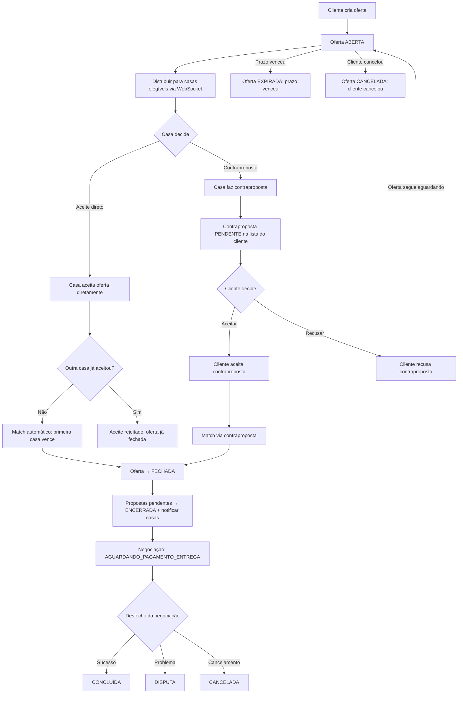
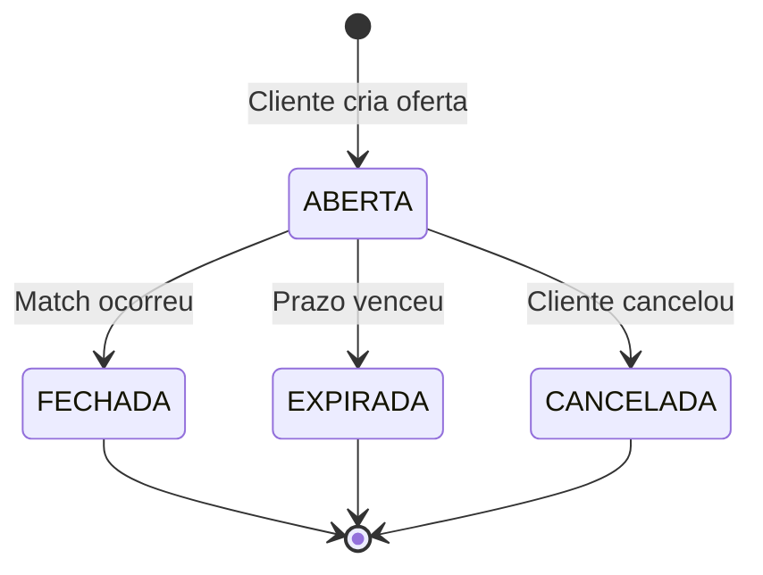
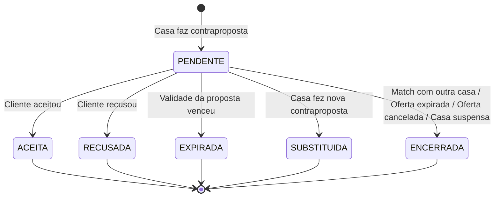
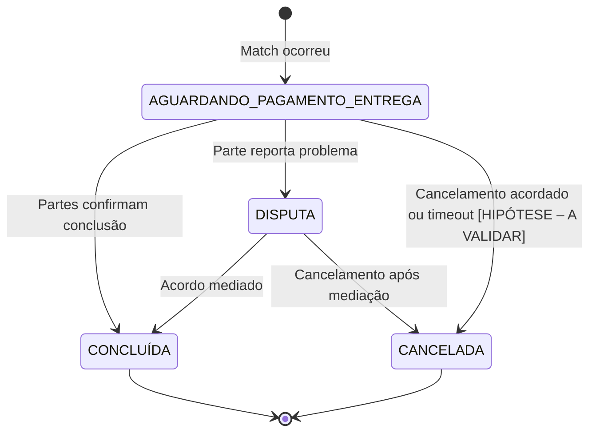

# PRD: Marketplace de Câmbio — MVP

## Overview

### Problem Statement

Pessoas físicas e jurídicas que precisam comprar ou vender moeda estrangeira enfrentam um mercado fragmentado e opaco. As cotações variam significativamente entre casas de câmbio, os canais de comparação são limitados (telefone, visita presencial, sites individuais) e não há um mecanismo padronizado para que o cliente negocie ativamente a taxa que deseja pagar. Do lado das casas de câmbio, a captação de clientes depende de presença física e marketing local, limitando o alcance e a competitividade.

O resultado é um mercado com alta assimetria de informação: clientes pagam mais do que precisariam e casas perdem negócios para concorrentes mais visíveis — não necessariamente melhores.

### Solution Summary

Um marketplace digital de câmbio baseado no modelo de "melhor oferta". O cliente publica uma oferta com a moeda, operação (compra/venda), valor, taxa desejada, produto (papel-moeda ou cartão pré-pago) e preferência de entrega ou retirada. Casas de câmbio cadastradas e aprovadas — elegíveis por moeda, produto e cidade — recebem a oferta em tempo real e podem aceitar diretamente ou fazer uma contraproposta. Quando ocorre um match, inicia-se uma negociação entre as partes até a conclusão da operação.

A plataforma atua como camada de tecnologia e intermediação: a operação de câmbio, o contrato e o fluxo financeiro permanecem com a casa de câmbio autorizada pelo Banco Central.

### Glossário e Convenções Operacionais

- **Operação de Compra e Venda:** A definição de compra/venda no marketplace é **sempre sob a perspectiva do CLIENTE**:
  - **COMPRA:** O cliente está adquirindo moeda estrangeira (desembolsa reais - BRL, recebe moeda estrangeira). A casa de câmbio atua como vendedora.
  - **VENDA:** O cliente está convertendo moeda estrangeira em moeda nacional (entrega moeda estrangeira, recebe reais - BRL). A casa de câmbio atua como compradora.
- **Valor Efetivo Total (VET):** Valor final total da transação em Reais, composto pela taxa de câmbio contratada somada às despesas tributárias de IOF e eventuais tarifas operacionais/logísticas informadas pela casa de câmbio. IOF e demais encargos: valor informado pela casa; alíquotas variam por operação e produto e mudam com frequência [VALIDAR COM ESPECIALISTA TRIBUTÁRIO]. O sistema não calcula nem fixa alíquotas.
- **Oferta Anônima:** Divulgação pré-match aos operadores contendo apenas parâmetros essenciais da demanda (moeda, operação, valor, taxa, produto, cidade, região/bairro e modalidade), sem nenhum dado de identificação pessoal ou endereço detalhado.

### Target Users

- **Cliente (Pessoa Física / Jurídica):** Deseja comprar ou vender moeda estrangeira ao melhor preço, com conveniência e transparência.
- **Casa de Câmbio (Owner, Operador, Financeiro):** Deseja ampliar sua base de clientes, receber demandas qualificadas e competir de forma transparente.
- **Admin da Plataforma:** Gerencia o cadastro de casas, monitora operações, garante conformidade e cuida da saúde do marketplace.

## Goals & Success Metrics

### Goals

1. Criar um canal digital que conecte clientes a casas de câmbio de forma transparente e competitiva.
2. Permitir que o cliente obtenha ofertas melhores do que encontraria por busca individual, reduzindo o esforço de comparação.
3. Validar a proposta de valor do modelo "oferta por melhor taxa" com casas e clientes em Rio de Janeiro e São Paulo.
4. Estabelecer a infraestrutura técnica e operacional para escalar o marketplace para novas cidades e funcionalidades.

### Success Metrics

| Métrica | Baseline Atual | Meta | Prazo |
|---------|---------------|------|-------|
| Casas de câmbio cadastradas e aprovadas (RJ + SP) | 0 | [HIPÓTESE – A VALIDAR] | 90 dias pós-lançamento |
| Ofertas criadas por semana | 0 | [HIPÓTESE – A VALIDAR] | 90 dias pós-lançamento |
| Taxa de match (ofertas que resultam em negociação) | 0% | [HIPÓTESE – A VALIDAR] | 90 dias pós-lançamento |
| Taxa de conclusão (negociações concluídas / matches) | 0% | [HIPÓTESE – A VALIDAR] | 90 dias pós-lançamento |
| Tempo médio até o primeiro match (minutos) | N/A | [HIPÓTESE – A VALIDAR] | 90 dias pós-lançamento |
| NPS do cliente | N/A | [HIPÓTESE – A VALIDAR] | 90 dias pós-lançamento |
| NPS da casa de câmbio | N/A | [HIPÓTESE – A VALIDAR] | 90 dias pós-lançamento |
| Retenção de casas ativas (mensal) | 0% | [HIPÓTESE – A VALIDAR] | 90 dias pós-lançamento |

### Non-Goals

- Ser uma corretora ou instituição de câmbio: a plataforma não opera câmbio, não custodia valores e não emite contratos.
- Substituir o atendimento presencial das casas de câmbio: o foco é a captação e negociação digital.
- Monetizar no MVP: o modelo de receita depende de validação jurídica e será implementado após o MVP.
- Cobrir todo o território nacional: o MVP está restrito a Rio de Janeiro e São Paulo.

## User Stories

| ID | User Story | Persona | Prioridade | Épico |
|----|------------|---------|------------|-------|
| US-001 | Autocadastro de Cliente com Validação Mínima | Cliente | P0 | Épico 1: Onboarding e Autenticação |
| US-002 | Autocadastro de Casa de Câmbio (KYB) | Casa (Owner) | P0 | Épico 1: Onboarding e Autenticação |
| US-003 | Aprovação/Reprovação de Casa pelo Admin | Admin | P0 | Épico 1: Onboarding e Autenticação |
| US-004 | Consulta de Cotação de Referência | Cliente / Casa | P0 | Épico 2: Cotações de Referência |
| US-005 | Fallback e Cache de Cotação no Backend | Sistema | P0 | Épico 2: Cotações de Referência |
| US-006 | Publicação de Oferta de Câmbio com Limite e Alerta | Cliente | P0 | Épico 3: Ofertas |
| US-007 | Configuração de Prazo de Expiração da Oferta | Cliente / Sistema | P0 | Épico 3: Ofertas |
| US-008 | Cancelamento de Oferta sem Match | Cliente | P0 | Épico 3: Ofertas |
| US-009 | Visualização e Histórico de Ofertas | Cliente | P0 | Épico 3: Ofertas |
| US-010 | Recebimento de Ofertas Elegíveis em Tempo Real (Oferta Anônima) | Casa (Operador) | P0 | Épico 4: Aceite e Contrapropostas |
| US-011 | Aceite Direto de Oferta (Match Automático) | Casa (Operador) | P0 | Épico 4: Aceite e Contrapropostas |
| US-012 | Envio de Contraproposta Estruturada por Casa | Casa (Operador) | P0 | Épico 4: Aceite e Contrapropostas |
| US-013 | Visualização e Comparação de Contrapropostas por Valor Total | Cliente | P0 | Épico 4: Aceite e Contrapropostas |
| US-014 | Aceite de Contraproposta pelo Cliente | Cliente | P0 | Épico 4: Aceite e Contrapropostas |
| US-015 | Recusa de Contraproposta pelo Cliente | Cliente | P1 | Épico 4: Aceite e Contrapropostas |
| US-016 | Resolução Transacional de Concorrência de Aceite | Sistema | P0 | Épico 5: Match e Negociação |
| US-017 | Encerramento em Cascata de Propostas Concorrentes | Sistema | P0 | Épico 5: Match e Negociação |
| US-018 | Acompanhamento da Negociação e Revelação Segura de Dados | Cliente / Casa | P0 | Épico 5: Match e Negociação |
| US-019 | Conclusão da Negociação e Timeout de Inatividade | Casa / Cliente | P0 | Épico 5: Match e Negociação |
| US-020 | Abertura e Resolução de Disputa em Negociação | Cliente / Casa / Admin | P1 | Épico 5: Match e Negociação |
| US-021 | Cadastro de Taxas de Balcão na Vitrine | Casa (Owner/Operador) | P1 | Épico 6: Vitrine Informativa |
| US-022 | Consulta da Vitrine de Taxas pelo Cliente | Cliente | P1 | Épico 6: Vitrine Informativa |
| US-023 | Notificações em Tempo Real via WebSocket | Cliente / Casa | P0 | Épico 7: Notificações |
| US-024 | Notificações Multicanal para Operadores Offline | Casa / Cliente | P1 | Épico 7: Notificações |
| US-025 | Gestão de Operadores e Membros da Casa | Casa (Owner) | P1 | Épico 8: Gestão e Governança |
| US-026 | Suspensão Preventiva de Casa pelo Admin | Admin | P0 | Épico 8: Gestão e Governança |
| US-027 | Log de Auditoria de Ações Transacionais | Admin / Sistema | P0 | Épico 8: Gestão e Governança |
| US-028 | Autenticação Multifator (MFA) Obrigatória para Casas de Câmbio | Casa (Owner/Operador) | P0 | Épico 1: Onboarding e Autenticação |
| US-029 | Confirmação Pré-Aceite com Resumo Financeiro Vinculante | Cliente / Casa (Operador) | P0 | Épico 4: Aceite e Contrapropostas |
| US-030 | Controle de Teto de Valor por Oferta e Monitoramento de Fracionamento (PLD) | Sistema / Admin | P0 | Épico 3: Ofertas |

Ver documento de [User Stories detalhadas](user-stories.md) para critérios de aceite completos e especificações INVEST.

## Scope

### In Scope (MVP)

- Cadastro e autenticação de clientes (pessoa física e jurídica)
- Cadastro de casas de câmbio (KYB) com fluxo de aprovação pelo admin
- Cotação de referência em tempo real (comercial, turismo, PTAX) via backend
- Criação de oferta pelo cliente (moeda, operação, valor, taxa, produto, entrega/retirada, prazo de expiração)
- Aceite direto de oferta pela casa de câmbio (match automático, first-come-first-served)
- Contrapropostas de casas de câmbio (sem match automático; cliente decide)
- Negociação com máquina de estados completa (AGUARDANDO_PAGAMENTO_ENTREGA → CONCLUÍDA / DISPUTA / CANCELADA)
- Notificações em tempo real via WebSocket (novas ofertas, aceites, contrapropostas, encerramento)
- Vitrine de taxas padrão por casa de câmbio (informativo)
- Painel administrativo para gestão de casas e monitoramento
- Autenticação JWT e controle de acesso baseado em roles (RBAC)
- Auditoria de todas as ações em ofertas, propostas e negociações

### Out of Scope

- Sistema de cobrança / monetização (depende de validação jurídica)
- Chat entre cliente e casa de câmbio
- Sistema de reputação / avaliações
- Aplicativo mobile (React Native / Expo)
- API pública para terceiros
- Landing pages personalizadas para casas de câmbio
- Geolocalização e busca por proximidade
- Contraproposta do cliente de volta à casa de câmbio
- Pagamento integrado (gateway de pagamento, PIX automático)

### Future Considerations

- **Atendimento parcial do valor (v2):** Permitir que casas de câmbio enviem contrapropostas cobrindo apenas uma fração do montante solicitado pelo cliente, mantendo o saldo remanescente em leilão aberto ou gerando sub-ofertas — deferido para manter a integridade transacional de atendimento integral no MVP.
- **Sistema de cobrança (v2):** Mensalidade por plano + taxa por negócio fechado + destaque na vitrine. Depende de parecer jurídico sobre cobrança por % da transação — deferido até validação regulatória.
- **Chat (v2):** Canal de comunicação direta entre cliente e casa dentro da plataforma — deferido por complexidade e por não ser essencial ao fluxo de match.
- **Reputação (v2):** Sistema de avaliação mútua após conclusão — deferido para priorizar o fluxo core de negociação.
- **App mobile (v2):** React Native / Expo com tipos compartilhados do monorepo — deferido para validar product-market fit no web primeiro.
- **API pública (v3):** Permitir que sistemas de casas integrem diretamente — deferido por complexidade e baixa demanda inicial.
- **Landing pages (v3):** Páginas personalizadas para casas — deferido por ser funcionalidade de aquisição, não core.
- **Geolocalização (v2):** Filtro por proximidade e mapa — deferido por complexidade de UX e dados.
- **Expansão geográfica (v2+):** Cobertura além de RJ e SP — depende de validação do modelo nos mercados iniciais.

## Solution Design

### Parâmetros Configuráveis da Plataforma

> [!NOTE]
> Os parâmetros operacionais abaixo controlam limites temporais, de concorrência, frequência e conformidade regulatória. Todos são gerenciados via configuração centralizada no backend (variáveis de ambiente e tabela `platform_configs`), podendo ser ajustados sem necessidade de alteração de código ou novos deploys. Os valores padrão representam hipóteses de calibração operacional para o piloto e são referenciados ao longo de todos os requisitos funcionais (FRs), user stories (USs) e critérios de aceitação (ACs).

| Parâmetro | Chave de Configuração | Valor Padrão | Unidade | Owner | Status |
|-----------|------------------------|--------------|---------|-------|--------|
| Expiração Padrão da Oferta | `OFFER_EXPIRATION_DEFAULT_MINUTES` | 30 | minutos | Produto | [HIPÓTESE – A VALIDAR] |
| Expiração Mínima da Oferta | `OFFER_EXPIRATION_MIN_MINUTES` | 15 | minutos | Produto | [HIPÓTESE – A VALIDAR] |
| Expiração Máxima da Oferta | `OFFER_EXPIRATION_MAX_MINUTES` | 60 | minutos | Produto | [HIPÓTESE – A VALIDAR] |
| Validade da Contraproposta | `PROPOSAL_VALIDITY_DEFAULT_MINUTES` | 10 | minutos | Produto | [HIPÓTESE – A VALIDAR] |
| Teto de Revisões de Proposta | `PROPOSAL_MAX_REVISIONS_PER_EXCHANGE` | 3 | revisões | Produto | [HIPÓTESE – A VALIDAR] |
| Cooldown entre Propostas | `PROPOSAL_COOLDOWN_SECONDS` | 30 | segundos | Produto | [HIPÓTESE – A VALIDAR] |
| Extensão da Oferta (Janela de Decisão) | `OFFER_EXTENSION_MINUTES` | 5 | minutos | Produto | [HIPÓTESE – A VALIDAR] |
| Teto de Extensões por Oferta | `OFFER_MAX_EXTENSIONS` | 1 | extensão | Produto | [HIPÓTESE – A VALIDAR] |
| Limite de Ofertas Abertas Simultâneas | `CUSTOMER_MAX_OPEN_OFFERS` | 3 | ofertas | Produto | [HIPÓTESE – A VALIDAR] |
| Desvio Máximo de Alerta da Cotação | `QUOTE_ALERT_DEVIATION_PERCENT` | 15 | % | Produto | [HIPÓTESE – A VALIDAR] |
| Janela de Execução Física (Papel-Moeda) | `EXECUTION_WINDOW_HOURS` | Mesmo dia útil (fechamento comercial) | horas/dia | Operações | [HIPÓTESE – A VALIDAR] |
| Prazo de Contestação de No-Show | `NO_SHOW_CONTESTATION_WINDOW_HOURS` | 24 | horas úteis | Operações | [HIPÓTESE – A VALIDAR] |
| Limite de Strikes de No-Show por Cliente | `CUSTOMER_MAX_NO_SHOW_STRIKES` | 3 | ausências | Operações | [HIPÓTESE – A VALIDAR] |
| Timeout de Inatividade na Negociação | `NEGOTIATION_INACTIVITY_TIMEOUT_DAYS` | 5 | dias úteis | Produto | [HIPÓTESE – A VALIDAR] |
| Aviso Prévio no Timeout de Inatividade | `NEGOTIATION_TIMEOUT_WARNING_HOURS` | 48 | horas | Produto | [HIPÓTESE – A VALIDAR] |
| SLA de Primeiro Atendimento em Disputa | `DISPUTE_FIRST_RESPONSE_SLA_HOURS` | 24 | horas úteis | Suporte | [HIPÓTESE – A VALIDAR] |
| Resolução Máxima de Disputa | `DISPUTE_MAX_RESOLUTION_DAYS` | 5 | dias úteis | Suporte | [HIPÓTESE – A VALIDAR] |
| Throttling de Alertas via WhatsApp | `WHATSAPP_ALERT_THROTTLING_MINUTES` | 30 | minutos | Engenharia | [HIPÓTESE – A VALIDAR] |
| Inatividade Offline para Alerta Multicanal | `OPERATOR_OFFLINE_THRESHOLD_MINUTES` | 5 | minutos | Engenharia | [HIPÓTESE – A VALIDAR] |
| Teto de Valor por Oferta no Piloto | `OFFER_MAX_VALUE_BRL` | 50.000,00 | BRL | Jurídico / PLD | [A VALIDAR COM JURÍDICO/PLD] |
| Janela de Monitoramento de Fracionamento | `PLD_STRUCTURING_WINDOW_HOURS` | 24 | horas | Jurídico / PLD | [A VALIDAR COM JURÍDICO/PLD] |

### Functional Requirements

#### Cadastro e Autenticação

- **FR-01:** O sistema deve permitir cadastro de clientes (pessoa física e jurídica) com e-mail, senha e dados pessoais/empresariais.
- **FR-02:** O sistema deve autenticar usuários via JWT e implementar refresh tokens.
- **FR-03:** O sistema deve implementar RBAC com os perfis: Admin, Casa de Câmbio (Owner, Operador, Financeiro) e Cliente.
- **FR-04:** Cada perfil deve ter permissões granulares definidas (ex.: Operador pode aceitar ofertas, Financeiro pode visualizar negociações mas não operar).

#### Cadastro de Casas de Câmbio (KYB)

- **FR-05:** A casa de câmbio deve poder se autocadastrar informando: CNPJ, razão social, nome fantasia, responsável legal, documentos, autorização do Banco Central e pontos de atendimento.
- **FR-06:** O cadastro da casa segue a máquina de estados: `PENDENTE` → `EM_ANÁLISE` → `APROVADA` → `SUSPENSA`.
- **FR-07:** O admin deve poder transicionar o status da casa entre os estados válidos (aprovar, suspender, reativar).
- **FR-08:** Somente casas com status `APROVADA` podem receber ofertas e operar na plataforma.
- **FR-09:** A casa deve cadastrar as moedas, produtos (papel-moeda, cartão pré-pago) e cidades em que atua. Essas configurações determinam a elegibilidade para receber ofertas.

#### Vitrine de Taxas

- **FR-10:** Cada casa pode cadastrar e manter taxas padrão de balcão (por moeda, compra/venda, papel-moeda/cartão pré-pago).
- **FR-11:** As taxas da vitrine são exibidas como informativo público; o foco da plataforma é a oferta e negociação.

#### Cotação de Referência

- **FR-12:** O backend deve consultar cotações de referência (comercial, turismo, PTAX) via AwesomeAPI como provedor primário, com fallback configurável.
- **FR-13:** As cotações devem ser cacheadas em Redis com TTL configurável.
- **FR-14:** O backend deve distribuir cotações atualizadas ao frontend via WebSocket.
- **FR-15:** O frontend **nunca** deve chamar o provedor de cotação diretamente.

#### Criação de Oferta

- **FR-16:** O cliente pode criar uma oferta informando: moeda, operação (compra/venda sob a perspectiva do cliente), valor, taxa desejada, produto (papel-moeda/cartão pré-pago), preferência (retirada/entrega), região/bairro (dado territorial sem identificação pessoal, ex.: "Zona Sul - Botafogo" ou "Zona Oeste - Pinheiros") e prazo de expiração.
- **FR-16A:** A taxa informada é definida em Reais (BRL) por unidade de moeda estrangeira (ex.: R$ 5,45 por 1 USD). Oferta e contraproposta são expressas em **valor total final em reais (VET - Valor Efetivo Total)**, tudo incluso (recomendação em aberto nº 1, pendente de validação com casas e tributarista). IOF e demais encargos: valor informado pela casa; alíquotas variam por operação e produto e mudam com frequência [VALIDAR COM ESPECIALISTA TRIBUTÁRIO]. O sistema não calcula nem fixa alíquotas. O ranking e a comparação de contrapropostas são ordenados condicionalmente pelo valor total em reais:
  - Operação `COMPRA`: ordenação **ascendente** (`ORDER BY total_brl ASC`, menor valor pago pelo cliente no topo);
  - Operação `VENDA`: ordenação **descendente** (`ORDER BY total_brl DESC`, maior valor recebido pelo cliente no topo).
- **FR-16B:** O cliente deve ter telefone verificado via código OTP (SMS ou WhatsApp) e CPF (no caso de Pessoa Física) ou CNPJ (no caso de Pessoa Jurídica) validado antes de publicar ofertas. O sistema deve impor um limite de ofertas abertas simultâneas por cliente conforme a [Tabela de Parâmetros Configuráveis](#parâmetros-configuráveis-da-plataforma).
- **FR-16C:** O sistema deve alertar o cliente caso a taxa informada tenha desvio excessivo em relação à cotação de referência do momento (desvio superior ao percentual definido na [Tabela de Parâmetros Configuráveis](#parâmetros-configuráveis-da-plataforma)), exigindo confirmação explícita para evitar erros de digitação. Quando não houver cotação de referência disponível (ex.: provedor externo fora do ar e cache Redis vazio), o sistema exibe banner informativo alertando sobre a indisponibilidade momentânea da cotação de mercado, solicita confirmação atenta dos valores digitados pelo cliente e **permite a publicação da oferta sem bloqueio**.
- **FR-17:** A oferta é criada com status `ABERTA` e distribuída como oferta anônima em tempo real (WebSocket e canais complementares) para todas as casas elegíveis (match por moeda + produto + cidade). A casa visualiza apenas: moeda, operação, valor, taxa desejada, produto, cidade, região/bairro e modalidade (retirada ou delivery, sem qualquer detalhe de logradouro, número, complemento ou CEP). Os dados de logradouro e CEP só são revelados após o match exclusivamente para a casa vencedora.
- **FR-18:** O cliente pode cancelar uma oferta `ABERTA`, transitando para `CANCELADA`. Todas as contrapropostas pendentes vinculadas transitam para `ENCERRADA` (com motivo `OFERTA_CANCELADA` registrado em auditoria) e as casas são notificadas.
- **FR-19:** Ofertas cujo prazo de expiração venceu transitam automaticamente para `EXPIRADA`. Todas as contrapropostas pendentes vinculadas transitam para `ENCERRADA` (com motivo `OFERTA_EXPIRADA` registrado em auditoria) e as casas são notificadas.

#### Aceite Direto

- **FR-20:** Uma casa elegível pode aceitar uma oferta `ABERTA` exatamente como publicada. No aceite direto, a casa informa a decomposição do valor total (câmbio, IOF e eventuais tarifas) para fins de transparência e formalização regulatória, mantendo o valor total final acordado. IOF e demais encargos: valor informado pela casa; alíquotas variam por operação e produto e mudam com frequência [VALIDAR COM ESPECIALISTA TRIBUTÁRIO]. O sistema não calcula nem fixa alíquotas.
- **FR-21:** O aceite direto gera match automático: a primeira casa a aceitar vence ("first-come, first-served"). No aceite direto, o cliente **não escolhe a casa** de câmbio (a primeira casa elegível a confirmar a aceitação fecha o contrato).
- **FR-22:** Quando o match ocorre, a oferta transita para `FECHADA` e todas as propostas pendentes de outras casas transitam para `ENCERRADA` (com motivo `MATCH_OUTRA_CASA` registrado em auditoria), com notificação às partes.
- **FR-23:** O sistema deve garantir controle transacional para aceites simultâneos: se duas casas aceitam ao mesmo tempo, apenas uma vence (serialização atômica no backend conforme [ADR-0006](../04-architecture/adr/adr-0006-concorrencia-match.md)).

#### Contrapropostas

- **FR-24:** Uma casa elegível pode submeter uma contraproposta estruturada em campos específicos: taxa de câmbio (BRL/unidade), valor (obrigatoriamente idêntico ao montante da oferta original no MVP — atendimento integral obrigatório), `prazo_validade_minutos` (conforme [Tabela de Parâmetros Configuráveis](#parâmetros-configuráveis-da-plataforma)), ponto/local de atendimento (`local_atendimento`, informando região/bairro da loja física para retirada ou área de cobertura de entrega pré-match), e a decomposição informada pela casa (taxa de câmbio, IOF e eventuais tarifas operacionais/logísticas), totalizando o **valor total final em reais (VET)**. IOF e demais encargos: valor informado pela casa; alíquotas variam por operação e produto e mudam com frequência [VALIDAR COM ESPECIALISTA TRIBUTÁRIO]. O sistema não calcula nem fixa alíquotas.
  - **Teto de Revisões e Cooldown:** Cada casa de câmbio pode submeter no máximo o número de revisões por oferta parametrizado (as versões anteriores transitam para `SUBSTITUÍDA`), com intervalo de cooldown obrigatório entre novas submissões conforme a [Tabela de Parâmetros Configuráveis](#parâmetros-configuráveis-da-plataforma).
  - **Reenvio após Recusa:** Caso o cliente recuse uma contraproposta (`RECUSADA`), a casa de câmbio PODE formular uma nova contraproposta enquanto a oferta principal permanecer `ABERTA`, desde que respeitado o teto total de revisões e o cooldown.
  - **Validade Efetiva e Extensão da Oferta (Janela de Decisão):** A validade efetiva da contraproposta é definida como o mínimo entre seu `prazo_validade_minutos` e o tempo restante para encerramento da oferta principal ($\min(\text{validade\_proposta}, \text{validade\_oferta})$). Caso uma contraproposta válida chegue nos minutos finais da oferta e a oferta ainda não tenha sido estendida, a oferta é estendida automaticamente conforme os limites da [Tabela de Parâmetros Configuráveis](#parâmetros-configuráveis-da-plataforma) (no máximo 1 extensão de 5 minutos por oferta [HIPÓTESE – A VALIDAR]). A fonte da verdade é `expires_at` no banco de dados (avaliado com `clock_timestamp()`); o worker assíncrono do BullMQ apenas dispara e relê, sem depender de reagendar jobs. A criação da contraproposta e a extensão de `expires_at` ocorrem atomicamente na mesma transação sob lock pessimista da oferta.
- **FR-25:** A contraproposta é criada com status `PENDENTE` e **não** gera match automático.
- **FR-26:** O cliente visualiza todas as contrapropostas recebidas em uma lista ordenada condicionalmente pelo valor total em reais (VET) — ascendente para compra e descendente para venda — e pode aceitar ou recusar cada uma individualmente.
- **FR-27:** Quando o cliente aceita uma contraproposta, ela transita para `ACEITA`, a oferta transita para `FECHADA`, e todas as demais propostas pendentes transitam para `ENCERRADA` (com motivo `MATCH_OUTRA_CASA` registrado em auditoria) — com notificação às casas.
- **FR-28:** Quando o cliente recusa uma contraproposta, ela transita para `RECUSADA`. A oferta principal permanece `ABERTA` aguardando outros aceites ou contrapropostas.
- **FR-29:** Contrapropostas cujo prazo de validade venceu transitam para `EXPIRADA`.

#### Negociação

- **FR-30:** Quando um match ocorre (aceite direto ou aceite de contraproposta), uma negociação é criada com status `AGUARDANDO_PAGAMENTO_ENTREGA`.
- **FR-31:** A negociação é concluída quando ambas as partes confirmam a liquidação no sistema (ou confirmação de uma das partes com tolerância de contestação em até 24 horas úteis), transitando para `CONCLUÍDA`.
  - **Janela de Execução Pós-Match:** As partes devem cumprir a operação cambial dentro da janela de execução física acordada conforme a [Tabela de Parâmetros Configuráveis](#parâmetros-configuráveis-da-plataforma) (recomendação: mesmo dia útil até o fechamento comercial/bancário para papel-moeda; prazo para cartão pré-pago a definir) [HIPÓTESE – A VALIDAR com as casas]. Se a janela de execução expirar sem cumprimento pela parte que atrasou, a taxa pactuada perde a vinculação obrigatória contra variações drásticas de mercado.
  - **Checkpoint de Fim de Janela de Execução e Declaração de No-Show (Ausência):** Ao término da janela de execução acordada, o sistema dispara notificação bilateral solicitando status da operação: (1) `Concluída`, (2) `Não compareceu` (No-show), ou (3) `Remarcar`. Se a casa de câmbio declarar `Não compareceu`, o cliente tem o prazo definido na [Tabela de Parâmetros Configuráveis](#parâmetros-configuráveis-da-plataforma) (24 horas úteis) para contestar.
    - *Sem contestação:* A negociação transiciona automaticamente para `CANCELADA` por ausência (motivo `CANCELADA_NO_SHOW`) e o sistema incrementa 1 strike no histórico do cliente. Atingido o limite de strikes da tabela de parâmetros, o cliente sofre restrição preventiva para novas ofertas [HIPÓTESE – A VALIDAR].
    - *Com contestação:* A negociação transiciona imediatamente para `DISPUTA`, acionando a mediação do suporte.
    - *Risco de Abuso pela Casa e Auditoria:* Registra-se expressamente o risco de a casa de câmbio abusar da declaração de no-show em casos onde a taxa de mercado tenha oscilado desfavoravelmente contra a taxa acordada. Para mitigar esse risco, toda declaração de ausência exige registro detalhado e imutável em log de auditoria (`actor_id`, timestamp, motivo, IP), permitindo monitoramento de taxas anômalas de declaração de no-show pelo Admin.
  - **Timeout Máximo de Inatividade na Negociação:** Caso a negociação permaneça sem qualquer manifestação das partes pelo período limite parametrizado (5 dias úteis com 48h de aviso prévio conforme a [Tabela de Parâmetros Configuráveis](#parâmetros-configuráveis-da-plataforma)), o sistema cancela a negociação automaticamente com status `CANCELADA`. (Nota de Escopo: No MVP gratuito, nenhuma cobrança ou estorno de tarifa ocorre na Fase 1; regras de cobrança e estorno pertencem exclusivamente à Fase 2 / ADR-0012).
- **FR-32:** A negociação transita para `DISPUTA` quando uma das partes reporta divergência (ex.: descumprimento de taxa, falta de estoque ou contestação de no-show). A mediação é conduzida pelo suporte/admin da plataforma, com prazo de atendimento de até 24 horas úteis e resolução em até 5 dias úteis conforme a [Tabela de Parâmetros Configuráveis](#parâmetros-configuráveis-da-plataforma), tendo como desfechos possíveis: resolução amigável (`CONCLUÍDA`), cancelamento justificado (`CANCELADA`) ou sanção administrativa à parte infratora.
- **FR-33:** A negociação pode transitar para `CANCELADA` sob condições fundamentadas (acordo mútuo, resolução de disputa, ausência não contestada em no-show ou inatividade comprovada).

#### Notificações em Tempo Real e Multicanal

- **FR-34:** O sistema deve notificar casas elegíveis em tempo real quando uma nova oferta compatível é criada.
- **FR-35:** O sistema deve notificar o cliente em tempo real quando um aceite direto ou contraproposta é recebido.
- **FR-36:** O sistema deve notificar todas as casas com propostas pendentes quando uma oferta é fechada, expirada ou cancelada, registrando em auditoria o motivo específico do encerramento.
- **FR-37:** As notificações em tempo real no painel web devem ser entregues via WebSocket (Socket.IO) com reconexão automática. Adicionalmente, para operadores offline ou em segundo plano, o sistema deve suportar canais complementares: push notifications no navegador, e-mail transacional e mensageria/WhatsApp para alertas de ofertas de alta prioridade.
  - **Throttling e Consentimento do WhatsApp:** O disparo de notificações via WhatsApp para mesas offline deve ser limitado pelo intervalo parametrizado na [Tabela de Parâmetros Configuráveis](#parâmetros-configuráveis-da-plataforma) por operador offline em formato consolidado (digest: *"Você possui X novas ofertas compatíveis aguardando no painel"*), exigindo opt-in prévio e utilização estrita de templates de mensagens aprovados pela Meta [verificar na documentação atual da WhatsApp Business Platform] para prevenir suspensão do número oficial.

#### Painel Administrativo

- **FR-38:** O admin deve ter acesso a um painel com visão geral de: casas cadastradas e seus status, ofertas ativas, matches e negociações em andamento.
- **FR-39:** O admin deve poder gerenciar o ciclo de vida das casas de câmbio (aprovar, suspender, reativar).
- **FR-40:** O admin deve poder consultar o log de auditoria de todas as ações relevantes.

#### Auditoria

- **FR-41:** Todas as ações em ofertas (criação, cancelamento, expiração, fechamento) devem ser registradas em log de auditoria com timestamp, ator e detalhes da ação.
- **FR-42:** Todas as ações em propostas (criação, aceite, recusa, expiração, substituição, encerramento) devem ser registradas em log de auditoria.
- **FR-43:** Todas as transições de estado em negociações devem ser registradas em log de auditoria.

#### Conformidade e Segurança

- **FR-44:** O sistema deve implementar consentimento de coleta e tratamento de dados conforme LGPD.
- **FR-45:** O sistema deve suportar solicitações de anonimização e direito ao esquecimento (LGPD).
- **FR-46:** Proteção de dados e anonimização nas **duas direções (bidirecional)**: os dados de identificação pessoal, telefone e endereço detalhado do cliente NÃO são revelados à casa de câmbio antes do match; reciprocamente, dados de contato direto (telefone, e-mail) e endereço exato da loja da casa NÃO são revelados ao cliente antes do match. Ambas as partes só recebem os dados essenciais da contraparte após a confirmação transacional do match, mitigando vazamento e desintermediação.
- **FR-47:** O sistema deve exigir autenticação multifator (MFA via TOTP/App autenticador) obrigatória para todos os usuários com perfis vinculados a casas de câmbio (Owner e Operador) antes de conceder acesso aos ambientes de pregão e transações cambiais [HIPÓTESE – A VALIDAR].
- **FR-48:** O sistema deve exibir modal/etapa de confirmação explícita antes de qualquer aceite vinculante (seja aceite direto por operador ou aceite de contraproposta por cliente), apresentando resumo financeiro consolidado contendo: moeda, valor, total em reais (VET decomposto) e prazo/local acordados, exigindo clique de confirmação ativa para mitigar aceites acidentais.
- **FR-49:** O sistema deve aplicar um teto máximo de valor por oferta no piloto conforme a [Tabela de Parâmetros Configuráveis](#parâmetros-configuráveis-da-plataforma) [A VALIDAR COM JURÍDICO/PLD]. Adicionalmente, o sistema deve monitorar em tempo real e emitir alerta administrativo preventivo de suspeita de PLD/FT caso um mesmo cliente (CPF ou CNPJ) submeta ofertas fracionadas sequenciais logo abaixo do limite em uma janela de 24 horas.

### User Experience

**Fluxo Principal do Cliente:**

1. Cliente se cadastra e faz login.
2. Visualiza cotação de referência em tempo real.
3. Cria uma oferta informando os parâmetros desejados.
4. Aguarda respostas das casas (aceites diretos ou contrapropostas).
5. Visualiza contrapropostas em lista comparativa.
6. Aceita uma proposta ou aguarda o aceite direto de uma casa.
7. Negociação inicia; cliente e casa finalizam a operação fora da plataforma (no MVP).

**Fluxo Principal da Casa de Câmbio:**

1. Casa se cadastra com dados KYB e aguarda aprovação.
2. Após aprovação, configura moedas, produtos e cidades de atuação.
3. Opcionalmente cadastra taxas de vitrine.
4. Recebe notificações de ofertas compatíveis em tempo real.
5. Avalia oferta e decide: aceitar diretamente ou contrapropor.
6. Quando há match, inicia negociação com o cliente.

**Indicadores Visuais Importantes:**

- Status da oferta com cores semânticas (aberta, fechada, expirada, cancelada).
- Countdown do prazo de expiração da oferta.
- Cotação de referência sempre visível ao criar/avaliar oferta.
- Badge de contagem de contrapropostas recebidas.

### Edge Cases

> [!NOTE]
> Os cenários de exceção, concorrência transacional e resiliência abaixo estão formalizados e detalhados como critérios executáveis em formato Given/When/Then no documento [Acceptance Criteria](acceptance-criteria.md).

| Cenário | Comportamento Esperado | Critério de Aceitação |
|---------|----------------------|-----------------------|
| Concorrência de aceites simultâneos ($N$ casas) | Controle de concorrência transacional serializado no backend ([ADR-0006](../04-architecture/adr/adr-0006-concorrencia-match.md)) garante exatamente 1 vencedor (HTTP 200/201) e $N-1$ conflitos (HTTP 409 Conflict), com 1 negociação única gravada | [AC-05](acceptance-criteria.md#ac-05-teste-de-carga-e-concorrência-de-aceite-direto-n-requisições-paralelas) |
| Oferta expira em concorrência com tentativa de aceite | Verificação atômica contra relógio em tempo real do banco (`clock_timestamp()` via [ADR-0006](../04-architecture/adr/adr-0006-concorrencia-match.md)); se expirada, requisição é rejeitada com HTTP 410 Gone sem alterar estado no banco | [AC-06](acceptance-criteria.md#ac-06-tentativa-de-aceite-em-oferta-expirada-race-condition-com-worker-assíncrono) |
| Cliente aceita contraproposta que já expirou | Sistema rejeita a operação com HTTP 400 (`PROPOSAL_EXPIRED`) sem alterar estado na requisição; validade padrão assumida como 10 min [HIPÓTESE – A VALIDAR] | [AC-07](acceptance-criteria.md#ac-07-tentativa-de-aceite-de-contraproposta-expirada-pelo-cliente) |
| Cliente tenta cancelar oferta após match confirmado | Sistema bloqueia transição de FECHADA para CANCELADA (HTTP 422 `OFFER_ALREADY_CLOSED`) para preservar o compromisso operacional da negociação [A VALIDAR COM ADVOGADO] | [AC-08](acceptance-criteria.md#ac-08-tentativa-de-cancelamento-de-oferta-pelo-cliente-após-consolidação-de-match) |
| Casa com status `SUSPENSA` durante negociação | Propostas pendentes invalidadas imediatamente e negociação ativa retida preventivamente com motivo próprio `SUSPENSAO_PARCEIRO` e aviso neutro ao cliente [VALIDAR COM JURÍDICO] | [AC-09](acceptance-criteria.md#ac-09-casa-de-câmbio-suspensa-pelo-admin-com-negociação-em-curso) |
| Provedor de cotação (AwesomeAPI) fora do ar | Backend usa fallback configurado; se persistir, entrega cache Redis com `is_stale: true` sem travar emissão | [AC-10](acceptance-criteria.md#ac-10-indisponibilidade-total-das-apis-de-cotação-de-referência-awesomeapi--fallback) |
| Perda de conexão WebSocket e reconexão | Cliente reconecta automaticamente via Socket.IO e sincroniza estado via REST sem reload manual | [AC-11](acceptance-criteria.md#ac-11-queda-e-reconexão-de-conexão-websocket-durante-o-leilão) |
| Concorrência de cancelamento vs. aceite direto | Serialização atômica garante que a transação pioneira encerra o estado (409 `OFFER_CANCELED` ou 422 `OFFER_ALREADY_CLOSED`) | [AC-17](acceptance-criteria.md#ac-17-cancelamento-de-oferta-pelo-cliente-vs-aceite-direto-simultâneos) |
| Aceite de proposta SUBSTITUÍDA | Envio de ID + versão rejeitado com HTTP 409 (`PROPOSAL_SUPERSEDED`), retornando a proposta mais recente | [AC-20](acceptance-criteria.md#ac-20-tentativa-de-aceite-de-proposta-com-versão-desatualizada-substituída) |
| Operador com perfil Financeiro tentando operar | Bloqueio imediato na autorização RBAC com HTTP 403 Forbidden (`INSUFFICIENT_PERMISSIONS`) | [AC-21](acceptance-criteria.md#ac-21-tentativa-de-operação-por-usuário-com-perfil-financeiro) |
| Contraproposta no fim da oferta vs. Aceite Direto | Transação atômica serializada com lock na oferta garante que extensão (máx. 1) ou fechamento ocorra sem corrida | [AC-25](acceptance-criteria.md#ac-25-contraproposta-nos-minutos-finais-com-extensão-única-da-oferta-vs-aceite-direto-concorrente) |
| Segunda extensão de oferta nos minutos finais | Sistema nega segunda extensão (`OFFER_EXTENSION_LIMIT_REACHED` / 422), mantendo o teto de 1 extensão e validade atrelada ao prazo restante | [AC-26](acceptance-criteria.md#ac-26-tentativa-de-segunda-extensão-da-oferta-teto-de-1-extensão-atingido) |
| Checkpoint de fim de janela e declaração de No-Show | Notificação bilateral: ausência declarada dá 24h úteis para contestar; sem resposta transita para `CANCELADA` com strike; com contestação vai para `DISPUTA` | [AC-28](acceptance-criteria.md#ac-28-checkpoint-de-fim-de-janela-de-execução-e-declaração-de-no-show-ausência) |
| Usuário de casa tentando operar sem MFA | Bloqueio de acesso operacional com HTTP 403 Forbidden (`MFA_REQUIRED`), exigindo segundo fator ativo | [AC-29](acceptance-criteria.md#ac-29-autenticação-multifator-mfa-obrigatória-para-operadores-de-casas-de-câmbio) |
| Aceite direto ou de proposta sem confirmação explícita | Exibição obrigatória de modal com resumo decomposto antes do dispatch da transação vinculante | [AC-30](acceptance-criteria.md#ac-30-modal-de-confirmação-prévia-antes-de-aceite-vinculante) |
| Oferta acima do teto de valor ou fracionada (PLD) | Rejeição de valores acima do teto (`OFFER_VALUE_LIMIT_EXCEEDED` / 422) e alerta de conformidade em caso de fracionamento suspeito | [AC-31](acceptance-criteria.md#ac-31-validação-de-teto-de-valor-por-oferta-e-alerta-de-fracionamento-pld) |

### Diagrama de Fluxo de Negociação

### Máquinas de Estado

#### Estados da Oferta

#### Estados da Proposta (Contraproposta)

> [!NOTE]
> No diagrama acima, `SUBSTITUIDA` representa o estado `SUBSTITUÍDA` (com acento). A notação Mermaid não suporta acentos em IDs de estado de forma confiável, então o acento é omitido no ID mas mantido na documentação textual. O encerramento em cascata (`ENCERRADA`) registra em log de auditoria o gatilho originador (`MATCH_OUTRA_CASA`, `OFERTA_EXPIRADA`, `OFERTA_CANCELADA` ou `CASA_SUSPENSA`).

#### Estados da Negociação

## Technical Considerations

### Constraints

- **Stack proposta:** Apenas NestJS (backend) e React (web) estão confirmados como decisões tomadas pela liderança. Os demais componentes (PostgreSQL como banco relacional, Redis + BullMQ para cache e filas, Socket.IO para WebSocket e monorepo com tipos compartilhados) constituem a **stack proposta** pela arquitetura e permanecem sujeitos a validação técnica e homologação da equipe.
- **Tempo real obrigatório:** Distribuição de ofertas e notificações devem usar WebSocket; polling não é aceitável para o fluxo de negociação.
- **Controle de concorrência:** O aceite simultâneo de ofertas deve ser serializado com controle transacional atômico no backend (conforme [ADR-0006](../04-architecture/adr/adr-0006-concorrencia-match.md)).
- **Frontend nunca chama provedor de cotação:** Toda comunicação com AwesomeAPI (e fallback) acontece no backend; o frontend recebe dados via WebSocket.
- **Monorepo proposto:** Tipos e interfaces compartilhados entre backend e frontend para garantir consistência dos contratos.

### Integration Points

- **AwesomeAPI:** Provedor primário de cotações (comercial, turismo, PTAX). Integração via HTTP no backend com cache Redis.
- **Provedor de cotação fallback:** A definir — deve ser configurável para substituição transparente.
- **Socket.IO:** Comunicação bidirecional em tempo real entre backend e clientes web. Deve suportar rooms (segmentação por casa/oferta) e reconexão automática.
- **BullMQ:** Processamento assíncrono de jobs: expiração automática de ofertas/propostas, envio de notificações, atualização de cotações.

### Data Requirements

- **Auditoria:** Toda ação em ofertas, propostas e negociações deve gerar registro imutável com timestamp, ator, ação, motivo e payload relevante.
- **LGPD e Anonimização:** Dados pessoais do cliente são protegidos por consentimento expresso. Na fase de leilão/oferta, a casa de câmbio recebe apenas uma oferta anônima (sem nome, sem CPF, sem e-mail, sem telefone e sem endereço). Dados de contato e endereço físico (para entrega) só são revelados após a confirmação transacional do match e estritamente para a casa vencedora.
- **Retenção:** Definir política de retenção de dados de ofertas expiradas/canceladas e negociações concluídas.
- **Backup e Recovery:** PostgreSQL com backup periódico; Redis como cache (dados reconstituíveis a partir do banco).

## Dependencies & Risks

### Dependencies

| Dependência | Responsável | Status | Impacto se Atrasada |
|-------------|-------------|--------|---------------------|
| AwesomeAPI (cotações) | Terceiro (externo) | Disponível | Sem cotação de referência; vitrine e UX de criação de oferta ficam degradados |
| Parecer jurídico regulatório (BACEN, PLD/KYC) | Jurídico | Não iniciado | Bloqueia go-to-market; risco de operar em desconformidade [A VALIDAR COM ADVOGADO] |
| Parecer jurídico LGPD | Jurídico | Não iniciado | Risco de não-conformidade com proteção de dados [A VALIDAR COM ADVOGADO] |
| Design de interfaces (UX/UI) | Design | Não iniciado | Atrasa desenvolvimento frontend |
| Infraestrutura de deploy (hosting, CI/CD) | Engenharia / DevOps | Não iniciado | Atrasa lançamento |

### Risks

| Risco | Probabilidade | Impacto | Mitigação |
|-------|---------------|---------|-----------|
| **Enquadramento regulatório:** Plataforma ser interpretada como instituição de câmbio pelo Banco Central | Alta | Crítico | Obter parecer jurídico especializado antes do lançamento [A VALIDAR COM ADVOGADO]. Garantir que a plataforma NÃO custodia valores, NÃO emite contratos de câmbio e NÃO realiza operações — apenas intermedia informação. Documentar modelo operacional com clareza jurídica. |
| **PLD/KYC insuficiente:** Plataforma ser usada para lavagem de dinheiro ou operações irregulares | Média | Crítico | Implementar KYB rigoroso com validação de autorização BACEN. Registrar auditoria completa. Consultar obrigações de PLD aplicáveis a plataformas de intermediação [A VALIDAR COM ADVOGADO]. |
| **Vazamento / desintermediação:** Casas e clientes combinam fora da plataforma após obter dados de contato | Alta | Alto | Dados de contato e endereço revelados somente após match (FR-46). Cobrar na conclusão cria incentivo perverso para as partes não confirmarem o fechamento na plataforma; a hipótese de modelo passa a ser cobrar no match [HIPÓTESE – SUJEITA A PARECER JURÍDICO]. |
| **Baixa liquidez inicial:** Poucas casas cadastradas geram poucas respostas a ofertas, frustrando clientes | Alta | Alto | Onboarding ativo de casas antes do lançamento ao público. Vitrine como atrativo para casas mesmo sem ofertas. Lançamento por cidade para concentrar oferta/demanda. |
| **Concorrência de aceites:** Bugs no controle transacional permitem match duplicado | Baixa | Alto | Implementar controle transacional atômico no backend. Cobertura de testes para cenário de aceite simultâneo. Monitoramento de anomalias. |
| **Indisponibilidade do provedor de cotação** | Média | Médio | Cache Redis com TTL generoso. Fallback configurável. Indicador visual de "cotação desatualizada" no frontend. |
| **Complexidade do MVP excessiva** | Média | Médio | Escopo locked neste documento. Itens fora de scope são rigorosamente deferidos. Revisão semanal de scope creep. |

> [!CAUTION]
> **Risco regulatório é crítico.** Câmbio é atividade regulada pelo Banco Central do Brasil. A premissa deste MVP é que a plataforma opera exclusivamente como camada de tecnologia e intermediação de informações. Um parecer jurídico especializado é **obrigatório** antes do lançamento para validar esse enquadramento [A VALIDAR COM ADVOGADO]. A operação sem validação jurídica pode acarretar riscos regulatórios e sanções administrativas [A VALIDAR COM ADVOGADO].

## Timeline & Milestones

| Marco | Descrição | Data Alvo |
|-------|-----------|-----------|
| M1 — Parecer jurídico | Obter parecer sobre enquadramento regulatório, PLD e LGPD | [HIPÓTESE – A VALIDAR] |
| M2 — Design aprovado | Wireframes e protótipos de alta fidelidade aprovados | [HIPÓTESE – A VALIDAR] |
| M3 — Infraestrutura e auth | Setup do monorepo, CI/CD, autenticação JWT, RBAC | [HIPÓTESE – A VALIDAR] |
| M4 — Cadastro de casas (KYB) | Fluxo completo de autocadastro, aprovação e configuração de moedas/produtos/cidades | [HIPÓTESE – A VALIDAR] |
| M5 — Cotação e vitrine | Integração com AwesomeAPI, cache, WebSocket para cotações, vitrine de taxas | [HIPÓTESE – A VALIDAR] |
| M6 — Ofertas e match | Criação de oferta, distribuição, aceite direto, controle de concorrência, máquina de estados | [HIPÓTESE – A VALIDAR] |
| M7 — Contrapropostas | Contraproposta, lista do cliente, aceite/recusa, encerramento em cascata | [HIPÓTESE – A VALIDAR] |
| M8 — Negociação | Fluxo pós-match com estados AGUARDANDO → CONCLUÍDA / DISPUTA / CANCELADA | [HIPÓTESE – A VALIDAR] |
| M9 — Admin e auditoria | Painel admin, gestão de casas, log de auditoria | [HIPÓTESE – A VALIDAR] |
| M10 — QA e ajustes | Testes integrados, correção de bugs, testes de concorrência | [HIPÓTESE – A VALIDAR] |
| M11 — Beta privado | Lançamento para grupo restrito de casas e clientes em uma cidade | [HIPÓTESE – A VALIDAR] |
| M12 — Lançamento MVP | Abertura para RJ e SP | [HIPÓTESE – A VALIDAR] |

## Open Questions

> [!IMPORTANT]
> Os itens abaixo estão **Em aberto** e devem ser decididos antes ou durante o desenvolvimento. Nenhum deve ser tratado como decidido. Decisões com recomendação indicada permanecem formalmente em aberto até homologação final.

- [ ] **Composição da Oferta e do VET (Decisão em Aberto nº 1):** Como a oferta do cliente e as contrapropostas devem ser expressas na plataforma? [Recomendação: oferta expressa em valor total final, tudo incluso. O aceite direto e as contrapropostas trazem a decomposição (câmbio, IOF, tarifas) informada pela casa, apenas para transparência; a lista é comparada pelo total. Alternativa: "taxa pura + encargos" (menos comparável pelo cliente)]. Pendente de validação com as casas parceiras e parecer tributário. IOF e demais encargos: valor informado pela casa; alíquotas variam por operação e produto e mudam com frequência [VALIDAR COM ESPECIALISTA TRIBUTÁRIO]. O sistema não calcula nem fixa alíquotas. — Owner: Produto + Jurídico/Tributário
- [ ] **Critérios de contestação de no-show e definição de ausência:** Quais evidências formais serão exigidas para contestar declaração de no-show? O que configura formalmente ausência não justificada para aplicação de strikes? — Owner: Produto + Operações + Jurídico
- [ ] **Critérios de detecção de fracionamento e teto PLD:** Qual o teto máximo de valor por oferta no piloto e qual o algoritmo/parâmetro de agregação para disparar alertas de ofertas fracionadas estruturadas abaixo de limites regulatórios de reporte (ex.: Circular BACEN 3.978 e normativas COAF)? — Owner: Jurídico / Compliance PLD
- [ ] **Prazo de expiração da oferta:** Qual o prazo padrão e o prazo máximo permitido? (Sugerido entre 15 e 30 minutos em horário comercial, configurável na tabela de parâmetros) — Owner: Produto
- [ ] **Validade da contraproposta (`prazo_validade_minutos`):** A contraproposta vincula a casa por X minutos? (Assumido operacionalmente como 10 minutos conforme tabela de parâmetros [HIPÓTESE – A VALIDAR com as casas parceiras]) — Owner: Produto
- [ ] **Identidade da casa de câmbio antes do match:** O cliente deve visualizar o nome fantasia da casa nas contrapropostas ou as propostas devem ser 100% anônimas até o match? [Recomendação: exibir o nome fantasia da casa na lista de contrapropostas para gerar credibilidade e permitir escolha consciente pelo cliente, mas sem nenhum canal de contato direto (telefone, e-mail ou endereço exato), a confirmar com o fundador] — Owner: Produto / Fundadores
- [ ] **Revisão de contraproposta e reenvio após recusa:** Teto de revisões por oferta por casa com cooldown parametrizado [HIPÓTESE – A VALIDAR]. Permitir nova contraproposta após recusa pelo cliente dentro desse teto? — Owner: Produto
- [ ] **Janela de decisão do cliente ao término da oferta:** Quando uma contraproposta é submetida nos minutos finais da oferta, a oferta deve ser estendida automaticamente por 5 minutos (máximo de 1 extensão) para assegurar tempo hábil de avaliação pelo cliente? [Recomendação: sim, extensão única de 5 minutos garantida] [HIPÓTESE – A VALIDAR] — Owner: Produto
- [ ] **Janela de execução física pós-match e vinculação da taxa:** Qual o prazo máximo de cumprimento da operação cambial pelas partes após o match (recomendação: mesmo dia útil até o fechamento bancário para papel-moeda; prazo de cartão a definir)? Se o cliente não comparecer no mesmo dia útil, a taxa pactuada é cancelada ou renegociada? [HIPÓTESE – A VALIDAR com as casas] — Owner: Produto / Operações
- [ ] **Modelo definitivo de cobrança e política de estorno (Fase 2 / ADR-0012):** No MVP (Fase 1), a plataforma opera em regime 100% gratuito. Para a Fase 2 paga: como conciliar o risco de desintermediação combinada com o risco de a casa pagar a taxa de match e ser lesada por cliente que não comparece? (Opção 1: estorno estritamente via abertura de disputa formal vs. Opção 2: estorno automático por cancelamento/inatividade) — Owner: Produto + Jurídico [ADR-0012]
- [ ] **Suspensão preventiva de casa e negociações em andamento:** Caso uma casa seja suspensa pelo Admin por denúncia ou inconformidade, o Admin deve ter discricionariedade para permitir que negociações em andamento com segurança confirmada sejam concluídas normalmente, ou todas devem ser suspensas compulsoriamente? — Owner: Jurídico + Operações [VALIDAR COM JURÍDICO]
- [ ] **Visibilidade entre casas:** As propostas são cegas (somente o cliente vê todas) ou há um ranking visível para as casas concorrentes? — Owner: Produto
- [ ] **Contraproposta reversa do cliente:** O cliente pode contrapropor de volta à casa? (Sugestão: fora do MVP; fluxo unidirecional simplifica a v1) — Owner: Produto
- [ ] **Enquadramento regulatório:** Plataforma se enquadra como correspondente cambial, marketplace de tecnologia ou outro? Quais obrigações de PLD/KYC se aplicam? — Owner: Jurídico [A VALIDAR COM ADVOGADO]
- [ ] **Timeout para confirmação de conclusão:** Qual o prazo limite em `AGUARDANDO_PAGAMENTO_ENTREGA` antes de o sistema enviar lembretes ou auto-cancelar a negociação por inatividade? (Padrão proposto: 5 dias úteis com 48h de aviso) — Owner: Produto
- [ ] **Detalhamento do fluxo e prazos de resolução de DISPUTA:** Quais evidências formais serão exigidas em caso de contestação de taxa, prazo ou entrega? — Owner: Produto + Jurídico
- [ ] **Cancelamento de negociação:** Sob quais condições uma negociação pode ser cancelada após o match? Há penalidade ou suspensão? — Owner: Produto
- [ ] **Permissões granulares dos sub-perfis da casa:** O que exatamente cada sub-perfil (Owner, Operador, Financeiro) pode fazer? (Financeiro bloqueado de operar aceite e propostas; Owner com MFA obrigatório) — Owner: Produto
- [ ] **Política de retenção de dados:** Por quanto tempo manter ofertas expiradas, negociações concluídas e logs de auditoria? — Owner: Produto + Jurídico
- [ ] **SLA de tempo real:** Qual a latência máxima aceitável para entrega de notificações WebSocket e canais complementares? (P95 < 500ms) — Owner: Engenharia

## Appendix

### Regras de Negociação (Resumo Consolidado)

1. O cliente publica uma oferta com a taxa pretendida (BRL por unidade), valor, modalidade, cidade, região/bairro e prazo de expiração.
2. Casas elegíveis (moeda + produto + cidade) são notificadas em tempo real. A oferta é anônima: dados pessoais do cliente e endereço detalhado (logradouro/CEP) NÃO são revelados pré-match.
3. Se uma casa **aceita exatamente** a oferta original, há match automático ("first-come, first-served") e a primeira a aceitar vence. No aceite direto, o cliente **não escolhe a casa**. A casa informa a decomposição do valor total (câmbio, IOF e tarifas) para fins de transparência sem alterar o total acordado. A oferta é encerrada para as demais e todas as contrapropostas concorrentes são encerradas em cascata com registro auditado.
4. Se uma casa formula **contraproposta**, o valor em moeda deve ser idêntico ao da oferta (atendimento integral no MVP), especificando taxa em BRL, `prazo_validade_minutos` (conforme tabela de parâmetros), ponto/área de atendimento (`local_atendimento`), e a decomposição de IOF e tarifas informada pela casa, totalizando o VET final em reais (sem alíquotas fixas no sistema). As contrapropostas não geram match automático; entram em lista ordenada condicionalmente pelo valor total em reais:
   - Operação COMPRA: ordenação **ascendente** (menor valor no topo);
   - Operação VENDA: ordenação **descendente** (maior valor no topo).
5. O teto de revisões de contraproposta e o cooldown entre envios respeitam a [Tabela de Parâmetros Configuráveis](#parâmetros-configuráveis-da-plataforma). Casas com propostas recusadas pelo cliente podem contrapropor de novo respeitando esses limites enquanto a oferta estiver aberta.
6. A validade efetiva da contraproposta é o menor valor entre `prazo_validade_minutos` e o tempo restante da oferta principal ($\min(\text{validade\_proposta}, \text{validade\_oferta})$). Caso chegue contraproposta nos minutos finais, a oferta é estendida automaticamente em 5 minutos (no máximo 1 extensão por oferta).
7. Quando qualquer match ocorre, todas as propostas concorrentes mudam para `ENCERRADA` na mesma transação registrando o gatilho originador (`MATCH_OUTRA_CASA`, `OFERTA_EXPIRADA`, `OFERTA_CANCELADA` ou `CASA_SUSPENSA`).
8. **Proteção bidirecional (FR-46):** nenhuma das partes visualiza dados de contato ou endereço exato antes do match. Ambas as partes recebem os dados essenciais da contraparte apenas após a consolidação formal do match.
9. **Concorrência:** requisições de aceite simultâneo são serializadas deterministicamente no backend ([ADR-0006](../04-architecture/adr/adr-0006-concorrencia-match.md)), garantindo exatamente 1 sucesso e $N-1$ conflitos tratados, sem double-matching.
10. **Segurança e Confirmação Vinculante:** Usuários de casas (Owner e Operador) possuem MFA obrigatório. Qualquer aceite vinculante exige confirmação explícita em modal de resumo financeiro consolidado.
11. **Checkpoint de No-Show e Gestão de Ausências:** Ao fim da janela de execução acordada, o sistema aciona checkpoint bilateral; declaração de ausência pela casa concede 24h úteis para contestação do cliente, transicionando para `CANCELADA` com acúmulo de strike (ou `DISPUTA` se contestada), sob estrita auditoria contra abusos.

### Roles e Perfis

| Role | Descrição | Exemplos de Permissão |
|------|-----------|----------------------|
| Admin | Administrador da plataforma | Gerenciar casas, aprovar/suspender KYB, visualizar todas as operações, acessar auditoria |
| Casa — Owner | Proprietário/responsável legal | Cadastrar casa, gerenciar equipe, configurar moedas/produtos/cidades (com MFA obrigatório) |
| Casa — Operador | Operador da mesa de câmbio | Receber ofertas em tempo real, efetuar aceites diretos, submeter contrapropostas (com MFA obrigatório) |
| Casa — Financeiro | Visão financeira da casa | Visualizar histórico de negociações, relatórios e conciliação (sem permissão de operar leilão) |
| Cliente | Pessoa física ou jurídica | Criar ofertas, aceitar/recusar contrapropostas, acompanhar e confirmar negociações |

### Modelo de Monetização (Hipóteses — Em aberto)

> [!WARNING]
> Nenhum modelo de monetização está decidido. O MVP (Fase 1 / T1) opera de forma 100% gratuita. As hipóteses abaixo pertencem à Fase 2 (T2) e dependem de validação comercial e parecer jurídico [A VALIDAR COM ADVOGADO].

- **Mensalidade por plano:** Casas pagam assinatura mensal com tiers de funcionalidades.
- **Taxa por negócio fechado:** Faturamento na consolidação do match no sistema (para mitigar sonegação de confirmação na conclusão) [HIPÓTESE – SUJEITA A PARECER JURÍDICO]. Política de estorno (disputa formal vs. inatividade) permanece em aberto ([ADR-0012](../04-architecture/adr/adr-0012-modelo-cobranca.md)).
- **Destaque na vitrine:** Casas pagam para ter posição privilegiada na exibição de taxas de balcão.
- **Landing pages:** Páginas personalizadas para casas como serviço premium pós-MVP.
- **% da transação:** Cobrança proporcional ao volume negociado — **depende de validação jurídica** [A VALIDAR COM ADVOGADO].

**Mitigação de vazamento:** Dados de contato e endereço físico de ambas as partes são liberados somente após match consolidado.

### Related Documents

- [Problem Statement](../01-discovery/problem-statement.md)
- [Hipóteses Validadas e a Validar](../01-discovery/hypotheses.md)
- [Matriz de Priorização (ICE, MoSCoW, Weighted Scoring)](../02-strategy/prioritization.md)
- [User Stories por Perfil e Épico](user-stories.md)
- [Acceptance Criteria e Cenários de Borda](acceptance-criteria.md)
- [Decisões Arquiteturais (ADRs)](../04-architecture/adr/)
- [OKRs dos Trimestres T1 e T2](../05-okrs/okrs.md)
- [Roadmap de Produto](../06-roadmap/roadmap.md)
- [Launch Checklist (Go-Live RJ/SP)](../07-launch/launch-checklist.md)
- [Relatório PM-Critic de Revisão](../09-review/pm-critic-report.md)

### Revision History

| Versão | Data | Autor | Mudanças |
|--------|------|-------|----------|
| 1.0 | 2026-11-02 | Equipe de Produto | Versão inicial do PRD do MVP |
| 1.1 | 2026-11-03 | Equipe de Produto | Correções da revisão PM-Critic: links cruzados e alinhamento de bordas |
| 1.2 | 2026-11-03 | Equipe de Produto | Revisão solicitada: ajuste no fluxo de recusa, encerramento de propostas em expiração/cancelamento, cobrança no match, notificações multicanal, regras de taxa/condição/VET, anonimização pré-match, verificação de cliente, resolução de disputas, linguagem jurídica neutra e stack proposta. |
| 1.3 | 2026-11-03 | Equipe de Produto | Revisão completa v1.3: explicitação no glossário de que compra/venda é sob a ótica do cliente; sincronização de todas as 27 User Stories (US-001 a US-027); fechamento da questão de atendimento parcial para o MVP (integral obrigatório) e migração para Future Considerations; ordenação condicional de contrapropostas por valor total VET (compra ASC, venda DESC em FR-16A e FR-26); inclusão de Região/Bairro na oferta anônima (FR-16 e FR-17); validação cadastral para PF (CPF) ou PJ (CNPJ) em FR-16B; comportamento sem bloqueio quando ausente cotação de referência (FR-16C); explicitação de que no aceite direto o cliente não escolhe a casa; padronização de prazo_validade_minutos; inclusão de discriminação de IOF/tarifas sem alíquotas fixas (FR-24); teto de 3 revisões com cooldown de 30s e reenvio após recusa (FR-24); regra única de conclusão, janela de execução física pós-match e timeout de 5 dias úteis (FR-31); throttling de WhatsApp em digest e opt-in obrigatório (FR-37); proteção de dados bidirecional pré-match (FR-46); remoção de SQL da tabela de edge cases e alinhamento de concorrência com ADR-0006 e clock_timestamp(); e registro formal de perguntas em aberto com recomendações (identidade da casa pré-match, estorno no ADR-0012, término de negociações de casa suspensa, janela de execução e janela de decisão do cliente). |
| 1.4 | 2026-11-03 | Equipe de Produto | Revisão ampla v1.4: introdução da seção de Parâmetros Configuráveis da Plataforma com tabela única e centralizada no backend; remoção completa de alíquotas fixas de IOF, substituindo por valor informado pela casa [VALIDAR COM ESPECIALISTA TRIBUTÁRIO]; registro da Composição do VET como Decisão em Aberto nº 1 (recomendação: oferta expressa em valor total final, tudo incluso; decomposição informada pela casa no aceite direto e contrapropostas apenas para transparência); teto de no máximo 1 extensão de 5 minutos por oferta (expires_at no banco checado com clock_timestamp(), worker do BullMQ sem reagendamento, lock pessimista na oferta); checkpoint de no-show ao término da janela de execução acordada (notificação bilateral, 24h úteis para contestação, cancelamento por ausência com strikes vs DISPUTA se contestada, sob auditoria estrita contra abuso da casa); explicitação de que o MVP é 100% gratuito (cobrança e estorno pertencem exclusivamente à Fase 2 / ADR-0012); inclusão de Casa Suspensa no diagrama de transição de propostas e alinhamento dos 4 gatilhos auditados idênticos (MATCH_OUTRA_CASA, OFERTA_EXPIRADA, OFERTA_CANCELADA, CASA_SUSPENSA); novos requisitos de segurança e PLD (FR-47 MFA para casas, FR-48 confirmação pré-aceite com resumo vinculante, FR-49 teto de valor por oferta e alerta de fracionamento PLD); sincronização de 30 User Stories (US-001 a US-030); e novas perguntas em aberto (critérios de contestação de no-show e limites de fracionamento PLD). |
