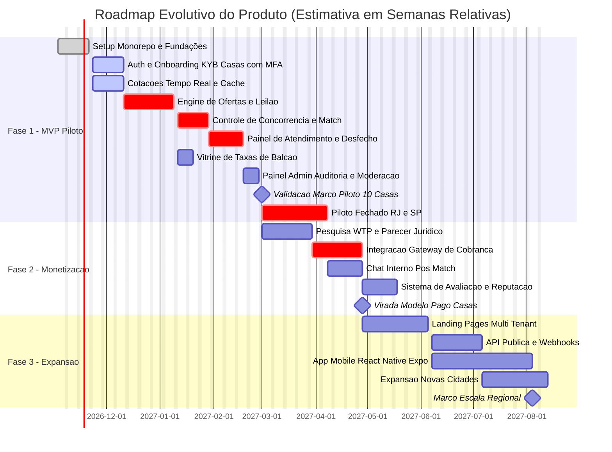
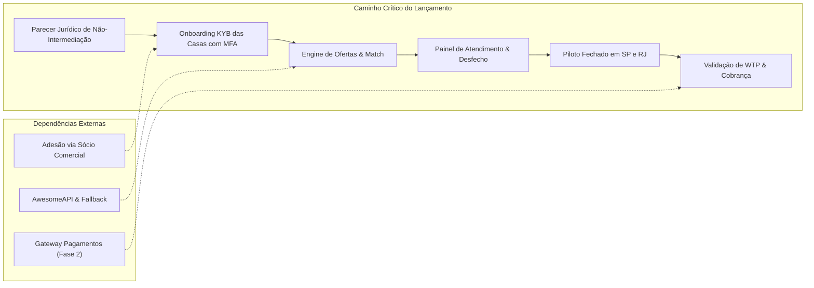

# Roadmap de Produto: Plataforma de Comunicação e Aproximação Cambial

Este documento consolida o planejamento evolutivo do produto, combinando os resultados da [Matriz de Priorização](../02-strategy/prioritization.md), as metas operacionais dos [OKRs](../05-okrs/okrs.md), o [Contexto Competitivo](../01-discovery/competitive-context.md) e as decisões técnicas dos [ADRs](../04-architecture/adr/). Atualizado na v1.5.1 para incorporar o plano de Go-to-Market (GTM), a meta operacional de ofertas por casa/semana e a exploração do Modo Oferta Privada na Fase 2.

> [!NOTE]
> Os prazos estão estruturados em **semanas relativas** (S01 a S24) contadas a partir do início formal do ciclo de desenvolvimento, marcados como `[ESTIMATIVA]` e sujeitos a calibração com as casas parceiras.

---

## Visão Geral das Fases

---

## Estratégia de Go-to-Market (GTM) e Aquisição de Demanda

A liquidez da plataforma é governada pela dinâmica de *multi-homing* das casas parceiras: operadores de mesa priorizam a ferramenta que entrega fluxo constante de negócios. O GTM para o lançamento piloto apoia-se em três pilares de tração:

1. **SEO Local de Cotação por Cidade e Bairro:** Otimização para buscas com intenção imediata ("comprar dólar sp", "cotação euro turismo rj", "câmbio barra da tijuca"). Tráfego orgânico focado em intenção transacional.
2. **Landing Pages e Presença Digital das Casas:** Criação de páginas públicas leves por casa parceira para que divulguem em seus próprios canais (site institucional, redes sociais, balcão).
3. **Base de Clientes das Casas Parceiras:** Alavancagem da demanda recorrente das 10 casas piloto em SP e RJ.
4. **Meta Operacional de Liquidez:** **3 a 5 ofertas por casa ativa por semana** [HIPÓTESE – A VALIDAR] para sustentar engajamento diário e tempo de resposta < 15 minutos ([H5](../01-discovery/hypotheses.md#h5--hipótese-de-multi-homing-e-priorização-por-densidade-de-ofertas)).
5. **Modo Oferta Privada (Ideia para Validação, Fora do MVP):** Conceito de direcionamento exclusivo da oferta para a casa titular da landing page. Planejado para estudo e prototipação na **Fase 2 / Post-MVP**.

---

## Detalhamento das Fases

### Fase 1: MVP (Lançamento Piloto RJ e SP)
**Foco Estratégico:** Provar a tese de liquidez, aproximação comercial eficiente e tempo de resposta ágil sem fricção financeira, operando com 5 a 10 casas parceiras comprometidas no Rio de Janeiro e em São Paulo sob a premissa de plataforma de mensageria e comunicação (não-custódia).

#### Escopo Entregue
- **Onboarding e KYB com MFA:** Autocadastro de casas, upload documental e aprovação administrativa com estados `PENDENTE` → `EM_ANÁLISE` → `APROVADA` → `SUSPENSA` ([US-002](user-stories.md#us-002-autocadastro-de-casa-de-câmbio-kyb), [ADR-0009](adr/adr-0009-onboarding-kyb-casas.md)), com obrigatoriedade de segundo fator MFA via TOTP para Owner e Operadores ([US-026](user-stories.md#us-026-autenticação-multifator-mfa-obrigatória-para-casas-de-câmbio)).
- **Cotações de Referência:** AwesomeAPI com fallback secundário, cache Redis (TTL 300s) e distribuição via WebSocket ([ADR-0005](adr/adr-0005-estrategia-cotacao.md)).
- **Motor de Leilão e Parâmetros:** Publicação de ofertas anônimas pelo cliente (com região/bairro) com limites e prazos parametrizados centralmente na Tabela de Parâmetros Configuráveis, teto de valor no piloto de R$ 50.000,00 ([US-028](user-stories.md#us-028-controle-de-teto-de-valor-por-oferta-no-piloto)), e agendamento BullMQ ([ADR-0003](adr/adr-0003-redis-bullmq-filas.md)).
- **Aceite Direto e Concorrência:** Match automático ("first-come, first-served") com controle transacional atômico no PostgreSQL ([ADR-0006](adr/adr-0006-concorrencia-match.md)) utilizando relógio em tempo real `clock_timestamp()`, sem mutação de estado em rejeições, e modal obrigatório de confirmação com decomposição financeira pré-aceite ([US-027](user-stories.md#us-027-confirmação-pré-aceite-com-resumo-financeiro-vinculante)).
- **Contrapropostas:** Fluxo de contrapropostas com atendimento integral obrigatório no MVP, ordenação condicional pelo valor total em reais (VET: compra ASC, venda DESC), discriminação de IOF e tarifas informada pela casa sem alíquotas fixas no código, parâmetro unificado `prazo_validade_minutos`, e validade efetiva truncada ao tempo restante da oferta ([US-025](user-stories.md#us-025-truncamento-da-validade-da-proposta-pelo-fim-da-oferta)).
- **Atendimento Comercial e Desfecho Bilateral:** O aceite consolida um compromisso comercial que transiciona para `EM_ATENDIMENTO` e revela bilateralmente os canais de contato direto (telefone e e-mail) ([US-018](user-stories.md#us-018-painel-de-atendimento-comercial-e-revelação-bilateral-de-contatos-pós-match)). Módulo simplificado de relato de desfecho (`CONCLUÍDO` vs `NÃO_CONCLUÍDO` com motivo) ([US-019](user-stories.md#us-019-relato-bilateral-de-desfecho-do-atendimento-comercial)), canal "Relatar Problema" para a moderação administrativa sem mediação financeira ([US-020](user-stories.md#us-020-relato-de-problema-operacional-para-moderação-da-plataforma)), e timeout automático para `SEM_RETORNO` ([AC-30](acceptance-criteria.md#ac-30-timeout-de-atendimento-para-sem_retorno)).
- **Desistência Voluntária:** Permissão para desistência do atendimento pós-match com registro obrigatório de justificativa e notificação imediata à outra parte ([AC-08](acceptance-criteria.md#ac-08-desistência-voluntária-do-atendimento-pós-match)).
- **Notificações Multicanal:** Alertas em tempo real via WebSocket e canais complementares (Web Push, e-mail e WhatsApp para operadores offline com throttling de 30 min em digest e opt-in obrigatório) ([US-024](user-stories.md#us-024-notificações-multicanal-para-operadores-offline-com-throttling-e-opt-in)).
- **Máquina de Estados:**
  - Oferta: `ABERTA` / `FECHADA` / `EXPIRADA` / `CANCELADA`
  - Proposta: `PENDENTE` / `ACEITA` / `RECUSADA` / `EXPIRADA` / `SUBSTITUÍDA` / `ENCERRADA` (gatilhos auditados: `MATCH_OUTRA_CASA`, `OFERTA_EXPIRADA`, `OFERTA_CANCELADA`, `CASA_SUSPENSA`)
  - Atendimento: `EM_ATENDIMENTO` / `CONCLUÍDO` / `NÃO_CONCLUÍDO` / `SEM_RETORNO` (com status operacional `SUSPENSAO_PARCEIRO` e retenção preventiva `parceiro_suspenso: true` em caso de suspensão de casa)
- **Vitrine de Taxas:** Cadastro de balcão informativo por moeda e produto ([US-021](user-stories.md#us-021-cadastro-de-taxas-de-balcão-na-vitrine)). *(Fast-follow condicional: importação por planilha CSV caso confirmada na entrevista de validação com casas).*
- **Painel Admin:** Gestão de parceiros, aprovação KYB, auditoria imutável, e moderação de conduta/reputação baseada em relatos de problemas.
- **Gratuidade Total no Piloto:** Fase 1 operando 100% gratuita; regras de cobrança de software pertencem exclusivamente à Fase 2 ([ADR-0012](adr/adr-0012-modelo-cobranca.md)).
- *Itens Removidos do MVP (movidos para Futuro/Fase 2):* Disputa mediada pelo admin com SLAs financeiros; checkpoint rígido de no-show com strikes e contestação de 24h úteis; extensão automática da oferta nos minutos finais; bloqueio de cancelamento pós-match; e monitoramento automatizado de fracionamento PLD.

#### Critérios de Entrada
- Parecer preliminar de viabilidade regulatória atestando a atuação como plataforma de comunicação sem custódia ou intermediação financeira ([ADR-0010](adr/adr-0010-plataforma-sem-custodia.md));
- Compromisso prévio firmado pelo parceiro comercial com 10 casas (mínimo de 5 em SP e 5 no RJ) e assinatura de Cartas de Intenção (LOIs);
- Ambiente de homologação funcional com testes de concorrência aprovados.

#### Critérios de Saída (Gates para Fase 2)
- Mínimo de 10 casas ativas operando no piloto por pelo menos 4 semanas consecutivas;
- Mais de 50 atendimentos gerados em produção com tempo médio de resposta < 20 minutos [HIPÓTESE – A VALIDAR];
- Média de 3 a 5 ofertas recebidas por casa ativa por semana atingida [HIPÓTESE – A VALIDAR];
- Zero casos de double-matching registrados na base de dados;
- Parecer jurídico definitivo favorável ao modelo de comunicação e faturamento de software (taxa por lead ou SaaS).

---

### Fase 2: Monetização e Confiança
**Foco Estratégico:** Validar a sustentabilidade do negócio introduzindo o modelo de faturamento de software nas casas parceiras e construindo recursos de confiança para mitigar riscos operacionais e desvios de conduta.

#### Escopo Entregue
- **Sistema de Cobrança de Software (SaaS / Taxa por Match Aceito):** Módulo de cobrança integrado a gateway nacional (Asaas ou Iugu) para faturamento de mensalidades ou taxa por lead/match aceito (sob parecer jurídico prévio, conforme [ADR-0012](adr/adr-0012-modelo-cobranca.md)).
- **Chat Interno Pós-Match:** Mensageria contextualizada dentro da plataforma após a consolidação do match, permitindo combinar retirada/entrega sem necessidade de expor WhatsApp pessoal de operadores.
- **Sistema de Avaliação e Reputação Bilateral:** Avaliação mútua com notas (1 a 5 estrelas) e tags de elogio/crítica (pontualidade, integridade da taxa, agilidade).
- **Prototipação do Modo Oferta Privada e Landing Pages:** Teste de conceito de páginas públicas parametrizadas por casa parceira para captura direta de ofertas privadas sem concorrência aberta [HIPÓTESE – A VALIDAR].
- **Módulos Avançados de Governança:** Avaliação de regras de extensão de oferta sob demanda e conciliação de relatos de problemas.
- **Relatórios Administrativos Avançados:** Painel de conciliação para o perfil `EXCHANGE_FINANCIAL` da casa com exportação para CSV/Excel.

#### Critérios de Entrada
- Critérios de saída da Fase 1 plenamente atingidos;
- Alinhamento comercial prévio com as casas piloto sobre a transição do modelo gratuito para o modelo pago;
- Definição da tabela de preços fundamentada na pesquisa de WTP (KR3.1).

#### Critérios de Saída (Gates para Fase 3)
- Retenção paga superior a 60% da base ativa de casas do piloto;
- Faturamento mensal comprovado e inadimplência inferior a 10%;
- Menos de 2% de atendimentos gerando queixas graves de quebra de taxa.

---

### Fase 3: Expansão de Canais e Escala Geográfica
**Foco Estratégico:** Multiplicar os pontos de contato e a densidade de mercado através de landing pages white-label para as casas parceiras, aplicativo móvel nativo, API pública para tesourarias e expansão para novas capitais brasileiras.

#### Escopo Entregue
- **Landing Pages White-Label Multi-Tenant:** Aplicação Next.js com subdomínios e temas dinâmicos por casa de câmbio para atração de tráfego local de SEO ([ADR-0011](adr/adr-0011-landing-pages-multi-tenant.md)).
- **API Pública e Webhooks:** Endpoints seguros via API Keys para permitir que grandes casas integrem robôs de negociação automática e ERPs legados.
- **Aplicativo Mobile (React Native / Expo):** App nas lojas (Google Play e Apple App Store) com notificações push nativas e biometria para clientes e operadores de campo.
- **Geolocalização Avançada:** Ordenação de ofertas e casas por raio geográfico (km de distância) para retirada presencial imediata.
- **Expansão Regional:** Abertura da plataforma para praças adicionais (Curitiba, Belo Horizonte, Porto Alegre e Brasília).

#### Critérios de Entrada
- Operação em SP e RJ financeiramente equilibrada (breakeven operacional local);
- Infraestrutura de monorepo e CI/CD escalada para suportar múltiplos deploys simultâneos;
- Acordo com parceiros comerciais locais nas novas cidades.

#### Critérios de Saída
- Presença ativa em pelo menos 5 capitais do Brasil;
- Mais de 5.000 atendimentos comerciais mensais concluídos com sucesso na plataforma [HIPÓTESE – A VALIDAR].

---

## Marcos de Validação com as Casas Parceiras

| Marco | Semana Relativa | Objetivo da Validação | Participantes | Critério de Sucesso |
|-------|-----------------|-----------------------|---------------|---------------------|
| **M1: Validação de UX do Operador** | S06 `[ESTIMATIVA]` | Testar a interface de recebimento de ofertas e envio de contrapropostas com 3 operadores reais | Time de Produto + 3 Casas Piloto SP | Operador consegue aceitar ou contrapropor em menos de 30 segundos após login |
| **M2: Validação de Prazos e Validade** | S07 `[ESTIMATIVA]` | Alinhar prazos máximos de expiração de oferta (30m vs 1h) e validade de contraproposta (10m vs 15m) | Sócio Comercial + 10 Casas Piloto | Consenso assinado sobre prazos aceitáveis para a operação diária |
| **M3: Go/No-Go do Piloto em Produção** | S08 `[ESTIMATIVA]` | Revisão completa de prontidão técnica, aprovação do checklist jurídico e cadastros KYB aprovados conforme [Launch Checklist](../07-launch/launch-checklist.md) | Fundadores + Admin + Líderes das Casas | 100% dos blockers do Launch Checklist resolvidos e 10 casas com operadores treinados |
| **M4: Revisão de Meio de Piloto** | S12 `[ESTIMATIVA]` | Analisar taxa de resposta real, motivos de recusa de propostas e índice de desfechos sem retorno | Time de Produto + Todas as Casas Ativas | Menos de 15% de desvios operacionais ou atendimentos sem retorno |
| **M5: Validação da Tabela de Preços (WTP)** | S14 `[ESTIMATIVA]` | Apresentação do modelo de monetização definitivo e assinatura de termos comerciais pagos | Fundadores + Proprietários das Casas | Mínimo de 6 casas piloto assinando a continuidade no plano pago |

---

## Gerenciamento de Dependências e Caminho Crítico

- **Risco de Bloqueio 1 (Jurídico):** Se o parecer jurídico apontar necessidade de licença regulatória de câmbio ou pagamento, o fluxo precisará reforçar ainda mais a comunicação pura e aproximação antes do go-live.
- **Risco de Bloqueio 2 (Adesão de Casas):** Sem a presença ativa de pelo menos 5 casas em uma praça, a taxa de resposta cai drasticamente, inviabilizando a experiência para os clientes daquela localidade.

---

## Histórico de Revisão

| Versão | Data | Autor | Mudanças |
|--------|------|-------|----------|
| 1.0 | 2026-11-02 | Equipe de Produto | Criação inicial do Roadmap em 3 fases com Gantt Mermaid |
| 1.1 | 2026-11-03 | Equipe de Produto | Alinhamento com revisão PM-Critic |
| 1.2 | 2026-11-03 | Equipe de Produto | Alinhamento com PRD v1.2: inclusão de notificações multicanal offline na Fase 1, adequação das regras de concorrência com lock pessimista, atualização do modelo de cobrança para cobrança no match (sujeita a parecer jurídico) e refinamento dos critérios de transição de fase. |
| 1.3 | 2026-11-03 | Equipe de Produto | Alinhamento com PRD v1.3: precisão de concorrência transacional com clock_timestamp() (ADR-0006); contrapropostas com atendimento integral obrigatório no MVP, ordenação condicional compra/venda e prazo_validade_minutos; throttling de WhatsApp e opt-in; retenção parceiro_suspenso; e manutenção em aberto da política de estorno no ADR-0012. |
| 1.4 | 2026-11-03 | Equipe de Produto | Alinhamento com PRD v1.4: inclusão de MFA obrigatório para casas (US-028), modal de confirmação pré-aceite com decomposição financeira transparente (US-029), controle de teto de valor por oferta e monitoramento preventivo de fracionamento PLD (US-030); checkpoint de fim de janela de execução acordada com gestão de no-show e strikes (US-019); teto de 1 extensão na oferta; e reforço formal de gratuidade total da Fase 1 com faturamento restrito à Fase 2 (ADR-0012). |
| 1.5 | 2026-11-03 | Equipe de Produto | Reposicionamento para plataforma de comunicação e aproximação tecnológica (estilo Melhor Câmbio / Nomad). Substituição do fluxo de negociação/execução por Atendimento Comercial (`EM_ATENDIMENTO`), inclusão de relato bilateral de desfecho (`CONCLUÍDO`, `NÃO_CONCLUÍDO`, `SEM_RETORNO`), botão "Relatar Problema" para moderação sem custódia, desistência voluntária pós-match. Movimentação de extensão automática de ofertas, disputa com SLAs e no-show/strikes para a Fase 2 / Futuro. |
| 1.5.1 | 2026-11-03 | Equipe de Produto | Complemento v1.5.1: inclusão da Estratégia de Go-to-Market (GTM) e Aquisição de Demanda (SEO local por cidade, landing pages das casas e base parceira); meta de 3 a 5 ofertas por casa ativa/semana como gate de saída da Fase 1; fast-follow de importação por CSV na Fase 1 se confirmado em pesquisa; e planejamento do teste do Modo Oferta Privada na Fase 2. |
